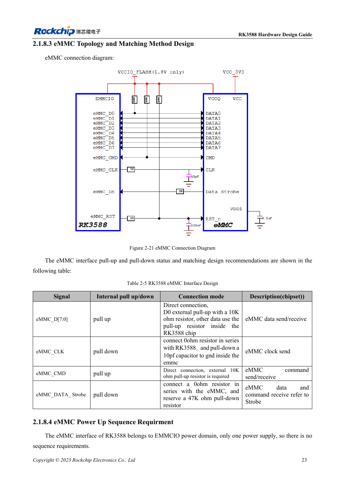
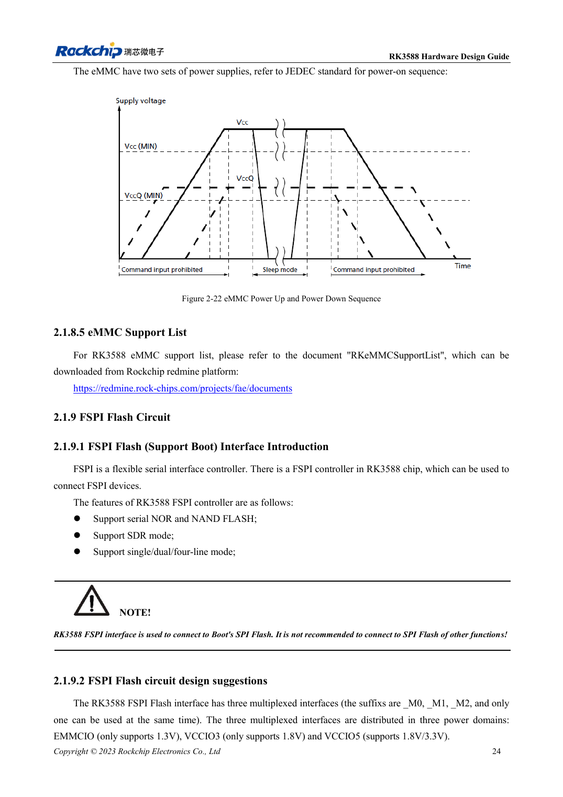

<!-- rk3588-hardware-v13-20261109 -->

# RK3588-eMMC: Takt, Pull-ups und Strobe

Grundlage sind die chinesische und englische Ausgabe des RK3588 Hardware Design Guide V1.3 (2023-02-13) für SoC-Platinen und Träger. AIM7- und LM7-Träger müssen den Moduldefinitionen folgen; Sige7 dient zur Software- und Peripherieprüfung. SoC-Funktionen sind keine Boardanschlussliste. SDK/BSP, Kernel, Boardrevision und Firmware prüfen. Werte sind Quellenreferenzen, keine ArmSoM-Messungen.

**RK3588 Hardware Design Guide V1.3 (2023-02-13), EN** · §2.1.8; §3.4.14

## CLK gemäß V1.3 ausführen

Tabelle 2-5: 0Ω in CLK am RK3588, 10pF nach Masse am eMMC. D0/CMD erhalten externe 10kΩ-Pull-ups, andere Daten interne. Strobe: 0Ω am Baustein und vorgesehene 47kΩ nach Masse. Nicht alle Signale gleich behandeln; Bauteilpositionen sind wesentlich.

## Versorgung und Modus prüfen

EMMCIO und die beiden Speicherversorgungen unterscheiden; Sequenz für das genaue Bauteil prüfen. Unterstützungsliste, Loader/BSP, Zielmodus, Kaltstart, Dauertransfer und Stromausfall-Recovery testen. eMMC von AIM7/LM7 sitzt auf dem Modul; Austausch oder externer Zugang richten sich nach dessen Dokumentation.

## Entwurfsparameter und Prüftabelle

| Punkt | Quellenreferenz |
| --- | --- |
| CLK | 0Ω am SoC; 10pF an eMMC |
| D0 / CMD | 10kΩ Pull-up |
| Strobe | 0Ω an eMMC; vorsehen 47kΩ Pull-down |
| PCB-Impedanz/Länge | 50Ω ±10% / <3.5in |
| Takt-Daten-Differenz | <120mil |

## Quellenabbildungen

Die Referenzseiten enthalten die zugehörigen Schalt- oder Zeitdiagramme; für volle Auflösung anklicken. Bezeichner und Werte gehören zum Referenzentwurf, nicht zum Schaltplan eines ArmSoM-Produkts.

Englisches Original · PDF 45 · 2-21

Englisches Original · PDF 46 · 2-22

## Entwicklung mit ArmSoM

AIM7 unterstützt Compute-Modul-Träger, LM7 die LGA-Modulintegration und Sige7 frühe Software-/Peripherieerprobung. Vor dem Trägerdesign klären, welche Versorgung, DDR- und Bootschaltungen bereits integriert sind. SoC-Referenzschaltungen nicht unnötig duplizieren. Anschlüsse, herausgeführte Schnittstellen, Pegel und Systemunterstützung anhand der Produktunterlagen prüfen.

- [ArmSoM AIM7](https://www.armsom.org/aim7) · [AIM7 Docs](https://docs.armsom.org/armsom-aim7)
- [ArmSoM Sige7](https://www.armsom.org/sige7) · [Sige7 Docs](https://docs.armsom.org/armsom-sige7)
- [ArmSoM LM7](https://www.armsom.org/lm7) · [LM7 Docs](https://docs.armsom.org/armsom-lm7)

## Weiterlesen

- [RK3588-Hardwaredesign: 30 Themen](/de/articles/rk3588-hardware-design-series/)
- [RK3588-DDR-Routing: Längen- und Laufzeitabgleich](/de/articles/rk3588-ddr-pcb-routing/)
- [RK3588-FSPI-Flash: Boot, Versorgung und Anpassung](/de/articles/rk3588-fspi-boot-hardware/)
