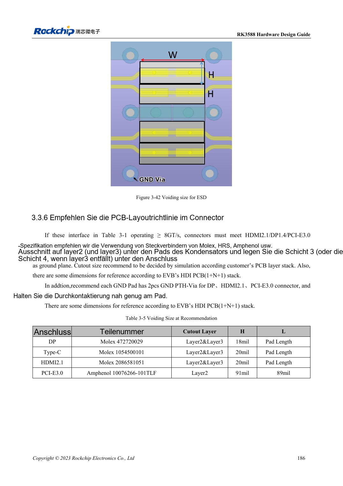

<!-- rk3588-hardware-v13-20261109 -->

# RK3588-ESD und EMI: Schnittstellenschutz und Rückwege

Grundlage sind die chinesische und englische Ausgabe des RK3588 Hardware Design Guide V1.3 (2023-02-13) für SoC-Platinen und Träger. AIM7- und LM7-Träger müssen den Moduldefinitionen folgen; Sige7 dient zur Software- und Peripherieprüfung. SoC-Funktionen sind keine Boardanschlussliste. SDK/BSP, Kernel, Boardrevision und Firmware prüfen. Werte sind Quellenreferenzen, keine ArmSoM-Messungen.

**RK3588 Hardware Design Guide V1.3 (2023-02-13), EN** · §5; §3.3.5

## Schutz am Stromeintritt platzieren

TVS nahe am Stecker oder Entladeeintritt mit kurzem niederimpedantem Masseweg platzieren. Reset, Takt und Interrupt vom Rand fernhalten, laut Quelle mindestens 5mm. ESD-Kapazität und Pads in SI einbeziehen; höhere Werte sind nicht automatisch besser.

## EMI an Quelle und Kopplung untersuchen

Unterbrochene Rückwege, Stubs, Gleichtaktumwandlung und Schaltregler vor Filtern/Schirmen prüfen. Kühler können gekoppelte Energie abstrahlen; Erdungsoptionen vorsehen und testen. Allgemeine Serienwiderstände ersetzen keine USB/HDMI/PCIe-Regeln. Mit realem Gehäuse, Kabeln und Zertifizierungsbedingungen prüfen; Hinweise sind keine Zertifizierung.

## Entwurfsparameter und Prüftabelle

| Punkt | Quellenreferenz |
| --- | --- |
| Randabstand empfindlicher Netze | ≥5mm |
| Taktquelle bis Serienwiderstand | ≤400mil |
| Versorgungsflächenrand | 20H; H=Dielektrikumsabstand Versorgung/Masse |
| Hochgeschwindigkeits-ESD | Schnittstellenspezifische Kapazitätsgrenzen |

## Quellenabbildungen

Die Referenzseiten enthalten die zugehörigen Schalt- oder Zeitdiagramme; für volle Auflösung anklicken. Bezeichner und Werte gehören zum Referenzentwurf, nicht zum Schaltplan eines ArmSoM-Produkts.

Englisches Original · PDF 208 · 3-42

## Entwicklung mit ArmSoM

AIM7 unterstützt Compute-Modul-Träger, LM7 die LGA-Modulintegration und Sige7 frühe Software-/Peripherieerprobung. Vor dem Trägerdesign klären, welche Versorgung, DDR- und Bootschaltungen bereits integriert sind. SoC-Referenzschaltungen nicht unnötig duplizieren. Anschlüsse, herausgeführte Schnittstellen, Pegel und Systemunterstützung anhand der Produktunterlagen prüfen.

- [ArmSoM AIM7](https://www.armsom.org/aim7) · [AIM7 Docs](https://docs.armsom.org/armsom-aim7)
- [ArmSoM Sige7](https://www.armsom.org/sige7) · [Sige7 Docs](https://docs.armsom.org/armsom-sige7)
- [ArmSoM LM7](https://www.armsom.org/lm7) · [LM7 Docs](https://docs.armsom.org/armsom-lm7)

## Weiterlesen

- [RK3588-Hardwaredesign: 30 Themen](/de/articles/rk3588-hardware-design-series/)
- [RK3588-Thermik: Referenzwärmewiderstand und Systemprüfung](/de/articles/rk3588-thermal-hardware-design/)
- [RK3588-Montage und Lagerung: Reflow, MSL3 und Backprotokoll](/de/articles/rk3588-assembly-storage-design/)
