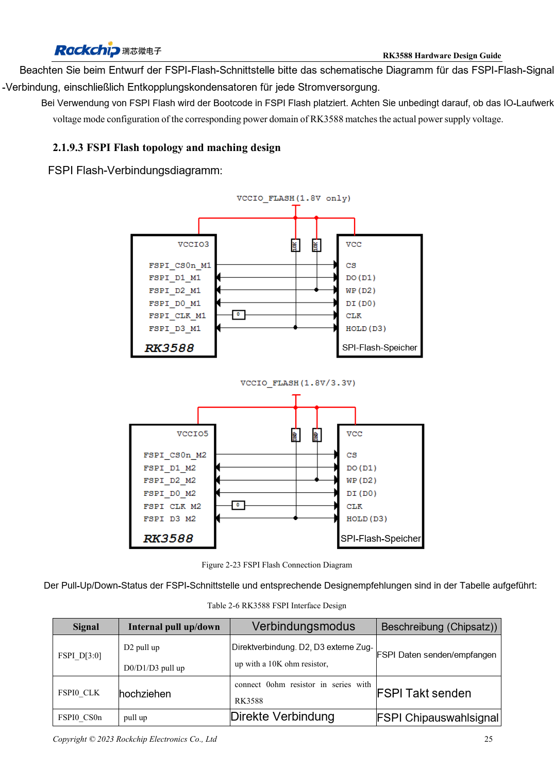

<!-- rk3588-hardware-v13-20261109 -->

# RK3588-FSPI-Flash: Boot, Versorgung und Anpassung

Grundlage sind die chinesische und englische Ausgabe des RK3588 Hardware Design Guide V1.3 (2023-02-13) für SoC-Platinen und Träger. AIM7- und LM7-Träger müssen den Moduldefinitionen folgen; Sige7 dient zur Software- und Peripherieprüfung. SoC-Funktionen sind keine Boardanschlussliste. SDK/BSP, Kernel, Boardrevision und Firmware prüfen. Werte sind Quellenreferenzen, keine ArmSoM-Messungen.

**RK3588 Hardware Design Guide V1.3 (2023-02-13), EN** · §2.1.9; §2.1.4; §3.4.17

## Bootrolle und Domäne bestimmen

FSPI kann frühen Code einschließlich PCIe-Initialisierung vor SSD-Boot speichern. Die Muxgruppe bestimmt die IO-Domäne; Flash muss dieselbe Versorgung nutzen. Gleiches Gehäuse genügt nicht für Austauschbarkeit: Bauteilunterstützung, Kapazität, Loader und Programmierablauf prüfen.

## Test und Recovery erhalten

Tabelle 2-6 sieht 10kΩ-Pull-ups für D2/D3, 0Ω in CLK am SoC und direktes CS vor. Position, Länge und Start gemeinsam prüfen, dann Kaltstarts und vollständigen Rücklesevergleich durchführen. USB-Recovery für Reparatur bei beschädigtem Flashinhalt erhalten.

## Entwurfsparameter und Prüftabelle

| Punkt | Quellenreferenz |
| --- | --- |
| D2 / D3 | Vorsehen 10kΩ Pull-up |
| CLK | 0Ω am SoC |
| Versorgung | Gleiche Schiene wie gewählte FSPI-IO-Domäne |
| PCB-Impedanz/Länge | 50Ω ±10% / <4in |
| Takt-Daten-Differenz | <200mil |

## Quellenabbildungen

Die Referenzseiten enthalten die zugehörigen Schalt- oder Zeitdiagramme; für volle Auflösung anklicken. Bezeichner und Werte gehören zum Referenzentwurf, nicht zum Schaltplan eines ArmSoM-Produkts.

Englisches Original · PDF 47 · 2-23

## Entwicklung mit ArmSoM

AIM7 unterstützt Compute-Modul-Träger, LM7 die LGA-Modulintegration und Sige7 frühe Software-/Peripherieerprobung. Vor dem Trägerdesign klären, welche Versorgung, DDR- und Bootschaltungen bereits integriert sind. SoC-Referenzschaltungen nicht unnötig duplizieren. Anschlüsse, herausgeführte Schnittstellen, Pegel und Systemunterstützung anhand der Produktunterlagen prüfen.

- [ArmSoM AIM7](https://www.armsom.org/aim7) · [AIM7 Docs](https://docs.armsom.org/armsom-aim7)
- [ArmSoM Sige7](https://www.armsom.org/sige7) · [Sige7 Docs](https://docs.armsom.org/armsom-sige7)
- [ArmSoM LM7](https://www.armsom.org/lm7) · [LM7 Docs](https://docs.armsom.org/armsom-lm7)

## Weiterlesen

- [RK3588-Hardwaredesign: 30 Themen](/de/articles/rk3588-hardware-design-series/)
- [RK3588-eMMC: Takt, Pull-ups und Strobe](/de/articles/rk3588-emmc-hardware-design/)
- [RK3588-SDMMC und SDIO-WLAN: Pegelwechsel und Schutz](/de/articles/rk3588-sdmmc-sdio-wifi-design/)
