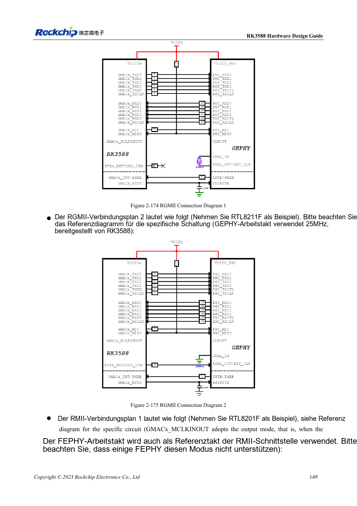

<!-- rk3588-hardware-v13-20261109 -->

# RK3588-Ethernet: GMAC, PHY und Taktrichtung

Grundlage sind die chinesische und englische Ausgabe des RK3588 Hardware Design Guide V1.3 (2023-02-13) für SoC-Platinen und Träger. AIM7- und LM7-Träger müssen den Moduldefinitionen folgen; Sige7 dient zur Software- und Peripherieprüfung. SoC-Funktionen sind keine Boardanschlussliste. SDK/BSP, Kernel, Boardrevision und Firmware prüfen. Werte sind Quellenreferenzen, keine ArmSoM-Messungen.

**RK3588 Hardware Design Guide V1.3 (2023-02-13), EN** · §2.3.10; §3.4.19

## Pegel und Taktquelle festlegen

Zwei GMACs verbinden externe RGMII/RMII-PHYs. GMAC0 liegt auf VCCIO3 nur mit 1.8V, GMAC1 auf VCCIO5 mit 1.8V/3.3V und fester 1.8V-Zusatzversorgung. RMII-50MHz-Richtung an MAC und PHY abstimmen, damit nicht zwei Ausgänge treiben.

## Delay und Anpassung prüfen

TX mit vorgesehenen 0Ω am SoC, RX mit 22Ω am PHY, MDIO-Pull-up 1.5–1.8kΩ. PHY-internes Delay, PCB-Laufzeit und BSP gemeinsam prüfen, um Doppelkompensation zu vermeiden. Raten, bidirektionale Dauerlast, Fehler und Reset testen. RGMII nicht direkt an RJ45 anschließen.

## Entwurfsparameter und Prüftabelle

| Punkt | Quellenreferenz |
| --- | --- |
| RGMII-Impedanz | 50Ω ±10% single-ended |
| TX/RX-Gruppe zu Takt | <120mil |
| Leiterlänge | <5in |
| MDIO-Pull-up | 1.5–1.8kΩ |

## Quellenabbildungen

Die Referenzseiten enthalten die zugehörigen Schalt- oder Zeitdiagramme; für volle Auflösung anklicken. Bezeichner und Werte gehören zum Referenzentwurf, nicht zum Schaltplan eines ArmSoM-Produkts.

Englisches Original · PDF 171 · 2-175

## Entwicklung mit ArmSoM

AIM7 unterstützt Compute-Modul-Träger, LM7 die LGA-Modulintegration und Sige7 frühe Software-/Peripherieerprobung. Vor dem Trägerdesign klären, welche Versorgung, DDR- und Bootschaltungen bereits integriert sind. SoC-Referenzschaltungen nicht unnötig duplizieren. Anschlüsse, herausgeführte Schnittstellen, Pegel und Systemunterstützung anhand der Produktunterlagen prüfen.

- [ArmSoM AIM7](https://www.armsom.org/aim7) · [AIM7 Docs](https://docs.armsom.org/armsom-aim7)
- [ArmSoM Sige7](https://www.armsom.org/sige7) · [Sige7 Docs](https://docs.armsom.org/armsom-sige7)
- [ArmSoM LM7](https://www.armsom.org/lm7) · [LM7 Docs](https://docs.armsom.org/armsom-lm7)

## Weiterlesen

- [RK3588-Hardwaredesign: 30 Themen](/de/articles/rk3588-hardware-design-series/)
- [RK3588-Audiohardware: I2S, PDM und Mikrofonarrays](/de/articles/rk3588-audio-hardware-design/)
- [RK3588-GPIO und SARADC: Domänen und Tasten](/de/articles/rk3588-gpio-saradc-hardware/)
