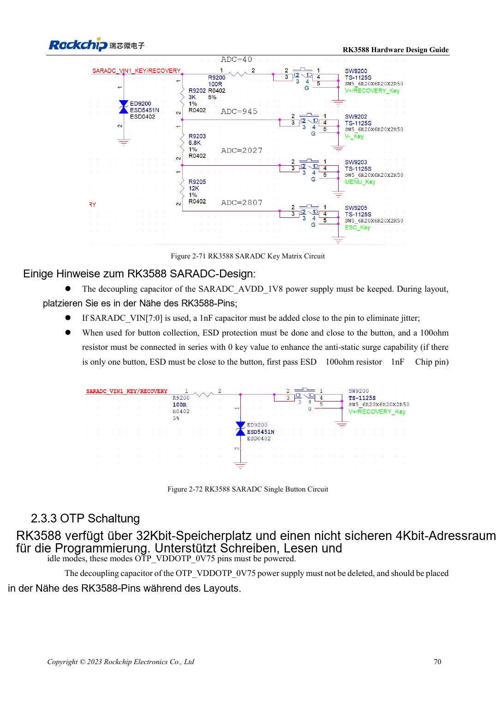

<!-- rk3588-hardware-v13-20261109 -->

# RK3588-GPIO und SARADC: Domänen und Tasten

Grundlage sind die chinesische und englische Ausgabe des RK3588 Hardware Design Guide V1.3 (2023-02-13) für SoC-Platinen und Träger. AIM7- und LM7-Träger müssen den Moduldefinitionen folgen; Sige7 dient zur Software- und Peripherieprüfung. SoC-Funktionen sind keine Boardanschlussliste. SDK/BSP, Kernel, Boardrevision und Firmware prüfen. Werte sind Quellenreferenzen, keine ArmSoM-Messungen.

**RK3588 Hardware Design Guide V1.3 (2023-02-13), EN** · §2.1.10; §2.3.2; §2.3.16

## Domänen zuerst prüfen

PMUIO1, EMMCIO, VCCIO1 und VCCIO3 sind fest 1.8V; PMUIO2, VCCIO2 und VCCIO4/5/6 wählen 1.8V oder 3.3V. Feste Begleitpins und wählbare Pins nicht zwischen S0/S3 mischen. Automatische Domänenerkennung erlaubt keine 5V-Signale.

## Nicht alle ADC-Kanäle sind frei

SARADC: 12 Bit, 1MS/s, 0–1.8V, acht Eingänge; IN0_BOOT ist reserviert, IN1 behält Recovery und 10kΩ-Pull-up. 1nF nahe genutzten Pins, ESD vor dem Tastenserienwiderstand. Die Angabe ±35 Tastencodes/123mV ist neben 12 Bit uneindeutig; Schwellen anhand Treiberskalierung und Messung bestimmen.

## Entwurfsparameter und Prüftabelle

| Punkt | Quellenreferenz |
| --- | --- |
| SARADC | 12bit; 1MS/s; 0–1.8V |
| Reservierte Eingänge | IN0_BOOT; IN1 Wiederherstellung |
| Eingangsfilter | 1nF |
| Recovery-Pull-up | 10kΩ |

## Quellenabbildungen

Die Referenzseiten enthalten die zugehörigen Schalt- oder Zeitdiagramme; für volle Auflösung anklicken. Bezeichner und Werte gehören zum Referenzentwurf, nicht zum Schaltplan eines ArmSoM-Produkts.

Englisches Original · PDF 92 · 2-71

## Entwicklung mit ArmSoM

AIM7 unterstützt Compute-Modul-Träger, LM7 die LGA-Modulintegration und Sige7 frühe Software-/Peripherieerprobung. Vor dem Trägerdesign klären, welche Versorgung, DDR- und Bootschaltungen bereits integriert sind. SoC-Referenzschaltungen nicht unnötig duplizieren. Anschlüsse, herausgeführte Schnittstellen, Pegel und Systemunterstützung anhand der Produktunterlagen prüfen.

- [ArmSoM AIM7](https://www.armsom.org/aim7) · [AIM7 Docs](https://docs.armsom.org/armsom-aim7)
- [ArmSoM Sige7](https://www.armsom.org/sige7) · [Sige7 Docs](https://docs.armsom.org/armsom-sige7)
- [ArmSoM LM7](https://www.armsom.org/lm7) · [LM7 Docs](https://docs.armsom.org/armsom-lm7)

## Weiterlesen

- [RK3588-Hardwaredesign: 30 Themen](/de/articles/rk3588-hardware-design-series/)
- [RK3588-Ethernet: GMAC, PHY und Taktrichtung](/de/articles/rk3588-gmac-hardware-design/)
- [RK3588-UART, SPI, CAN, I2C und PWM zuordnen](/de/articles/rk3588-serial-control-hardware/)
