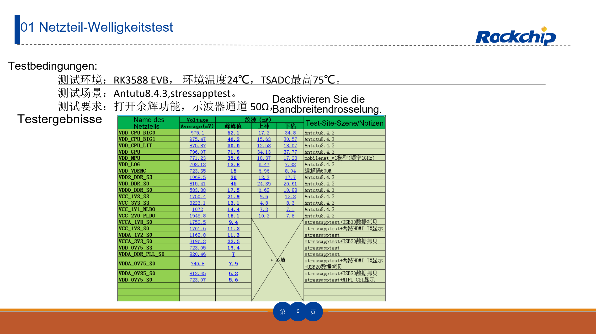
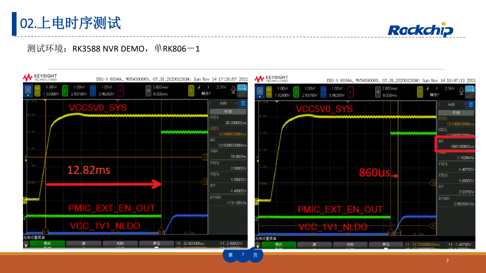
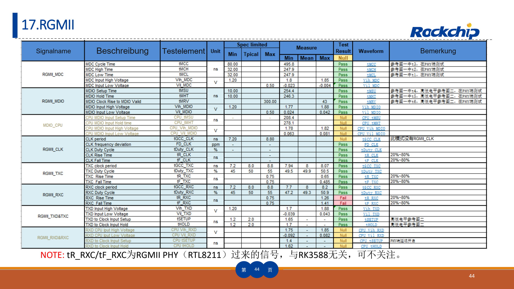

Dieser thematische Leitfaden erläutert das Quelldokument mit wichtigen Daten, Grenzen und Originalabbildungen. Er ist keine seitenweise Übersetzung und kein vollständiges Pin- oder Registerhandbuch. Herstellerbeispiele sind keine ArmSoM-Messungen. Vor der Anwendung sind Platinenrevision, Schaltplan, SDK/BSP, Kernel und Treiber zu prüfen; für diesen Artikel wurden keine neuen Hardwaretests durchgeführt.

**Hauptquelle：** `RK3588_HW_Test_Report_Summary V1.3_20230215.pdf` · PDF 51 Seiten.

## Referenzmethode statt Freigabe für die eigene Platine

Der 51-seitige Bericht enthält 23 Gruppen zu Versorgung, DDR, Speicher, Video, Netzwerk und Audio. Er hilft, Messungen und Bedingungen festzulegen und Grenzfälle zu untersuchen. AIM7, Sige7 und LM7 sind dokumentierte RK3588-Produkte; andere Träger, Kühlung, Versorgung und Anschlüsse brauchen eigene Ergebnisse.

Der Dateiname nennt V1.3_20230215, das Titelblatt noch V1.2_20220829. Die Änderungstabelle ergänzt V1.3 mit einem RGMII-Update auf S. 44. Dieser Leitfaden folgt der tatsächlichen Datei und hält die Versionsabweichung fest.

## Die 23 Gruppen organisieren

| Quellennummern | Prüfgruppen | Bedingungen und Nachweise |
| --- | --- | --- |
| 01–03 | Spannungsripple, Einschaltfolge, Verbrauch | Last, Umgebung, Schienen, Messpunkte, Tastköpfe, Trigger und Messgrenze |
| 04–06 | LPDDR4, LPDDR5, eMMC | Bauteil/BOM, DDR-Initialisierung, Frequenz, Temperatur, Timing und Dauer-I/O |
| 07–09 | PCIe3.0, PCIe2.0, SATA3.0 | Linkmodus, Lanes, Kabel/Adapter, Auge/Wellenform und Dauerverkehr |
| 10–12 | HDMI TX, Type-C DP, eDP | Ausgabemodus, Lanes, Display/Last, Stecker und Messadapter |
| 13–16 | MIPI D/C PHY, MIPI DPHY, USB3.0, USB2.0 | Rate, Richtung, Modus, Last, Kabel und Messpunkt |
| 17–20 | RGMII, SDMMC, SPDIF, UART | I/O-Spannung, Frequenz, Richtung, Timing und Fehlerbedingungen |
| 21–23 | I2S, PDM, I2C | Takt, Abtast-/Busfrequenz, Last, Pull-ups und Flanken |

Mit Versorgung und Boot beginnen, dann Speicher, Einzelschnittstellen und schließlich Parallelbelastung sowie Temperaturgrenzen prüfen. Desktopanzeige, Netzwerklink oder eine Videowiedergabe decken das nicht ab.

*Herstellertest zu Versorgungsripple und Bedingungen — Chinesische Originalabbildung; in dieser Auswahl liegt keine entsprechende englische Abbildung vor. `RK3588_HW_Test_Report_Summary V1.3_20230215.pdf`, PDF p. 6.*

## Ripple braucht einen definierten Messaufbau

S. 6 verwendet RK3588 EVB, 24℃ Umgebung, maximal 75℃ TSADC und Antutu 8.4.3/stressapptest. Außerdem stehen Persistenz, 50Ω und ausgeschaltete Bandbreitenbegrenzung im Bericht. Das beschreibt diesen Aufbau, keine universelle Anschlussmethode. Vor 50Ω-Eingangsnutzung prüfen, ob Tastkopf und Kopplung die Versorgung unzulässig belasten.

Masseleitungslänge, Messpunkt, Bandbreite, Spitze-Spitze-Wert, Mittelspannung und Wiederholungen dokumentieren. Leerlauf und Lastsprünge können anders aussehen. Ein Screenshot ohne Lastangabe ist schwer reproduzierbar.

*Einschaltbeispiel RK3588 NVR DEMO — Chinesische Originalabbildung; in dieser Auswahl liegt keine entsprechende englische Abbildung vor. `RK3588_HW_Test_Report_Summary V1.3_20230215.pdf`, PDF p. 7.*

## Erfolgreiches Booten belegt keine korrekte Sequenz

Das Beispiel auf S. 7 stammt vom RK3588 NVR DEMO mit einem RK806-1. Signale dem eigenen Versorgungsbaum, Enable, Reset und Referenztakt zuordnen. Kaltstart, schnellen Neustart, Unterspannung und langsames Abschalten prüfen. Beispielverzögerungen sind keine Standardtimings für AIM7, Sige7 oder LM7.

Die Verbrauchsübersicht auf S. 12 verweist separat auf `RK3588 Power Consumption Test Report V1.1_20220829_CN`. Daraus allein wird hier keine Netzteilleistung abgeleitet. Peripherie-Anlaufstrom, Wandlerverluste und Kühlung gehören dazu.

## Funktion, Signalqualität und Stabilität getrennt abnehmen

Geräteerkennung belegt nur einen Teil des Links. Bei PCIe/SATA/USB ausgehandelte Geschwindigkeit, Rückstufungen, Fehler und thermisch stabilen Durchsatz prüfen. Bei Displays Pixelformat, Wiederholrate, Jitter und Empfänger untersuchen. DDR-Ergebnisse gelten für konkrete Bausteine, Routing und Initialisierung.

Getestete LPDDR4/LPDDR5 und Modi bedeuten keine identische Bestückung aller ArmSoM-Produkte. Änderungen an Speicher, Träger, Stecker oder Kabel erfordern eine Neubewertung betroffener Tests. Alte Screenshots qualifizieren keine neue Hardware.

*Originale RGMII-Prüftabelle mit Hinweis — Chinesische Originalabbildung; in dieser Auswahl liegt keine entsprechende englische Abbildung vor. `RK3588_HW_Test_Report_Summary V1.3_20230215.pdf`, PDF p. 44.*

## RGMII verdeutlicht die Signalverantwortung

S. 44 ordnet `tR_RXC/tF_RXC` dem externen RTL8211-PHY zu. Das erklärt die Herkunft; es rechtfertigt nicht, den am SoC ankommenden Empfangstakt zu ignorieren. Sender, Empfänger, Verzögerung und Tastpunkt bestimmen, bevor eine Timingverletzung zugeordnet wird.

## Mindestumfang eines Prüfprotokolls

Board-/Trägerrevision, BOM, Image/Kernel, Temperatur, Geräte/Kalibrierung, Anschlussbild, Last, Kriterien, Rohdaten und Wiederholungsbefund festhalten. Herstellerreferenz, Projektziel und eigene Messung getrennt ausweisen. Fehler brauchen Reproduktionsschritte.

Sige7 eignet sich als Einstieg für Anwendungs- und Peripherieprüfungen. AIM7-/LM7-Projekte müssen Träger, Verbindung und Kühlung im selben Protokoll berücksichtigen. Systemform und Schnittstellen entscheiden über das Produkt, nicht allein dieser Herstellerbericht.

## Produkte und Entwicklungsunterlagen

- **AIM7** — [Produkt](https://www.armsom.org/aim7) · [Dokumentation](https://docs.armsom.org/armsom-aim7)
- **Sige7** — [Produkt](https://www.armsom.org/sige7) · [Dokumentation](https://docs.armsom.org/armsom-sige7)
- **LM7** — [Produkt](https://www.armsom.org/lm7) · [Dokumentation](https://docs.armsom.org/armsom-lm7)

## Weiterführende Artikel

- [RK3588-NVR-Referenzdesign](/de/articles/rk3588-nvr-reference-design/)
- [Fertigungsprozess und Prüfliste](/de/articles/rockchip-hardware-production-checklist/)
