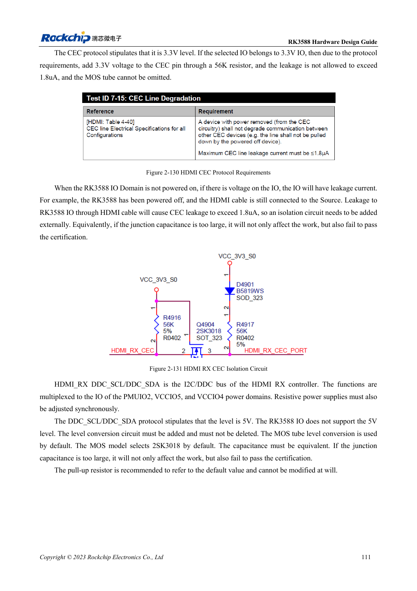

<!-- rk3588-hardware-v13-20261109 -->

# RK3588-HDMI-RX: Capture-Eingang, CEC und DDC

Grundlage sind die chinesische und englische Ausgabe des RK3588 Hardware Design Guide V1.3 (2023-02-13) für SoC-Platinen und Träger. AIM7- und LM7-Träger müssen den Moduldefinitionen folgen; Sige7 dient zur Software- und Peripherieprüfung. SoC-Funktionen sind keine Boardanschlussliste. SDK/BSP, Kernel, Boardrevision und Firmware prüfen. Werte sind Quellenreferenzen, keine ArmSoM-Messungen.

**RK3588 Hardware Design Guide V1.3 (2023-02-13), EN** · §2.3.7.4; §3.4.7

## RX ist kein umgekehrter TX

Tabelle 2-24 nutzt 2.2Ω in RX-Daten/Takt und 200Ω mit 1% von REXT nach Masse. HPD wird vom Empfänger über die MOS-Referenzschaltung zum Sender ausgegeben. TX-Kopplung und Biasnetz nicht in RX kopieren. Richtung, Referenzwiderstand und Versorgung zuerst prüfen.

## Leckstrom im ausgeschalteten Zustand prüfen

HDMI-DDC nutzt 5V, RK3588-IO verträgt keine 5V; Pegelwandlung erhalten. CEC benötigt Isolation; RX nutzt 56kΩ statt 27kΩ von TX. Leckstrom bei aktivem Sender und ausgeschaltetem Empfänger, HPD, EDID, Capture-Format und Kabelstabilität testen.

## Entwurfsparameter und Prüftabelle

| Punkt | Quellenreferenz |
| --- | --- |
| RX-Serie / REXT | 2.2Ω / 200Ω ±1% |
| RX-CEC-Referenz | 56kΩ |
| Differenzimpedanz/Länge | 100Ω ±10% / <6in |
| Takt-Daten-Differenz | <480mil |

## Quellenabbildungen

Die Referenzseiten enthalten die zugehörigen Schalt- oder Zeitdiagramme; für volle Auflösung anklicken. Bezeichner und Werte gehören zum Referenzentwurf, nicht zum Schaltplan eines ArmSoM-Produkts.

Englisches Original · PDF 133 · 2-131

## Entwicklung mit ArmSoM

AIM7 unterstützt Compute-Modul-Träger, LM7 die LGA-Modulintegration und Sige7 frühe Software-/Peripherieerprobung. Vor dem Trägerdesign klären, welche Versorgung, DDR- und Bootschaltungen bereits integriert sind. SoC-Referenzschaltungen nicht unnötig duplizieren. Anschlüsse, herausgeführte Schnittstellen, Pegel und Systemunterstützung anhand der Produktunterlagen prüfen.

- [ArmSoM AIM7](https://www.armsom.org/aim7) · [AIM7 Docs](https://docs.armsom.org/armsom-aim7)
- [ArmSoM Sige7](https://www.armsom.org/sige7) · [Sige7 Docs](https://docs.armsom.org/armsom-sige7)
- [ArmSoM LM7](https://www.armsom.org/lm7) · [LM7 Docs](https://docs.armsom.org/armsom-lm7)

## Weiterlesen

- [RK3588-Hardwaredesign: 30 Themen](/de/articles/rk3588-hardware-design-series/)
- [RK3588-Kameras: CSI, D/C-PHY und CIF planen](/de/articles/rk3588-camera-hardware-design/)
- [RK3588-HDMI-TX: FRL, TMDS und Kompatibilität](/de/articles/rk3588-hdmi-tx-hardware-design/)
