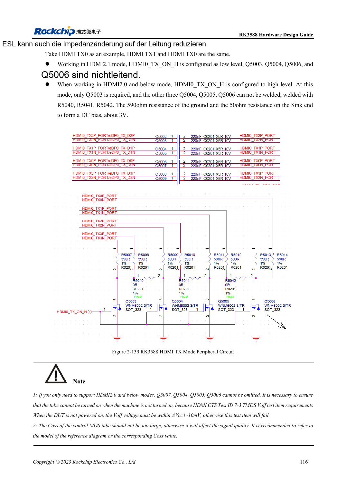
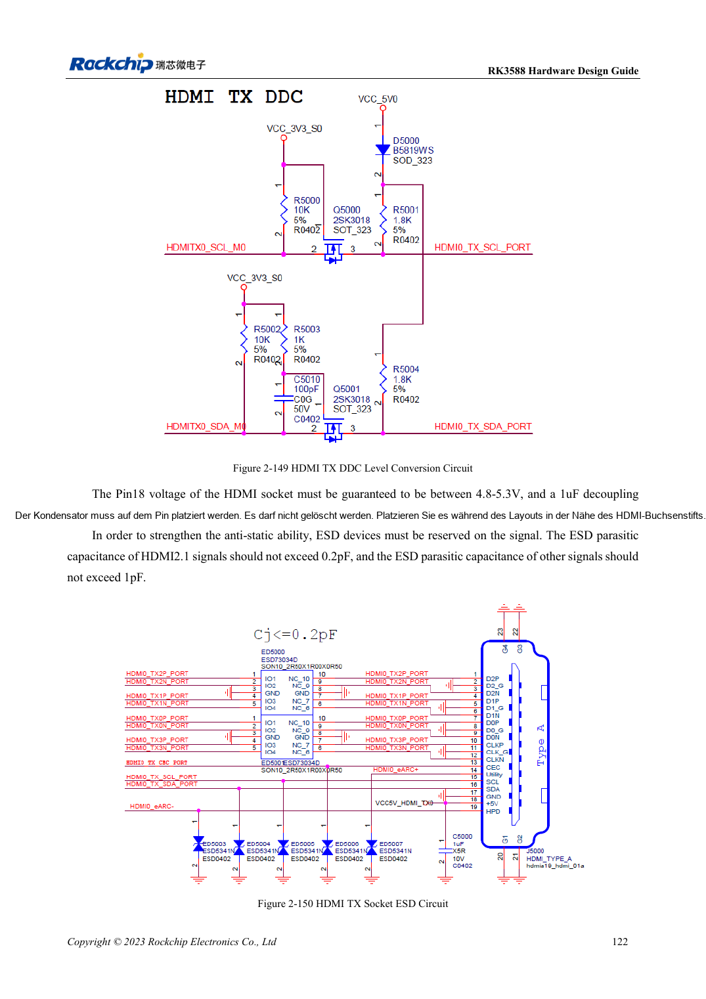

<!-- rk3588-hardware-v13-20261109 -->

# RK3588-HDMI-TX: FRL, TMDS und Kompatibilität

Grundlage sind die chinesische und englische Ausgabe des RK3588 Hardware Design Guide V1.3 (2023-02-13) für SoC-Platinen und Träger. AIM7- und LM7-Träger müssen den Moduldefinitionen folgen; Sige7 dient zur Software- und Peripherieprüfung. SoC-Funktionen sind keine Boardanschlussliste. SDK/BSP, Kernel, Boardrevision und Firmware prüfen. Werte sind Quellenreferenzen, keine ArmSoM-Messungen.

**RK3588 Hardware Design Guide V1.3 (2023-02-13), EN** · §2.3.8.1; §3.4.8

## FRL und TMDS benötigen verschiedene Zustände

HDMI2.1 nutzt FRL, HDMI2.0 und ältere Modi TMDS. Die Referenz verwendet 220nF und geschalteten Bias, bei TMDS 590Ω zusammen mit dem Empfänger. MOS-Auszustand und parasitäre Kapazität sind wichtig. Ein Bild rechtfertigt kein Entfernen der Steuerung. Gemeinsame HDMI/eDP-PHYs begrenzen Gleichzeitigkeit.

## Steuerung und Hochgeschwindigkeit prüfen

REXT: 8.2kΩ, 1%. DDC braucht 5V-Wandlung, TX-CEC 27kΩ und Isolation gegen Leckstrom. Pin18 am Stecker: 4.8–5.3V. HDMI2.1-ESD ≤0.2pF. Hotplug, ausgeschaltete Verbindung sowie Displays/Kabel testen. Historische Nichtunterstützung beschreibt die Quellenversion, nicht jeden aktuellen BSP.

## Entwurfsparameter und Prüftabelle

| Punkt | Quellenreferenz |
| --- | --- |
| TX-Kopplungs-/Biasreferenz | 220nF / 590Ω |
| REXT | 8.2kΩ ±1% |
| PCB-Differenzimpedanz/Länge | 100Ω ±10% / <4in |
| Vias/Abstand | Möglichst ohne Vias / ≥7× Leiterbreite |

## Quellenabbildungen

Die Referenzseiten enthalten die zugehörigen Schalt- oder Zeitdiagramme; für volle Auflösung anklicken. Bezeichner und Werte gehören zum Referenzentwurf, nicht zum Schaltplan eines ArmSoM-Produkts.

Englisches Original · PDF 138 · 2-139

Englisches Original · PDF 144 · 2-150

## Entwicklung mit ArmSoM

AIM7 unterstützt Compute-Modul-Träger, LM7 die LGA-Modulintegration und Sige7 frühe Software-/Peripherieerprobung. Vor dem Trägerdesign klären, welche Versorgung, DDR- und Bootschaltungen bereits integriert sind. SoC-Referenzschaltungen nicht unnötig duplizieren. Anschlüsse, herausgeführte Schnittstellen, Pegel und Systemunterstützung anhand der Produktunterlagen prüfen.

- [ArmSoM AIM7](https://www.armsom.org/aim7) · [AIM7 Docs](https://docs.armsom.org/armsom-aim7)
- [ArmSoM Sige7](https://www.armsom.org/sige7) · [Sige7 Docs](https://docs.armsom.org/armsom-sige7)
- [ArmSoM LM7](https://www.armsom.org/lm7) · [LM7 Docs](https://docs.armsom.org/armsom-lm7)

## Weiterlesen

- [RK3588-Hardwaredesign: 30 Themen](/de/articles/rk3588-hardware-design-series/)
- [RK3588-HDMI-RX: Capture-Eingang, CEC und DDC](/de/articles/rk3588-hdmi-rx-hardware-design/)
- [RK3588-MIPI-Displays: D-PHY, C-PHY und Panels](/de/articles/rk3588-mipi-display-hardware/)
