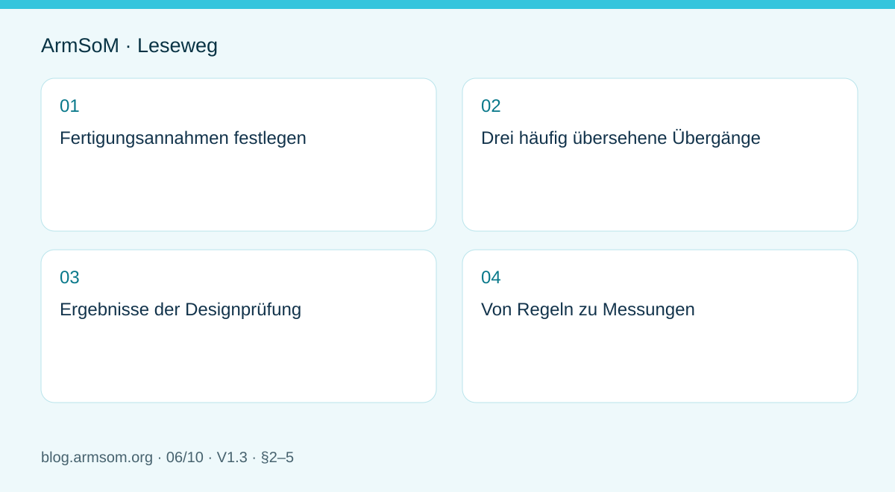
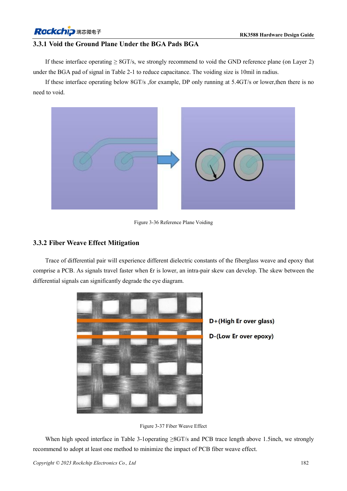
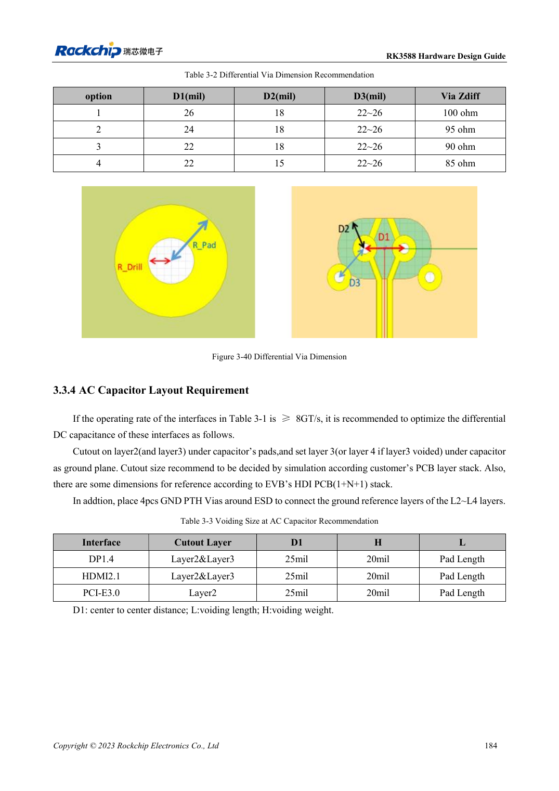
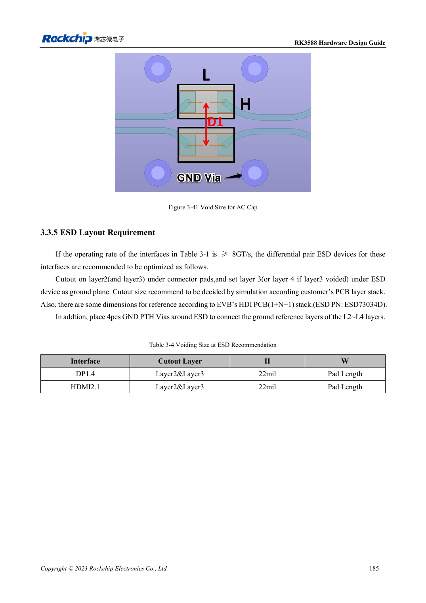

# RK3588-PCB-Prüfung: Lagenaufbau, Impedanz und Leiterführung

## Geltungsbereich und Quellen

Dies ist ein thematischer Engineering-Leitfaden, keine seitenweise Übersetzung des gesamten PDF. Quellenbeispiele sind keine ArmSoM-Messungen. Spannungen, Pins, SDK/BSP und Kernel mit der tatsächlichen Platinenrevision abgleichen.

**Rockchip:** `RK3588 Hardware Design Guide-CN-V1.3-20230213.pdf` · V1.3 · §2–5

## Fertigungsannahmen festlegen

Der Lagenaufbau umfasst mehr als die Layerzahl. Dielektrikumsdicke, Material, Kupfer und Toleranzen bestimmen Impedanz und Verlust. Schnittstellenziele, Referenzlagen und Geometrie mit dem Fertiger abstimmen und als Regeln festhalten. Eine kopierte Leiterbahnbreite reproduziert nicht automatisch die Referenzimpedanz.

§3.1 behandelt Aufbau und Fanout, §3.2 allgemeines Routing, §3.3 Signale ab 8GT/s und §3.4 einzelne Schnittstellen. Zahlenwerte sind dem jeweiligen Abschnitt zu entnehmen.

## Drei häufig übersehene Übergänge

1. **BGA- und Steckerpads:** Lokale Kapazität verändert die Impedanz; die Referenzfläche muss zu Footprint und Aufbau passen.
2. **Vias und Lagenwechsel:** Stubs und Rückstromübergänge zusätzlich zum Signalvia prüfen.
3. **Kopplung und Schutz:** Funktion und Padübergang sind beide relevant. Ein ESD-Bauteil garantiert keine unveränderte Kanalreserve.

Auch Glasgewebeeffekte werden behandelt. Ihre Material- und Geometrieabhängigkeit lässt sich nicht allein durch einen Längenausgleich am Leitungsende beheben.

## Ergebnisse der Designprüfung

| Prüfung | Nachweis |
| --- | --- |
| Durchgehende Referenz | Prüfung entlang kritischer Leitungen |
| Impedanz und Länge | Fertigerwerte, modusspezifische Grenzen, Reserve |
| Vias und Stecker | Anzahl, Position, Bauteile und Modelle |
| Versorgung und Rückstrom | Entkopplung, Masse und Schirmanschlüsse |
| Prüfbarkeit | Messzugang ohne wesentliche Kanalstörung |

Unbewertete lange Messpunktabzweige vermeiden. Keine unnötigen Kopplungen und Mäander allein für gleiche Leitungslängen erzeugen.

## Von Regeln zu Messungen

DRC prüft hinterlegte Regeln, belegt aber keine Kanalreserve. Signalintegrität, Erkennung oder Training, Zielrate und Dauerübertragung mit tatsächlichen Kabeln und Gehäuse prüfen. Funktioniert nur eine niedrigere Rate, Kanal, Versorgung und Software getrennt untersuchen.

Ein Träger ist nur Teil des Kanals eines ArmSoM-Moduls. Ebenso zertifiziert ein erfolgreicher Anwendungstest auf Sige7 keine andere PCB.

## Abbildung aus der Quelle

Original aus dem englischen Dokument, gemeinsam für EN/RU/DE. Referenzdesign, kein ArmSoM-Platinenschaltplan.

`RK3588 hardware design guide-EN-V1.3-20230213.pdf` · PDF p. 25.

## Produkte und Entwicklungsunterlagen

- **AIM7** — [Produktseite](https://www.armsom.org/aim7) · [Dokumentation](https://docs.armsom.org/armsom-aim7)
- **Sige7** — [Produktseite](https://www.armsom.org/sige7) · [Dokumentation](https://docs.armsom.org/armsom-sige7)
- **LM7** — [Produktseite](https://www.armsom.org/lm7) · [Dokumentation](https://docs.armsom.org/armsom-lm7)

## Weitere Beiträge der Reihe

- [RK3576 in Betrieb nehmen: Minimalsystem und erste Einschaltprüfung](/de/articles/rk3576-hardware-bringup/)
- [ArmSoM CM5-Trägerplatine: Checkliste für Versorgung, Boot und Schnittstellen](/de/articles/019-cm5-carrier-production/)
- [RK3576-Hochgeschwindigkeitsschnittstellen: Schaltplan und PCB gemeinsam prüfen](/de/articles/rk3576-high-speed-interface-design/)
- [RK3588S-Hardwaredesign: vom Referenzschaltplan zur CM7s-Trägerplatine](/de/articles/rk3588s-cm7s-carrier-design/)
- [RK3588 für Edge-KI: Versorgung, Kühlung und Erweiterung gemeinsam planen](/de/articles/rk3588-edge-ai-hardware-design/)
- [RK3506-HMI-Hardware: Entwicklung mit CM1 oder Forge1](/de/articles/rk3506-industrial-hmi-hardware/)
- [RK3308-Varianten: Hardwarekompatibilität für P2-Pro-Audioprojekte](/de/articles/rk3308-hardware-variant-compatibility/)
- [RK3588S und RK3588S2: Prüfungen vor einer Hardwareänderung](/de/articles/rk3588s-rk3588s2-hardware-differences/)
- [Vom Rockchip-Prototyp zur Serie: Prozessvorgaben und Prüfunterlagen](/de/articles/rockchip-hardware-production-checklist/)

<!-- rk3588-hardware-v13-20261109 -->

## RK3588-Hochgeschwindigkeits-PCB: Pads und Vias ab 8GT/s

Grundlage sind die chinesische und englische Ausgabe des RK3588 Hardware Design Guide V1.3 (2023-02-13) für SoC-Platinen und Träger. AIM7- und LM7-Träger müssen den Moduldefinitionen folgen; Sige7 dient zur Software- und Peripherieprüfung. SoC-Funktionen sind keine Boardanschlussliste. SDK/BSP, Kernel, Boardrevision und Firmware prüfen. Werte sind Quellenreferenzen, keine ArmSoM-Messungen.

**RK3588 Hardware Design Guide V1.3 (2023-02-13), EN** · §3.2; §3.3

## Anwendbare Datenraten bestimmen

Abschnitt 3.3 behandelt DP1.4 mit 8.1Gbps, HDMI2.1 mit 12Gbps und PCIe3 mit 8GT/s. Relevante BGA-Pads nutzen als Referenz L2-Aussparung R=10mil, nicht alle Signale. Niedrigere Raten und andere Aufbauten neu bewerten statt eine Regel überall anzuwenden.

## Rückstrom nach Aussparungen erhalten

Wird L2 unter einem Kondensator entfernt, muss L3 Masse sein; bei L2/L3-Aussparung L4, mit nahen Masseverbindungen. Maße gelten für EVB-Aufbau und Bauteile. Relevante Leiter über 1.5in benötigen Glasgewebeprüfung, etwa Winkelrouting. Modul, Träger und Stecker als vollständigen Kanal simulieren oder messen.

## Entwurfsparameter und Prüftabelle

| Punkt | Quellenreferenz |
| --- | --- |
| BGA-Aussparungsreferenz | R=10mil; für ≥8GT/s Links |
| Glasgewebeprüfung | 8GT/s und Länge >1.5in |
| Winkelbeispiel | 10°–35° |
| Via-Referenzradien | Bohrung 0.1mm; Pad 0.2mm |

## Quellenabbildungen

Die Referenzseiten enthalten die zugehörigen Schalt- oder Zeitdiagramme; für volle Auflösung anklicken. Bezeichner und Werte gehören zum Referenzentwurf, nicht zum Schaltplan eines ArmSoM-Produkts.

Englisches Original · PDF 204 · 3-36

Englisches Original · PDF 206 · 3-40

Englisches Original · PDF 207 · 3-41

## Entwicklung mit ArmSoM

AIM7 unterstützt Compute-Modul-Träger, LM7 die LGA-Modulintegration und Sige7 frühe Software-/Peripherieerprobung. Vor dem Trägerdesign klären, welche Versorgung, DDR- und Bootschaltungen bereits integriert sind. SoC-Referenzschaltungen nicht unnötig duplizieren. Anschlüsse, herausgeführte Schnittstellen, Pegel und Systemunterstützung anhand der Produktunterlagen prüfen.

- [ArmSoM AIM7](https://www.armsom.org/aim7) · [AIM7 Docs](https://docs.armsom.org/armsom-aim7)
- [ArmSoM Sige7](https://www.armsom.org/sige7) · [Sige7 Docs](https://docs.armsom.org/armsom-sige7)
- [ArmSoM LM7](https://www.armsom.org/lm7) · [LM7 Docs](https://docs.armsom.org/armsom-lm7)

## Weiterlesen

- [RK3588-Hardwaredesign: 30 Themen](/de/articles/rk3588-hardware-design-series/)
- [RK3588-Lagenaufbau und Fanout: HDI oder PTH](/de/articles/rk3588-pcb-stackup-fanout/)
- [RK3588-Power-PCB und PDN: Kupfer, Rückwege und Abblockung](/de/articles/rk3588-power-pcb-pdn-design/)
