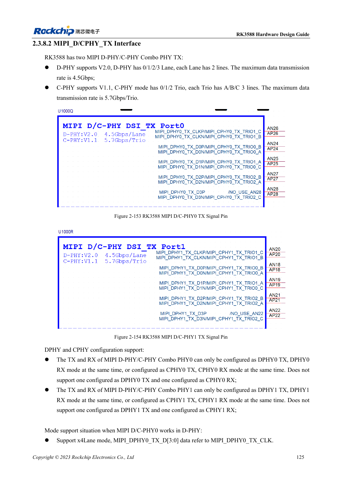
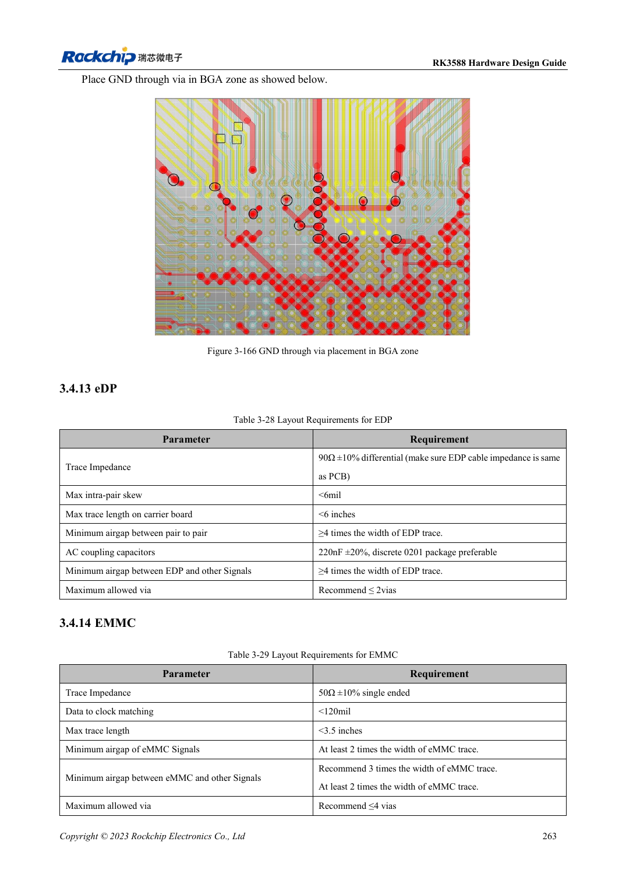

<!-- rk3588-hardware-v13-20261109 -->

# RK3588-MIPI-Displays: D-PHY, C-PHY und Panels

Grundlage sind die chinesische und englische Ausgabe des RK3588 Hardware Design Guide V1.3 (2023-02-13) für SoC-Platinen und Träger. AIM7- und LM7-Träger müssen den Moduldefinitionen folgen; Sige7 dient zur Software- und Peripherieprüfung. SoC-Funktionen sind keine Boardanschlussliste. SDK/BSP, Kernel, Boardrevision und Firmware prüfen. Werte sind Quellenreferenzen, keine ArmSoM-Messungen.

**RK3588 Hardware Design Guide V1.3 (2023-02-13), EN** · §2.3.8.2; §3.4.12; §3.4.23

## Lanes und Trios getrennt planen

Die zwei D/C-Combo-PHYs bieten vier Zweidraht-Datenlanes bei D-PHY oder drei A/B/C-Trios bei C-PHY. TX/RX desselben PHY müssen denselben D- oder C-PHY-Modus nutzen. Panelprotokoll, Lane-/Triozahl und Timing vor Verdrahtung prüfen.

## Panels brauchen mehr als Daten

Hintergrundlichtversorgung, Enable, Reset, Touch-I2C und Interrupt nach Pegel und Sequenz abstimmen. D-PHY-Differenzimpedanz und C-PHY-Einzelimpedanz benötigen getrennte DRC-Regeln. Panelinitialisierung im konkreten BSP, Helligkeitswechsel, Schlaf/Aufwachen, Touchstörungen und Dauerbetrieb testen.

## Entwurfsparameter und Prüftabelle

| Punkt | Quellenreferenz |
| --- | --- |
| D-PHY-Quellenrate | 4.5Gbps/lane |
| C-PHY-Quellenrate | 5.7Gbps/trio |
| C-PHY-Impedanz | 50Ω ±10% single-ended |
| C-PHY innerhalb/zwischen Trios | <6mil / <100mil |
| C-PHY-Länge | <5in |

## Quellenabbildungen

Die Referenzseiten enthalten die zugehörigen Schalt- oder Zeitdiagramme; für volle Auflösung anklicken. Bezeichner und Werte gehören zum Referenzentwurf, nicht zum Schaltplan eines ArmSoM-Produkts.

Englisches Original · PDF 147 · 2-153

Englisches Original · PDF 285 · 3-166

## Entwicklung mit ArmSoM

AIM7 unterstützt Compute-Modul-Träger, LM7 die LGA-Modulintegration und Sige7 frühe Software-/Peripherieerprobung. Vor dem Trägerdesign klären, welche Versorgung, DDR- und Bootschaltungen bereits integriert sind. SoC-Referenzschaltungen nicht unnötig duplizieren. Anschlüsse, herausgeführte Schnittstellen, Pegel und Systemunterstützung anhand der Produktunterlagen prüfen.

- [ArmSoM AIM7](https://www.armsom.org/aim7) · [AIM7 Docs](https://docs.armsom.org/armsom-aim7)
- [ArmSoM Sige7](https://www.armsom.org/sige7) · [Sige7 Docs](https://docs.armsom.org/armsom-sige7)
- [ArmSoM LM7](https://www.armsom.org/lm7) · [LM7 Docs](https://docs.armsom.org/armsom-lm7)

## Weiterlesen

- [RK3588-Hardwaredesign: 30 Themen](/de/articles/rk3588-hardware-design-series/)
- [RK3588-HDMI-TX: FRL, TMDS und Kompatibilität](/de/articles/rk3588-hdmi-tx-hardware-design/)
- [RK3588-DP und eDP: PHYs, AUX und Kopplung](/de/articles/rk3588-dp-edp-hardware-design/)
