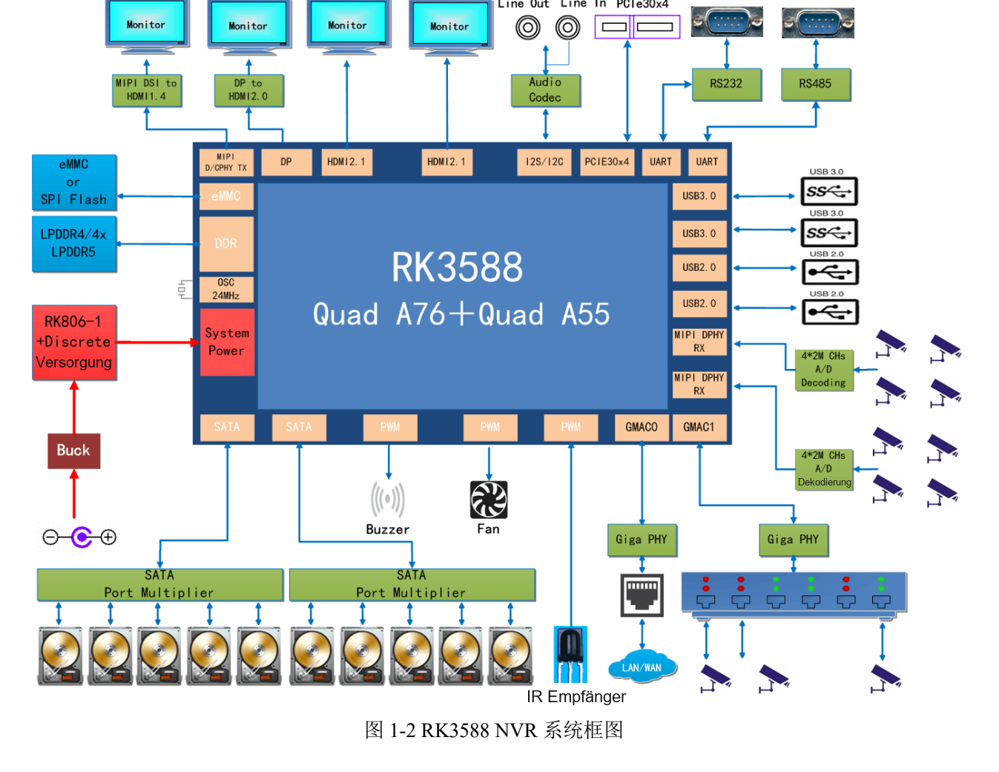
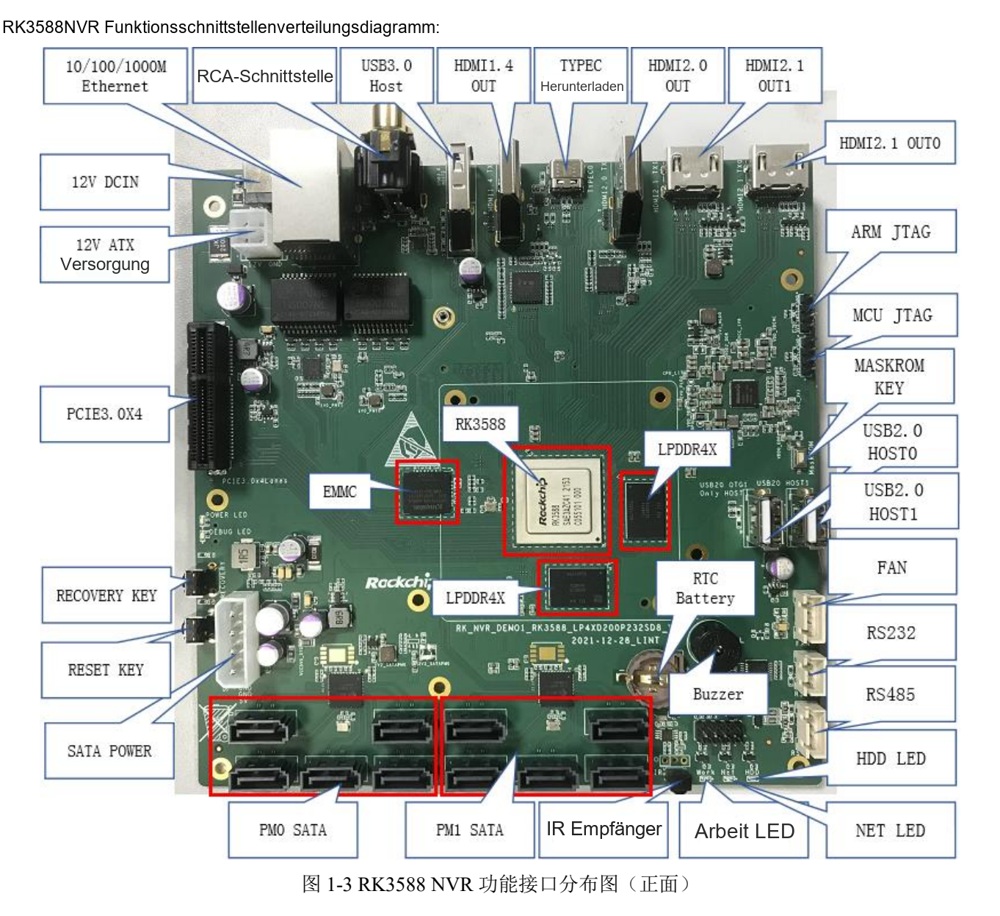

Dieser thematische Leitfaden erläutert das Quelldokument mit wichtigen Daten, Grenzen und Originalabbildungen. Er ist keine seitenweise Übersetzung und kein vollständiges Pin- oder Registerhandbuch. Herstellerbeispiele sind keine ArmSoM-Messungen. Vor der Anwendung sind Platinenrevision, Schaltplan, SDK/BSP, Kernel und Treiber zu prüfen; für diesen Artikel wurden keine neuen Hardwaretests durchgeführt.

**Hauptquelle：** `Rockchip_RK3588_NVR_User_Guide_V1.0_CN_20220421.pdf` · PDF 49 Seiten.

## Herstellerreferenz statt ArmSoM-Produktkonfiguration

Die Quelle beschreibt `RK_NVR_DEMO1_RK3588_LP4XD200P232SD8_V21_20211228.DSN` mit RK3588, einem RK806-1, 4GB LPDDR4x und 32GB eMMC. Das Standardnetzteil liefert 12V/3A. Diese Werte bestimmen nicht automatisch Speicher, Eingangsspannung oder Portzahl von AIM7, Sige7 oder LM7.

*RK3588-NVR-Systemdiagramm — Chinesische Originalabbildung; in dieser Auswahl liegt keine entsprechende englische Abbildung vor. `Rockchip_RK3588_NVR_User_Guide_V1.0_CN_20220421.pdf`, PDF p. 12.*

## Den Signalweg hinter jedem Stecker verstehen

| Funktion | Umsetzung der Quelle | Produktprüfung |
| --- | --- | --- |
| SATA | 2 JMB575 erweitern auf bis zu 10 Laufwerke | Gemeinsame Bandbreite, Treiber, Versorgung und parallele Schreiblast |
| PCIe | PCIe3.0 x4; Referenztakt PI6C557-05BLE | Modus, Takt, Reset, Karte und Dauerdurchsatz |
| Netzwerk | 2 Gigabit-RJ45 mit RTL8211F-CG | Kamera-/Verwaltungsnetz, Verluste und Überlastung |
| Kamera | 2×4-lane oder 4×2-lane MIPI DPHY RX über 80pin | Stecker, Lanes, Versorgung und Sensortreiber |
| Debug/Download | MINI USB Debug; Type-C für Firmware | Portfunktionen vor Anschluss unterscheiden |

Zehn SATA-Ports entstehen durch Erweiterung. Es sind keine zehn unabhängigen nativen RK3588-Controller und keine Zusage gleichzeitiger Spitzenraten aller Laufwerke. Anlaufstrom und Kühlung sind nicht automatisch vom Standardnetzteil abgedeckt.

*Anschlüsse der RK3588-NVR-Referenzplatine — Chinesische Originalabbildung; in dieser Auswahl liegt keine entsprechende englische Abbildung vor. `Rockchip_RK3588_NVR_User_Guide_V1.0_CN_20220421.pdf`, PDF p. 14.*

## Natives und über Bridges erzeugtes HDMI trennen

S. 45–47 beschreiben MIPI über IT6161 zu HDMI1.4b, DP über IT6563FN zu HDMI2.0 sowie zwei HDMI2.1-Ausgänge. Die Übersicht auf S. 12 nennt drei HDMI, die Tabelle auf S. 13 dagegen einmal HDMI1.4, einmal HDMI2.0 und zweimal HDMI2.1. Die Abweichung bleibt dokumentiert. Einzelpfade werden erklärt, ohne vier beliebig gleichzeitig nutzbare Ausgänge zu behaupten.

Für eine Videowand Auflösung, Bildrate, Farbformat und Quelle jedes Ausgangs erfassen. Displaycontroller, Bridge, Stecker und BSP gemeinsam prüfen. Eine maximale Schnittstellenangabe ersetzt keine vollständige Kombinationsmatrix.

## Die Pipeline von Kamera bis Aufzeichnung budgetieren

Erfassung, Decoding/Bildverarbeitung, optionale Inferenz, Encoding, Schreiben und lokale Anzeige trennen. Streamzahl, Bitrate, Puffer, Latenz und Fehlerbehandlung je Stufe erfassen. Netzwerkkamera und rohe MIPI-Aufnahme verwenden unterschiedliche Bandbreiten und Softwarepfade.

Ringaufzeichnung, vollen Datenträger, Entfernen/Ausfall, Stromverlust und Indexwiederherstellung testen. Bei Parallel-I/O Gesamtdurchsatz und langsamsten Stream erfassen, nicht nur einen Einzelplattenwert. RAID und Dateisystem sind spätere Systementscheidungen, keine bereits gelieferte EVB-Funktion.

## Vor Recovery und Flashen Konfiguration sichern

Das Windows-Treiberbeispiel heißt `DriverAssitant_v5.1.1`. Für Loader Type-C mit dem PC verbinden, RECOVERY beim Einschalten/Reset halten und erst nach Erkennung loslassen. MASKROM nutzt die entsprechende Taste mit bestätigter Erkennung. Loader, Parameter, Uboot und weitere Dateien müssen zu Platine und Speicher passen; Daten vorher sichern.

Das gilt für die Referenzplatine. ADC-Pins, 12V-Schritt oder Kurzschlussverfahren nicht auf ArmSoM übertragen. Eine Produktions-Recovery braucht zugänglichen Downloadport, serielle Logs und Versionsnachweise.

## I2C und Pegel vor Erweiterungen prüfen

S. 23 nennt ES8311 an I2C3, `0x18`, 1.8V; FUSB302BMPX an I2C6, `0x22`, 3.3V; HYM8563TS an I2C6, `0x51`, 3.3V. IT6161 erscheint als `0x98`; dies wird nicht automatisch als Linux-7-bit-Adresse verwendet. Adresskonvention, Multiplexing, Versorgungsdomäne und Pull-ups prüfen.

Auf der letzten Seite steht noch die Vorlagenbezeichnung „RK3588S EVB“. Das ändert die RK3588-Zuordnung des NVR nicht.

## Entwicklungsumfang mit ArmSoM begrenzen

Sige7 bietet einen Einstieg als komplette Anwendungsplatine; AIM7 und LM7 ermöglichen unterschiedliche Modul-/Trägeransätze. Tatsächliche Anschlüsse und Software prüfen, bevor Speichererweiterung, Videoeingänge und Kühlung feststehen. Zehn SATA-Stecker oder komplette NVR-Software werden für diese Produkte hier nicht als Standard zugesagt.

## Produkte und Entwicklungsunterlagen

- **AIM7** — [Produkt](https://www.armsom.org/aim7) · [Dokumentation](https://docs.armsom.org/armsom-aim7)
- **Sige7** — [Produkt](https://www.armsom.org/sige7) · [Dokumentation](https://docs.armsom.org/armsom-sige7)
- **LM7** — [Produkt](https://www.armsom.org/lm7) · [Dokumentation](https://docs.armsom.org/armsom-lm7)

## Weiterführende Artikel

- [RK3588-Hardwareprüfung](/de/articles/rk3588-hardware-test-report/)
