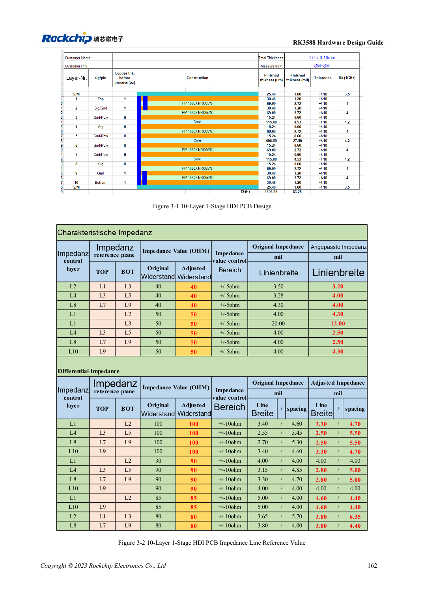
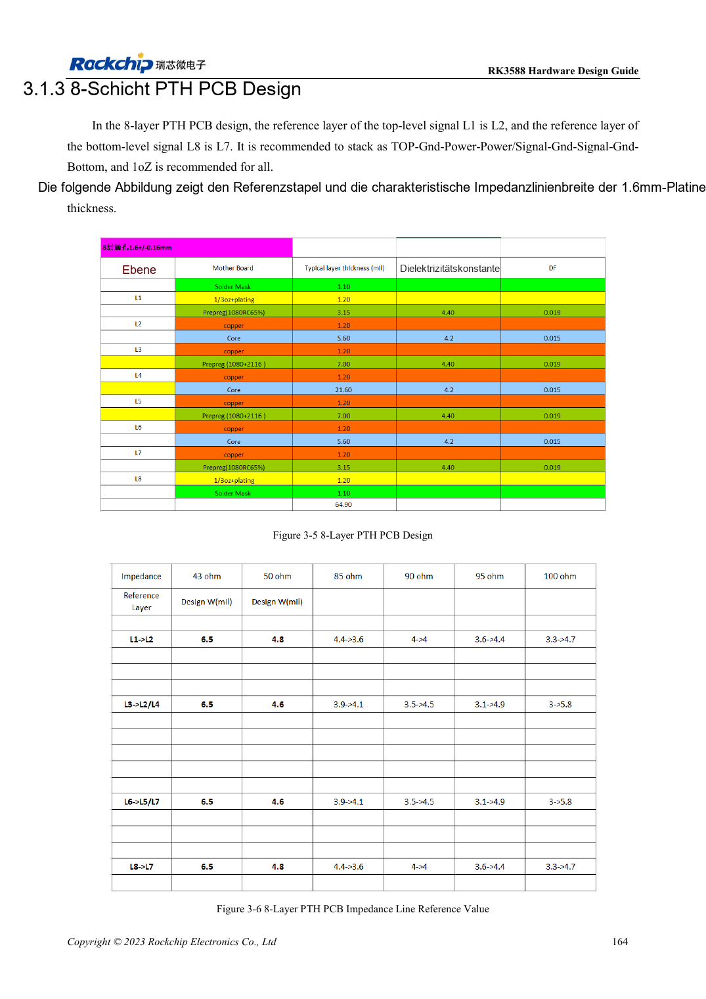
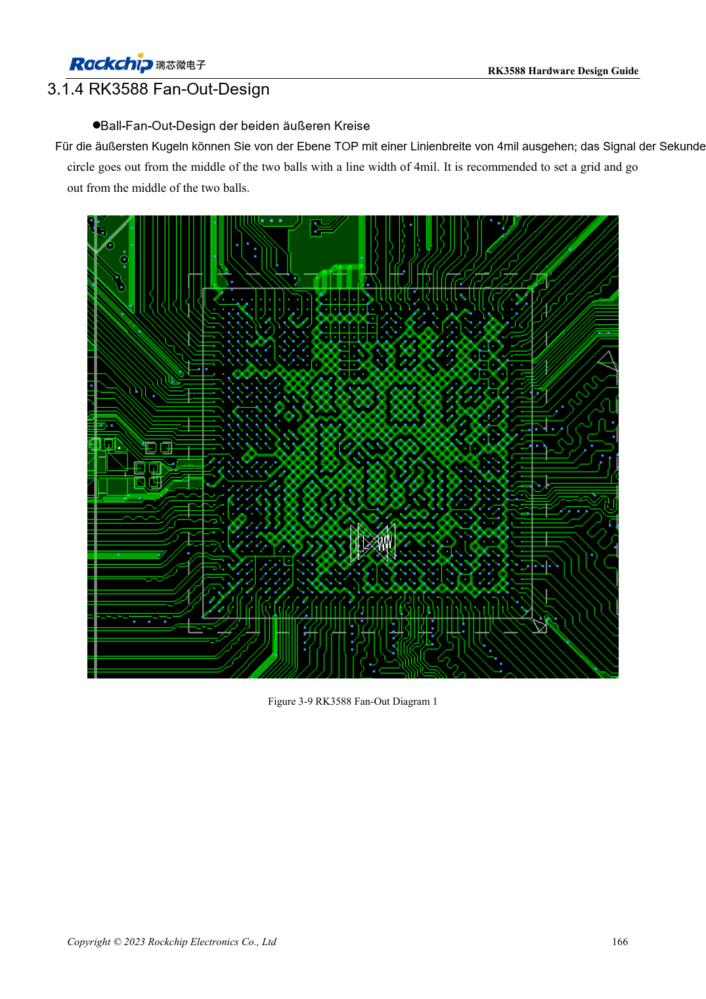

<!-- rk3588-hardware-v13-20261109 -->

# RK3588-Lagenaufbau und Fanout: HDI oder PTH

Grundlage sind die chinesische und englische Ausgabe des RK3588 Hardware Design Guide V1.3 (2023-02-13) für SoC-Platinen und Träger. AIM7- und LM7-Träger müssen den Moduldefinitionen folgen; Sige7 dient zur Software- und Peripherieprüfung. SoC-Funktionen sind keine Boardanschlussliste. SDK/BSP, Kernel, Boardrevision und Firmware prüfen. Werte sind Quellenreferenzen, keine ArmSoM-Messungen.

**RK3588 Hardware Design Guide V1.3 (2023-02-13), EN** · §3.1; §3.2

## Lagenzahl allein entscheidet nicht

Gezeigt werden 10-Lagen-HDI erster/zweiter Ordnung und 8-Lagen-PTH. Der Aufbau muss Impedanz, Rückstrom, Kupfer, Fertigung und Kosten erfüllen. Masse neben Signalen bevorzugen, Kopplung benachbarter Signallagen beherrschen und symmetrisch aufbauen. Nach Material-/Dickenwechsel Geometrie mit dem Hersteller neu berechnen.

## Fanout mit Fertigung abstimmen

Für die äußeren zwei Ballreihen sind 4mil-Escape-Leiter gezeigt, keine allgemeine Impedanzbreite. Vias, Antipads, Versorgung und DDR-Vorlage prüfen. AIM7/LM7-Träger nutzen Modulstecker oder LGA statt SoC-BGA-Fanout; Fertigung aus Moduldokumentation ableiten.

## Entwurfsparameter und Prüftabelle

| Punkt | Quellenreferenz |
| --- | --- |
| Referenzlagenaufbauten | 10-Lagen HDI; 8-Lagen PTH |
| Beispiel-Platinendicke | 1.6mm |
| Lokaler Fanout der Außenreihe | 4mil |
| Geltungsbereich der Leiterlänge | PCB + Vias + Gehäuse |

## Quellenabbildungen

Die Referenzseiten enthalten die zugehörigen Schalt- oder Zeitdiagramme; für volle Auflösung anklicken. Bezeichner und Werte gehören zum Referenzentwurf, nicht zum Schaltplan eines ArmSoM-Produkts.

Englisches Original · PDF 184 · 3-1

Englisches Original · PDF 186 · 3-5

Englisches Original · PDF 188 · 3-9

## Entwicklung mit ArmSoM

AIM7 unterstützt Compute-Modul-Träger, LM7 die LGA-Modulintegration und Sige7 frühe Software-/Peripherieerprobung. Vor dem Trägerdesign klären, welche Versorgung, DDR- und Bootschaltungen bereits integriert sind. SoC-Referenzschaltungen nicht unnötig duplizieren. Anschlüsse, herausgeführte Schnittstellen, Pegel und Systemunterstützung anhand der Produktunterlagen prüfen.

- [ArmSoM AIM7](https://www.armsom.org/aim7) · [AIM7 Docs](https://docs.armsom.org/armsom-aim7)
- [ArmSoM Sige7](https://www.armsom.org/sige7) · [Sige7 Docs](https://docs.armsom.org/armsom-sige7)
- [ArmSoM LM7](https://www.armsom.org/lm7) · [LM7 Docs](https://docs.armsom.org/armsom-lm7)

## Weiterlesen

- [RK3588-Hardwaredesign: 30 Themen](/de/articles/rk3588-hardware-design-series/)
- [RK3588-UART, SPI, CAN, I2C und PWM zuordnen](/de/articles/rk3588-serial-control-hardware/)
- [RK3588-Hochgeschwindigkeits-PCB: Pads und Vias ab 8GT/s](/de/articles/rk3588-high-speed-pcb-review/)
