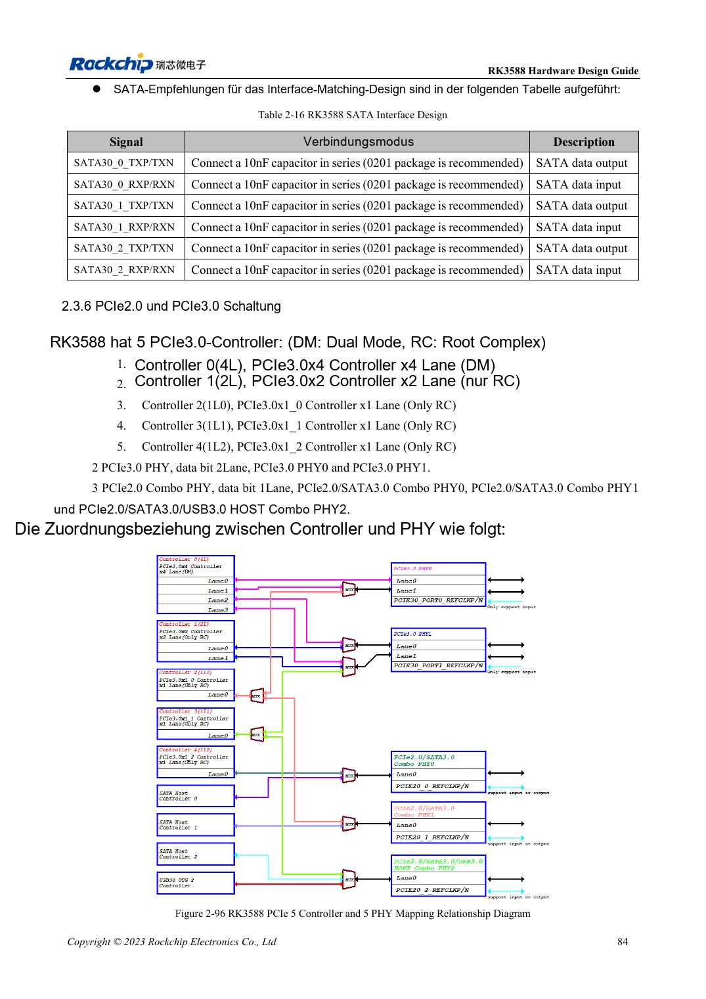
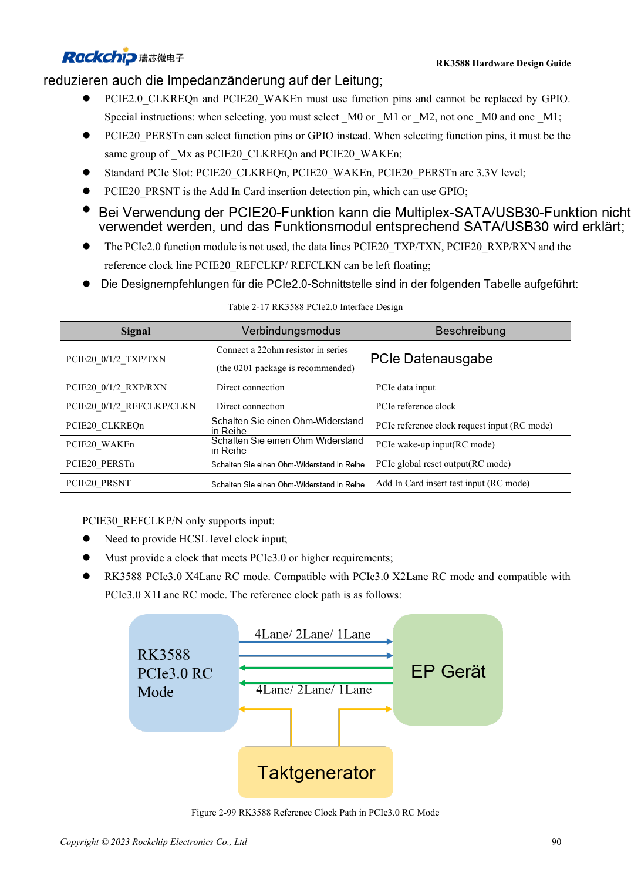

<!-- rk3588-hardware-v13-20261109 -->

# RK3588-PCIe: Lanes, Referenztakte und Versorgung

Grundlage sind die chinesische und englische Ausgabe des RK3588 Hardware Design Guide V1.3 (2023-02-13) für SoC-Platinen und Träger. AIM7- und LM7-Träger müssen den Moduldefinitionen folgen; Sige7 dient zur Software- und Peripherieprüfung. SoC-Funktionen sind keine Boardanschlussliste. SDK/BSP, Kernel, Boardrevision und Firmware prüfen. Werte sind Quellenreferenzen, keine ArmSoM-Messungen.

**RK3588 Hardware Design Guide V1.3 (2023-02-13), EN** · §2.3.6; §2.2.2.16; §3.4.5–3.4.6

## Controller sind keine unabhängigen Ports

Fünf Controller werden auf zwei PCIe3-PHYs und drei PCIe2-Combo-PHYs mit gemeinsamen Ressourcen abgebildet. x4, x2 und sämtliche x1 nicht addieren. PCIe3-REFCLK ist nur Eingang und benötigt HCSL; PCIe2 unterstützt Ein-/Ausgang, standardmäßig zum EP. ROM bootet nicht direkt von PCIe-SSD.

## Steuerpins und Versorgung prüfen

PCIe2-CLKREQn/WAKEn benötigen Funktionspins derselben Mx-Gruppe. PERSTn darf GPIO sein, seine dedizierte Funktion muss ebenfalls passen. Slotsteuerung mit 3.3V an die IO-Domäne anpassen. Beide PCIe3-Ports versorgen, selbst wenn nur einer aktiv ist. Kaltinitialisierung, Zielrate, Schlaf und Dauertransfer testen.

## Entwurfsparameter und Prüftabelle

| Punkt | Quellenreferenz |
| --- | --- |
| PCIe-Datenimpedanz | 85Ω ±10% |
| REFCLK-Impedanz | 100Ω ±10% |
| PCIe2-/PCIe3-Kopplung | 100nF / 220nF; ±20% |
| Daten-/REFCLK-Paardifferenz | <6mil / <12mil |
| Länge/Vias | <6in / empfohlen ≤2 |

## Quellenabbildungen

Die Referenzseiten enthalten die zugehörigen Schalt- oder Zeitdiagramme; für volle Auflösung anklicken. Bezeichner und Werte gehören zum Referenzentwurf, nicht zum Schaltplan eines ArmSoM-Produkts.

Englisches Original · PDF 106 · 2-96

Englisches Original · PDF 112 · 2-99

## Entwicklung mit ArmSoM

AIM7 unterstützt Compute-Modul-Träger, LM7 die LGA-Modulintegration und Sige7 frühe Software-/Peripherieerprobung. Vor dem Trägerdesign klären, welche Versorgung, DDR- und Bootschaltungen bereits integriert sind. SoC-Referenzschaltungen nicht unnötig duplizieren. Anschlüsse, herausgeführte Schnittstellen, Pegel und Systemunterstützung anhand der Produktunterlagen prüfen.

- [ArmSoM AIM7](https://www.armsom.org/aim7) · [AIM7 Docs](https://docs.armsom.org/armsom-aim7)
- [ArmSoM Sige7](https://www.armsom.org/sige7) · [Sige7 Docs](https://docs.armsom.org/armsom-sige7)
- [ArmSoM LM7](https://www.armsom.org/lm7) · [LM7 Docs](https://docs.armsom.org/armsom-lm7)

## Weiterlesen

- [RK3588-Hardwaredesign: 30 Themen](/de/articles/rk3588-hardware-design-series/)
- [RK3588-SATA: drei Controller und gemeinsame PHYs](/de/articles/rk3588-sata-hardware-design/)
- [RK3588-Kameras: CSI, D/C-PHY und CIF planen](/de/articles/rk3588-camera-hardware-design/)
