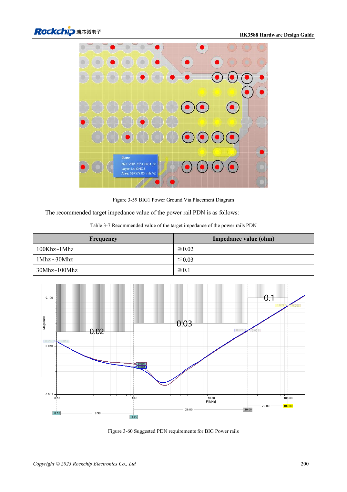

<!-- rk3588-hardware-v13-20261109 -->

# RK3588-Power-PCB und PDN: Kupfer, Rückwege und Abblockung

Grundlage sind die chinesische und englische Ausgabe des RK3588 Hardware Design Guide V1.3 (2023-02-13) für SoC-Platinen und Träger. AIM7- und LM7-Träger müssen den Moduldefinitionen folgen; Sige7 dient zur Software- und Peripherieprüfung. SoC-Funktionen sind keine Boardanschlussliste. SDK/BSP, Kernel, Boardrevision und Firmware prüfen. Werte sind Quellenreferenzen, keine ArmSoM-Messungen.

**RK3588 Hardware Design Guide V1.3 (2023-02-13), EN** · §3.4.2

## Kondensatorzahl allein reicht nicht

Massevias an Hochstrom-Buck-Kondensatoren sollen den positiven Vias entsprechen. Effektive Kupferbreite und Engstellen nach Durchkontaktierungen prüfen; schmale Thermal-Reliefs an kritischen Versorgungen vermeiden. RK806-Platzierung zwischen kurzen Pfaden und Wärmeverteilung abwägen.

## Impedanz frequenzabhängig prüfen

Tabelle 3-7 nennt frequenzabhängige BIG-PDN-Ziele, keinen Universalkondensator. Regler, Flächen, Vias, Gehäuse und ESR/ESL modellieren. Das sind Referenzempfehlungen, keine ArmSoM-Messungen. Einbruch und Nachschwingen bei Lastsprüngen mit Temperatur, Takt und Fehlern korrelieren.

## Entwurfsparameter und Prüftabelle

| Punkt | Quellenreferenz |
| --- | --- |
| BIG PDN 100kHz–1MHz | ≤0.02Ω |
| BIG PDN 1–30MHz | ≤0.03Ω |
| BIG PDN 30–100MHz | ≤0.1Ω |
| Via-Referenzstrom (<1V) | 0.5A; Quellenbeispiel 0.5×0.3mm Via |

## Quellenabbildungen

Die Referenzseiten enthalten die zugehörigen Schalt- oder Zeitdiagramme; für volle Auflösung anklicken. Bezeichner und Werte gehören zum Referenzentwurf, nicht zum Schaltplan eines ArmSoM-Produkts.

Englisches Original · PDF 222 · 3-60

## Entwicklung mit ArmSoM

AIM7 unterstützt Compute-Modul-Träger, LM7 die LGA-Modulintegration und Sige7 frühe Software-/Peripherieerprobung. Vor dem Trägerdesign klären, welche Versorgung, DDR- und Bootschaltungen bereits integriert sind. SoC-Referenzschaltungen nicht unnötig duplizieren. Anschlüsse, herausgeführte Schnittstellen, Pegel und Systemunterstützung anhand der Produktunterlagen prüfen.

- [ArmSoM AIM7](https://www.armsom.org/aim7) · [AIM7 Docs](https://docs.armsom.org/armsom-aim7)
- [ArmSoM Sige7](https://www.armsom.org/sige7) · [Sige7 Docs](https://docs.armsom.org/armsom-sige7)
- [ArmSoM LM7](https://www.armsom.org/lm7) · [LM7 Docs](https://docs.armsom.org/armsom-lm7)

## Weiterlesen

- [RK3588-Hardwaredesign: 30 Themen](/de/articles/rk3588-hardware-design-series/)
- [RK3588-Hochgeschwindigkeits-PCB: Pads und Vias ab 8GT/s](/de/articles/rk3588-high-speed-pcb-review/)
- [RK3588-Thermik: Referenzwärmewiderstand und Systemprüfung](/de/articles/rk3588-thermal-hardware-design/)
