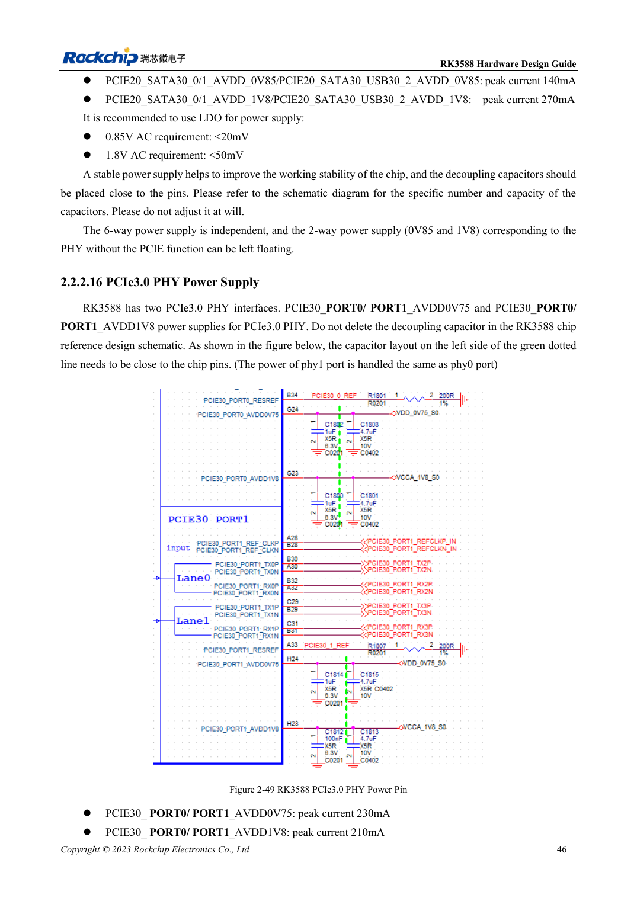
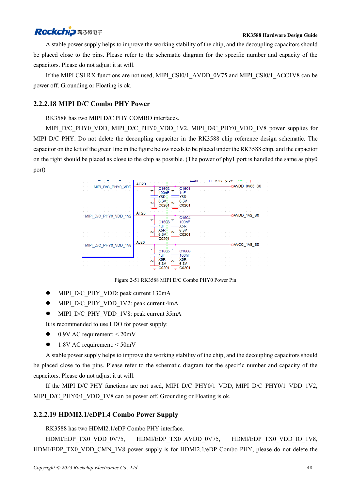

<!-- rk3588-hardware-v13-20261109 -->

# RK3588-Versorgung: Startanforderungen und ungenutzte PHYs

Grundlage sind die chinesische und englische Ausgabe des RK3588 Hardware Design Guide V1.3 (2023-02-13) für SoC-Platinen und Träger. AIM7- und LM7-Träger müssen den Moduldefinitionen folgen; Sige7 dient zur Software- und Peripherieprüfung. SoC-Funktionen sind keine Boardanschlussliste. SDK/BSP, Kernel, Boardrevision und Firmware prüfen. Werte sind Quellenreferenzen, keine ArmSoM-Messungen.

**RK3588 Hardware Design Guide V1.3 (2023-02-13), EN** · §2.2.1; §2.2.2

## Ungenutzte Funktionen erlauben nicht automatisch fehlende Schienen

Tabelle 2-9 verlangt Startversorgungen für CPU, GPU, NPU, VDENC, DDR, PMU, SARADC, OTP, EMMCIO, VCCIO2, USB2-PHY und TYPEC0. Start, Betrieb, Schlaf, Last, Ripple und Abblockung je Schiene festhalten. Software-Power-down ersetzt keine Startversorgung.

## Den konkreten PHY prüfen

Wird einer der PCIe3.0-Ports genutzt, benötigen beide 0.75V und 1.8V. PCIe2.0-Combo-PHY-Regeln sind nicht übertragbar. Im MIPI-CSI-Abschnitt stehen 0V75 und ein 0V9-Spitzenstromeintrag widersprüchlich nebeneinander. Dies bleibt eine Quellenfrage, die Schaltplan und Spezifikation klären müssen.

## Entwurfsparameter und Prüftabelle

| Punkt | Quellenreferenz |
| --- | --- |
| PCIe3.0-Analogwelligkeit | 0.75V: <20mV; 1.8V: <50mV |
| PCIe2.0-Analogwelligkeit | 0.85V: <20mV; 1.8V: <50mV |
| Ein aktiver PCIe3.0-Port | Beide Ports versorgt |

## Quellenabbildungen

Die Referenzseiten enthalten die zugehörigen Schalt- oder Zeitdiagramme; für volle Auflösung anklicken. Bezeichner und Werte gehören zum Referenzentwurf, nicht zum Schaltplan eines ArmSoM-Produkts.

Englisches Original · PDF 68 · 2-49

Englisches Original · PDF 70 · 2-51

## Entwicklung mit ArmSoM

AIM7 unterstützt Compute-Modul-Träger, LM7 die LGA-Modulintegration und Sige7 frühe Software-/Peripherieerprobung. Vor dem Trägerdesign klären, welche Versorgung, DDR- und Bootschaltungen bereits integriert sind. SoC-Referenzschaltungen nicht unnötig duplizieren. Anschlüsse, herausgeführte Schnittstellen, Pegel und Systemunterstützung anhand der Produktunterlagen prüfen.

- [ArmSoM AIM7](https://www.armsom.org/aim7) · [AIM7 Docs](https://docs.armsom.org/armsom-aim7)
- [ArmSoM Sige7](https://www.armsom.org/sige7) · [Sige7 Docs](https://docs.armsom.org/armsom-sige7)
- [ArmSoM LM7](https://www.armsom.org/lm7) · [LM7 Docs](https://docs.armsom.org/armsom-lm7)

## Weiterlesen

- [RK3588-Hardwaredesign: 30 Themen](/de/articles/rk3588-hardware-design-series/)
- [RK3588-Boot und Recovery: Maskrom, JTAG und UART](/de/articles/rk3588-boot-debug-hardware/)
- [RK3588-Einschaltfolge: RESETn und S0/S3](/de/articles/rk3588-power-sequencing-design/)
