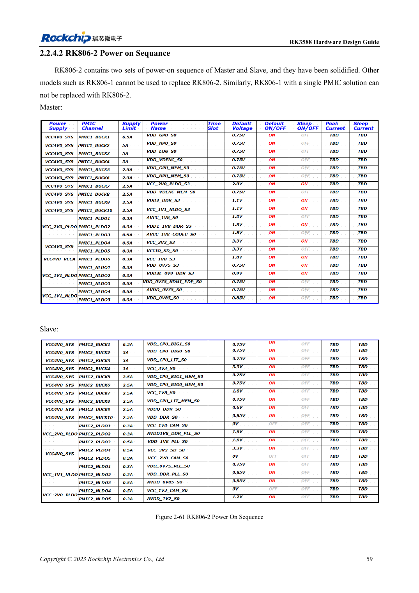

<!-- rk3588-hardware-v13-20261109 -->

# RK3588-Einschaltfolge: RESETn und S0/S3

Grundlage sind die chinesische und englische Ausgabe des RK3588 Hardware Design Guide V1.3 (2023-02-13) für SoC-Platinen und Träger. AIM7- und LM7-Träger müssen den Moduldefinitionen folgen; Sige7 dient zur Software- und Peripherieprüfung. SoC-Funktionen sind keine Boardanschlussliste. SDK/BSP, Kernel, Boardrevision und Firmware prüfen. Werte sind Quellenreferenzen, keine ArmSoM-Messungen.

**RK3588 Hardware Design Guide V1.3 (2023-02-13), EN** · §2.1.10.3; §2.2.1.2–2.2.1.3

## Explizite Folgen haben Vorrang

Niedrige Spannung zuerst ersetzt nicht Vorgaben wie MIPI_D/C_PHY_VDD → 1.8V → 1.2V. Den konkreten Power-Tree statt numerischer Sortierung nutzen. RESETn ≥1ms nach letzter Stabilisierung freigeben und Peripherie beachten. Beim Abschalten RESETn vor dem Entfernen der Versorgung aktivieren.

## Schlaf und Rückspeisung testen

Fester 1.8V-Pin und wählbare Domänenspannung müssen gemeinsam S0 oder S3 sein. Kaltstart, Warmreset, Schlaf und Abschalten messen, einschließlich Rückspeisung durch USB, HDMI und Controller. Träger folgen Moduleingang und Enable, statt interne SoC-Versorgungen nachzubauen.

## Entwurfsparameter und Prüftabelle

| Punkt | Quellenreferenz |
| --- | --- |
| Resetfreigabe | ≥1ms nach Stabilisierung der letzten Schiene |
| Abschalten | RESETn Low → Versorgung aus |
| MIPI-D/C-Referenz | VDD → 1.8V → 1.2V |

## Quellenabbildungen

Die Referenzseiten enthalten die zugehörigen Schalt- oder Zeitdiagramme; für volle Auflösung anklicken. Bezeichner und Werte gehören zum Referenzentwurf, nicht zum Schaltplan eines ArmSoM-Produkts.

Englisches Original · PDF 81 · 2-61

## Entwicklung mit ArmSoM

AIM7 unterstützt Compute-Modul-Träger, LM7 die LGA-Modulintegration und Sige7 frühe Software-/Peripherieerprobung. Vor dem Trägerdesign klären, welche Versorgung, DDR- und Bootschaltungen bereits integriert sind. SoC-Referenzschaltungen nicht unnötig duplizieren. Anschlüsse, herausgeführte Schnittstellen, Pegel und Systemunterstützung anhand der Produktunterlagen prüfen.

- [ArmSoM AIM7](https://www.armsom.org/aim7) · [AIM7 Docs](https://docs.armsom.org/armsom-aim7)
- [ArmSoM Sige7](https://www.armsom.org/sige7) · [Sige7 Docs](https://docs.armsom.org/armsom-sige7)
- [ArmSoM LM7](https://www.armsom.org/lm7) · [LM7 Docs](https://docs.armsom.org/armsom-lm7)

## Weiterlesen

- [RK3588-Hardwaredesign: 30 Themen](/de/articles/rk3588-hardware-design-series/)
- [RK3588-Versorgung: Startanforderungen und ungenutzte PHYs](/de/articles/rk3588-power-rail-planning/)
- [RK3588 und RK806: Einzel- und Doppel-PMIC](/de/articles/rk3588-rk806-pmic-design/)
