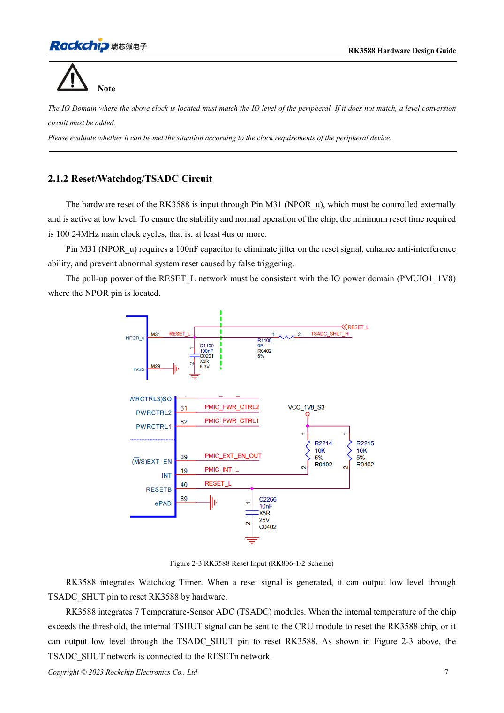
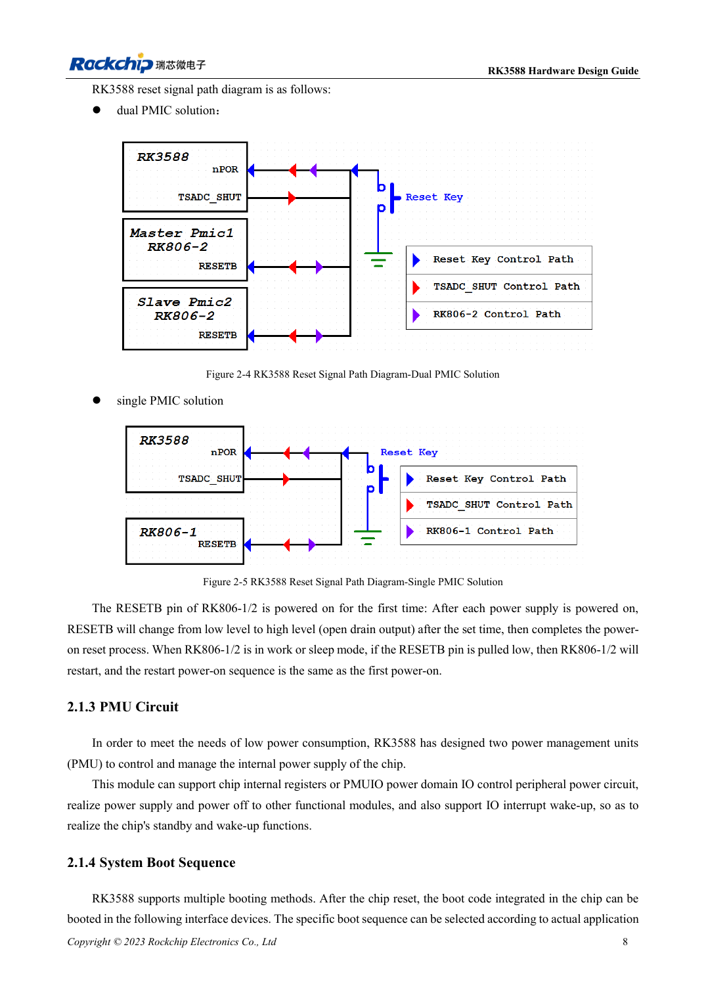

<!-- rk3588-hardware-v13-20261109 -->

# RK3588-Reset, Watchdog und Temperaturschutz

Grundlage sind die chinesische und englische Ausgabe des RK3588 Hardware Design Guide V1.3 (2023-02-13) für SoC-Platinen und Träger. AIM7- und LM7-Träger müssen den Moduldefinitionen folgen; Sige7 dient zur Software- und Peripherieprüfung. SoC-Funktionen sind keine Boardanschlussliste. SDK/BSP, Kernel, Boardrevision und Firmware prüfen. Werte sind Quellenreferenzen, keine ArmSoM-Messungen.

**RK3588 Hardware Design Guide V1.3 (2023-02-13), EN** · §2.1.2; §3.4.1

## Pulsbreite und Startwartezeit unterscheiden

NPOR_u an M31 ist Low-aktiv. Gefordert sind 100 Perioden bei 24MHz und zugleich mindestens 4μs; 100/24MHz≈4.167μs, daher reichen exakt 4.000μs nicht. 100nF nahe am Pin und Pull-up nach PMUIO1_1V8 vorsehen. ≥1ms nach der letzten stabilen Versorgung bis zur Resetfreigabe ist eine separate Vorgabe.

## Gesamtes Resetnetz validieren

RK806-1/2 gibt RESETB nach Startverzögerung frei; Low im Betrieb oder Schlaf wiederholt die Versorgungsfolge. Watchdog und sieben TSADC wirken ebenfalls am Reset mit. RESETn, Spannungen und UART gemeinsam beobachten. Taste → TVS → 100Ω → Filter → CPU/PMIC prüfen; Reset von DC/DC, Metallsteckern und Rand fernhalten.

## Entwurfsparameter und Prüftabelle

| Punkt | Quellenreferenz |
| --- | --- |
| NPOR_u | M31; aktiv Low |
| Mindestreset | 100 Zyklen @24MHz ≈4.167μs |
| Filterkondensator | 100nF |
| Pull-up | PMUIO1_1V8 |

## Quellenabbildungen

Die Referenzseiten enthalten die zugehörigen Schalt- oder Zeitdiagramme; für volle Auflösung anklicken. Bezeichner und Werte gehören zum Referenzentwurf, nicht zum Schaltplan eines ArmSoM-Produkts.

Englisches Original · PDF 29 · 2-3

Englisches Original · PDF 30 · 2-5

## Entwicklung mit ArmSoM

AIM7 unterstützt Compute-Modul-Träger, LM7 die LGA-Modulintegration und Sige7 frühe Software-/Peripherieerprobung. Vor dem Trägerdesign klären, welche Versorgung, DDR- und Bootschaltungen bereits integriert sind. SoC-Referenzschaltungen nicht unnötig duplizieren. Anschlüsse, herausgeführte Schnittstellen, Pegel und Systemunterstützung anhand der Produktunterlagen prüfen.

- [ArmSoM AIM7](https://www.armsom.org/aim7) · [AIM7 Docs](https://docs.armsom.org/armsom-aim7)
- [ArmSoM Sige7](https://www.armsom.org/sige7) · [Sige7 Docs](https://docs.armsom.org/armsom-sige7)
- [ArmSoM LM7](https://www.armsom.org/lm7) · [LM7 Docs](https://docs.armsom.org/armsom-lm7)

## Weiterlesen

- [RK3588-Hardwaredesign: 30 Themen](/de/articles/rk3588-hardware-design-series/)
- [RK3588-Takte: 24MHz, 32kHz und Layout](/de/articles/rk3588-clock-hardware-design/)
- [RK3588-Boot und Recovery: Maskrom, JTAG und UART](/de/articles/rk3588-boot-debug-hardware/)
