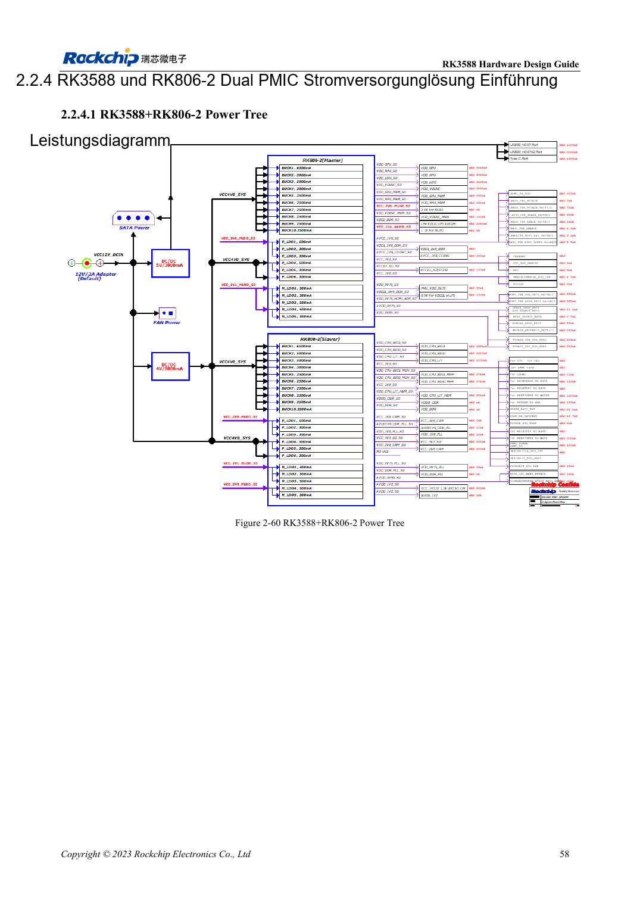
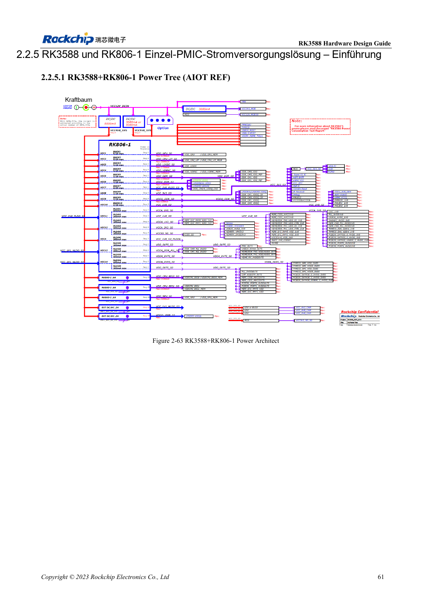

<!-- rk3588-hardware-v13-20261109 -->

# RK3588 und RK806: Einzel- und Doppel-PMIC

Grundlage sind die chinesische und englische Ausgabe des RK3588 Hardware Design Guide V1.3 (2023-02-13) für SoC-Platinen und Träger. AIM7- und LM7-Träger müssen den Moduldefinitionen folgen; Sige7 dient zur Software- und Peripherieprüfung. SoC-Funktionen sind keine Boardanschlussliste. SDK/BSP, Kernel, Boardrevision und Firmware prüfen. Werte sind Quellenreferenzen, keine ArmSoM-Messungen.

**RK3588 Hardware Design Guide V1.3 (2023-02-13), EN** · §2.2.3–2.2.5

## Vollständige Referenz wählen

Zwei RK806-2 und ein RK806-1 mit externen Versorgungen sind unterschiedliche Architekturen. Ausgangszuordnung, Standardspannungen, Sequenz, Bus, Schlaf und Reset gemeinsam übernehmen. 2.7–5.5V am PMIC sind keine ArmSoM-Board-Eingangsspezifikation.

## Synchronisierung und Layout

EXT_EN legt Master/Slave fest; SYNC/SYNC_CLK synchronisieren die zwei PMICs, VDC/PWRON/RESET nach Referenz verbinden. Ein PMIC arbeitet als Master mit offenen SYNC/SYNC_CLK. Hochstrompfade, Kondensator-Masserückwege und Wärmeverteilung prüfen. Maximalstrom ist keine Dauerstromgarantie bei jeder Temperatur.

## Entwurfsparameter und Prüftabelle

| Punkt | Quellenreferenz |
| --- | --- |
| RK806-Eingang | 2.7–5.5V |
| Gehäuse | 7×7mm QFN68 |
| Zwei-PMIC-Referenz | RK806-2 |
| Ein-PMIC-Referenz | RK806-1 + externe Versorgung |

## Quellenabbildungen

Die Referenzseiten enthalten die zugehörigen Schalt- oder Zeitdiagramme; für volle Auflösung anklicken. Bezeichner und Werte gehören zum Referenzentwurf, nicht zum Schaltplan eines ArmSoM-Produkts.

Englisches Original · PDF 80 · 2-60

Englisches Original · PDF 83 · 2-63

## Entwicklung mit ArmSoM

AIM7 unterstützt Compute-Modul-Träger, LM7 die LGA-Modulintegration und Sige7 frühe Software-/Peripherieerprobung. Vor dem Trägerdesign klären, welche Versorgung, DDR- und Bootschaltungen bereits integriert sind. SoC-Referenzschaltungen nicht unnötig duplizieren. Anschlüsse, herausgeführte Schnittstellen, Pegel und Systemunterstützung anhand der Produktunterlagen prüfen.

- [ArmSoM AIM7](https://www.armsom.org/aim7) · [AIM7 Docs](https://docs.armsom.org/armsom-aim7)
- [ArmSoM Sige7](https://www.armsom.org/sige7) · [Sige7 Docs](https://docs.armsom.org/armsom-sige7)
- [ArmSoM LM7](https://www.armsom.org/lm7) · [LM7 Docs](https://docs.armsom.org/armsom-lm7)

## Weiterlesen

- [RK3588-Hardwaredesign: 30 Themen](/de/articles/rk3588-hardware-design-series/)
- [RK3588-Einschaltfolge: RESETn und S0/S3](/de/articles/rk3588-power-sequencing-design/)
- [RK3588-DDR-Schaltung: LPDDR4/4X/5 und Kapazität](/de/articles/rk3588-ddr-circuit-design/)
