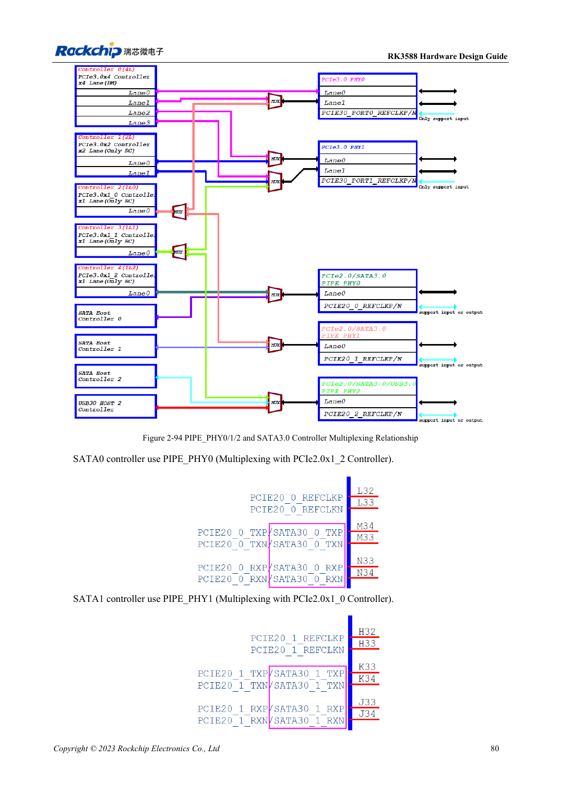

<!-- rk3588-hardware-v13-20261109 -->

# RK3588-SATA: drei Controller und gemeinsame PHYs

Grundlage sind die chinesische und englische Ausgabe des RK3588 Hardware Design Guide V1.3 (2023-02-13) für SoC-Platinen und Träger. AIM7- und LM7-Träger müssen den Moduldefinitionen folgen; Sige7 dient zur Software- und Peripherieprüfung. SoC-Funktionen sind keine Boardanschlussliste. SDK/BSP, Kernel, Boardrevision und Firmware prüfen. Werte sind Quellenreferenzen, keine ArmSoM-Messungen.

**RK3588 Hardware Design Guide V1.3 (2023-02-13), EN** · §2.3.5; §3.4.9

## Zuerst Muxmatrix erstellen

SATA0/1/2 nutzen PIPE_PHY0/1/2 gemeinsam mit PCIe; PHY2 betrifft auch USB3 HOST2. 1.5/3/6Gbps und Port Multiplier bedeuten weder drei herausgeführte SATA-Ports auf jedem ArmSoM-Board noch volle Bandbreite je Gerät. Ports vor Software- und Steckerzuordnung auswählen.

## Signale und Laufwerksversorgung getrennt prüfen

Die Referenz nutzt 10nF in TX und RX, vorzugsweise 0201; PCIe-Werte nicht kopieren. SATA_CP_DET, MP_SWITCH und CP_POD sind gemeinsame Steuerressourcen; Hotplug gezielt auslegen. Externe Versorgung auf Anlaufstrom prüfen sowie Dauerwrites, Fehler, Hotplug und Stromausfall-Recovery testen.

## Entwurfsparameter und Prüftabelle

| Punkt | Quellenreferenz |
| --- | --- |
| SATA-Kopplung | 10nF ±20%; TX und RX |
| Differenzziel | 100Ω ±10%; Quellenalternative 90Ω ±10% |
| Länge/Paardifferenz | <6in / <6mil |
| Empfohlene Viazahl | Empfohlen ≤2 |

## Quellenabbildungen

Die Referenzseiten enthalten die zugehörigen Schalt- oder Zeitdiagramme; für volle Auflösung anklicken. Bezeichner und Werte gehören zum Referenzentwurf, nicht zum Schaltplan eines ArmSoM-Produkts.

Englisches Original · PDF 102 · 2-94

## Entwicklung mit ArmSoM

AIM7 unterstützt Compute-Modul-Träger, LM7 die LGA-Modulintegration und Sige7 frühe Software-/Peripherieerprobung. Vor dem Trägerdesign klären, welche Versorgung, DDR- und Bootschaltungen bereits integriert sind. SoC-Referenzschaltungen nicht unnötig duplizieren. Anschlüsse, herausgeführte Schnittstellen, Pegel und Systemunterstützung anhand der Produktunterlagen prüfen.

- [ArmSoM AIM7](https://www.armsom.org/aim7) · [AIM7 Docs](https://docs.armsom.org/armsom-aim7)
- [ArmSoM Sige7](https://www.armsom.org/sige7) · [Sige7 Docs](https://docs.armsom.org/armsom-sige7)
- [ArmSoM LM7](https://www.armsom.org/lm7) · [LM7 Docs](https://docs.armsom.org/armsom-lm7)

## Weiterlesen

- [RK3588-Hardwaredesign: 30 Themen](/de/articles/rk3588-hardware-design-series/)
- [RK3588-USB und Type-C: Controller, PHYs und Recovery](/de/articles/rk3588-usb-typec-hardware-design/)
- [RK3588-PCIe: Lanes, Referenztakte und Versorgung](/de/articles/rk3588-pcie-hardware-design/)
