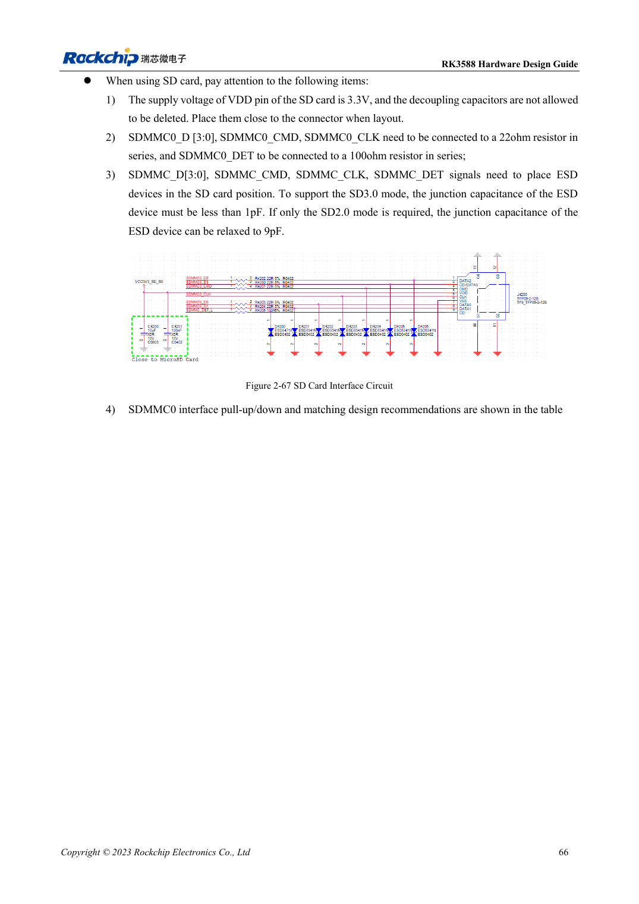

<!-- rk3588-hardware-v13-20261109 -->

# RK3588-SDMMC und SDIO-WLAN: Pegelwechsel und Schutz

Grundlage sind die chinesische und englische Ausgabe des RK3588 Hardware Design Guide V1.3 (2023-02-13) für SoC-Platinen und Träger. AIM7- und LM7-Träger müssen den Moduldefinitionen folgen; Sige7 dient zur Software- und Peripherieprüfung. SoC-Funktionen sind keine Boardanschlussliste. SDK/BSP, Kernel, Boardrevision und Firmware prüfen. Werte sind Quellenreferenzen, keine ArmSoM-Messungen.

**RK3588 Hardware Design Guide V1.3 (2023-02-13), EN** · §2.3.1; §3.4.15–3.4.16; §3.4.21

## Kartenversorgung und IO unterscheiden

SD-VDD beträgt 3.3V. VCCIO2 nach SD3.0-Aushandlung auf 1.8V umzuschalten bedeutet nicht, die Karte mit 1.8V zu versorgen. SDMMC/JTAG-Auswahl hängt von SDMMC_DET ab. Referenz: 22Ω an Daten/CMD/CLK, 100Ω an DET sowie Abblockung und ESD am Sockel.

## WLAN braucht Takt- und HF-Prüfung

Modul-IO, UART/PCM-Richtung und 32.768kHz-Amplitude prüfen; π-Anpassung der Antenne vorsehen. Quarzlast zum Modul wählen; die Anleitung nennt 10ppm bei Raumtemperatur. SD3.0-ESD-Kapazität muss <1pF sein. Verbindung, Durchsatz, Schlaf/Aufwachen und Versorgungszyklen testen.

## Entwurfsparameter und Prüftabelle

| Punkt | Quellenreferenz |
| --- | --- |
| SD-Karten-VDD | 3.3V |
| SD3.0-ESD-Kapazität | <1pF |
| ESD nur für SD2.0 | ≤9pF |
| Data/CMD/CLK; DET | 22Ω; 100Ω |
| PCB-Impedanz/Länge | 50Ω ±10% / <4in |
| Takt-Daten-Differenz | <120mil |

## Quellenabbildungen

Die Referenzseiten enthalten die zugehörigen Schalt- oder Zeitdiagramme; für volle Auflösung anklicken. Bezeichner und Werte gehören zum Referenzentwurf, nicht zum Schaltplan eines ArmSoM-Produkts.

Englisches Original · PDF 88 · 2-67

## Entwicklung mit ArmSoM

AIM7 unterstützt Compute-Modul-Träger, LM7 die LGA-Modulintegration und Sige7 frühe Software-/Peripherieerprobung. Vor dem Trägerdesign klären, welche Versorgung, DDR- und Bootschaltungen bereits integriert sind. SoC-Referenzschaltungen nicht unnötig duplizieren. Anschlüsse, herausgeführte Schnittstellen, Pegel und Systemunterstützung anhand der Produktunterlagen prüfen.

- [ArmSoM AIM7](https://www.armsom.org/aim7) · [AIM7 Docs](https://docs.armsom.org/armsom-aim7)
- [ArmSoM Sige7](https://www.armsom.org/sige7) · [Sige7 Docs](https://docs.armsom.org/armsom-sige7)
- [ArmSoM LM7](https://www.armsom.org/lm7) · [LM7 Docs](https://docs.armsom.org/armsom-lm7)

## Weiterlesen

- [RK3588-Hardwaredesign: 30 Themen](/de/articles/rk3588-hardware-design-series/)
- [RK3588-FSPI-Flash: Boot, Versorgung und Anpassung](/de/articles/rk3588-fspi-boot-hardware/)
- [RK3588-USB und Type-C: Controller, PHYs und Recovery](/de/articles/rk3588-usb-typec-hardware-design/)
