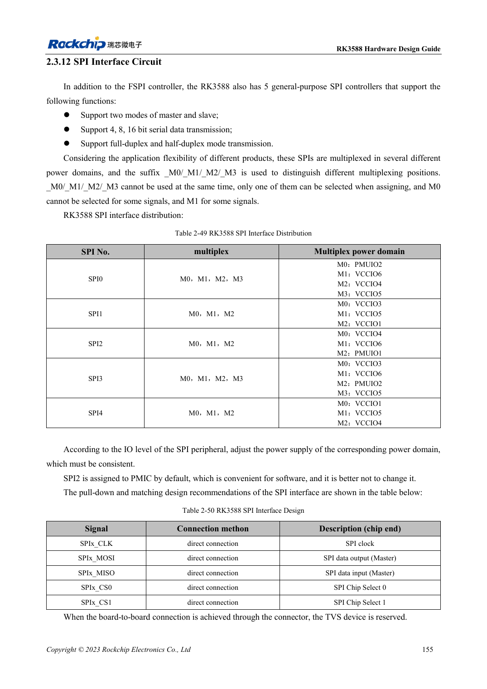

<!-- rk3588-hardware-v13-20261109 -->

# RK3588-UART, SPI, CAN, I2C und PWM zuordnen

Grundlage sind die chinesische und englische Ausgabe des RK3588 Hardware Design Guide V1.3 (2023-02-13) für SoC-Platinen und Träger. AIM7- und LM7-Träger müssen den Moduldefinitionen folgen; Sige7 dient zur Software- und Peripherieprüfung. SoC-Funktionen sind keine Boardanschlussliste. SDK/BSP, Kernel, Boardrevision und Firmware prüfen. Werte sind Quellenreferenzen, keine ArmSoM-Messungen.

**RK3588 Hardware Design Guide V1.3 (2023-02-13), EN** · §2.3.11–2.3.15

## Muxgruppen nicht mischen

M0/M1/M2 bei UART, SPI, CAN und I2C sind Alternativen, keine zusätzlichen Controller. Eine vollständige unterstützte Gruppe und ihre Versorgung prüfen. SPI2 ist standardmäßig für den PMIC vorgesehen. CAN braucht einen externen Transceiver; SoC-TX/RX sind keine differenziellen Busleitungen.

## Protokolle getrennt von Pintabellen prüfen

I2C nutzt 2.2kΩ als Referenz, angepasst an Last und Pegel; HDMI-DDC ist dediziert. V1.3 nennt CAN2.0B mit 1Mbps, keine CAN-FD-Zusage. PMUIO3/4/5/6 in der I2C-Tabelle passen nicht zur Domänentabelle. Vor Pinbelegung mit TRM und Schaltplan klären.

## Entwurfsparameter und Prüftabelle

| Punkt | Quellenreferenz |
| --- | --- |
| UART / allgemeines SPI | 10 / 5 Controller |
| CAN-Quellenumfang | 3 Controller; CAN2.0B; 1Mbps |
| I2C-Referenz | Bis 400Kbit/s; 2.2kΩ Pull-up |
| PWM-Anzahl der Quelle | 4 Controller ×4 Kanäle |

## Quellenabbildungen

Die Referenzseiten enthalten die zugehörigen Schalt- oder Zeitdiagramme; für volle Auflösung anklicken. Bezeichner und Werte gehören zum Referenzentwurf, nicht zum Schaltplan eines ArmSoM-Produkts.

Englisches Original · PDF 177 · table:2-50

## Entwicklung mit ArmSoM

AIM7 unterstützt Compute-Modul-Träger, LM7 die LGA-Modulintegration und Sige7 frühe Software-/Peripherieerprobung. Vor dem Trägerdesign klären, welche Versorgung, DDR- und Bootschaltungen bereits integriert sind. SoC-Referenzschaltungen nicht unnötig duplizieren. Anschlüsse, herausgeführte Schnittstellen, Pegel und Systemunterstützung anhand der Produktunterlagen prüfen.

- [ArmSoM AIM7](https://www.armsom.org/aim7) · [AIM7 Docs](https://docs.armsom.org/armsom-aim7)
- [ArmSoM Sige7](https://www.armsom.org/sige7) · [Sige7 Docs](https://docs.armsom.org/armsom-sige7)
- [ArmSoM LM7](https://www.armsom.org/lm7) · [LM7 Docs](https://docs.armsom.org/armsom-lm7)

## Weiterlesen

- [RK3588-Hardwaredesign: 30 Themen](/de/articles/rk3588-hardware-design-series/)
- [RK3588-GPIO und SARADC: Domänen und Tasten](/de/articles/rk3588-gpio-saradc-hardware/)
- [RK3588-Lagenaufbau und Fanout: HDI oder PTH](/de/articles/rk3588-pcb-stackup-fanout/)
