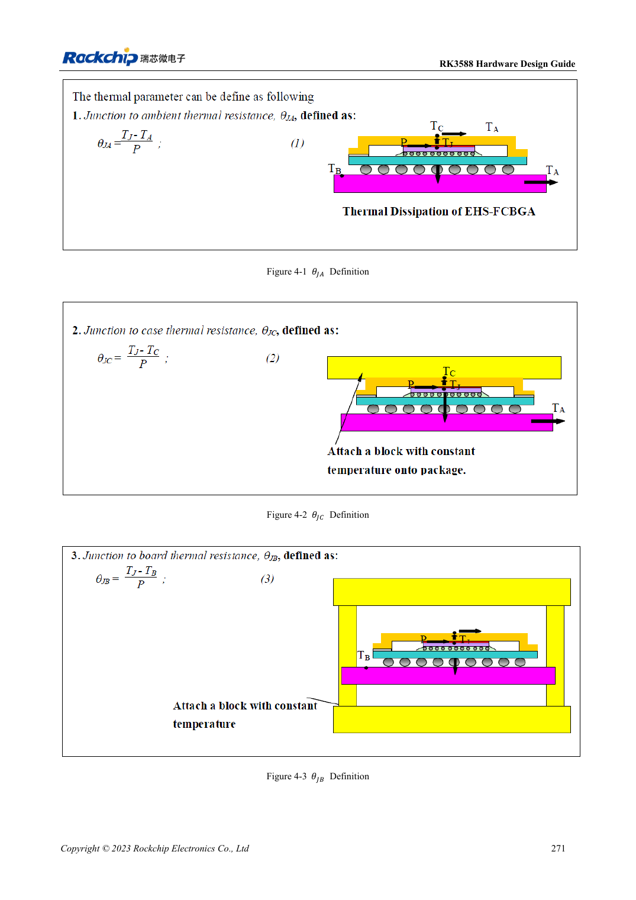

<!-- rk3588-hardware-v13-20261109 -->

# RK3588-Thermik: Referenzwärmewiderstand und Systemprüfung

Grundlage sind die chinesische und englische Ausgabe des RK3588 Hardware Design Guide V1.3 (2023-02-13) für SoC-Platinen und Träger. AIM7- und LM7-Träger müssen den Moduldefinitionen folgen; Sige7 dient zur Software- und Peripherieprüfung. SoC-Funktionen sind keine Boardanschlussliste. SDK/BSP, Kernel, Boardrevision und Firmware prüfen. Werte sind Quellenreferenzen, keine ArmSoM-Messungen.

**RK3588 Hardware Design Guide V1.3 (2023-02-13), EN** · §4

## Simulation ist keine Modul-Temperaturerhöhung

Tabelle 4-1 stammt aus einem konkreten Gehäuse-/JEDEC-FEM-Modell: 101×114mm, 1.6mm, zehn Lagen, ohne Kühlkörper. Nicht direkt auf AIM7, LM7-Träger oder Sige7-Gehäuse übertragen. θJA, θJB und θJC haben unterschiedliche Bezugspunkte und sind nicht austauschbar.

## Wärmepfad und Schutz gemeinsam prüfen

Pfad zu Wärmeinterface, Kühler, Gehäuse und Umgebung, Anpressdruck und Isolation prüfen. 20–50mm zwischen RK3588/RK806 sind eine Boardreferenz, kein Umbauauftrag für Module. Dauerlast, Takt, Temperatur und Anwendungslatenz mit realer BSP-Thermik testen; Schutzabschaltung belegt keine Leistung.

## Entwurfsparameter und Prüftabelle

| Punkt | Quellenreferenz |
| --- | --- |
| Quellen-θJA / θJB / θJC | 8.7 / 3.5 / 0.12 °C/W; Simulation |
| Quellen-PCB | 101×114mm; 1.6mm; 10 Lagen |
| Referenzabstand PMIC–SoC | RK3588–RK806: 20–50mm |

## Quellenabbildungen

Die Referenzseiten enthalten die zugehörigen Schalt- oder Zeitdiagramme; für volle Auflösung anklicken. Bezeichner und Werte gehören zum Referenzentwurf, nicht zum Schaltplan eines ArmSoM-Produkts.

Englisches Original · PDF 293 · 4-1

## Entwicklung mit ArmSoM

AIM7 unterstützt Compute-Modul-Träger, LM7 die LGA-Modulintegration und Sige7 frühe Software-/Peripherieerprobung. Vor dem Trägerdesign klären, welche Versorgung, DDR- und Bootschaltungen bereits integriert sind. SoC-Referenzschaltungen nicht unnötig duplizieren. Anschlüsse, herausgeführte Schnittstellen, Pegel und Systemunterstützung anhand der Produktunterlagen prüfen.

- [ArmSoM AIM7](https://www.armsom.org/aim7) · [AIM7 Docs](https://docs.armsom.org/armsom-aim7)
- [ArmSoM Sige7](https://www.armsom.org/sige7) · [Sige7 Docs](https://docs.armsom.org/armsom-sige7)
- [ArmSoM LM7](https://www.armsom.org/lm7) · [LM7 Docs](https://docs.armsom.org/armsom-lm7)

## Weiterlesen

- [RK3588-Hardwaredesign: 30 Themen](/de/articles/rk3588-hardware-design-series/)
- [RK3588-Power-PCB und PDN: Kupfer, Rückwege und Abblockung](/de/articles/rk3588-power-pcb-pdn-design/)
- [RK3588-ESD und EMI: Schnittstellenschutz und Rückwege](/de/articles/rk3588-esd-emi-hardware-design/)
