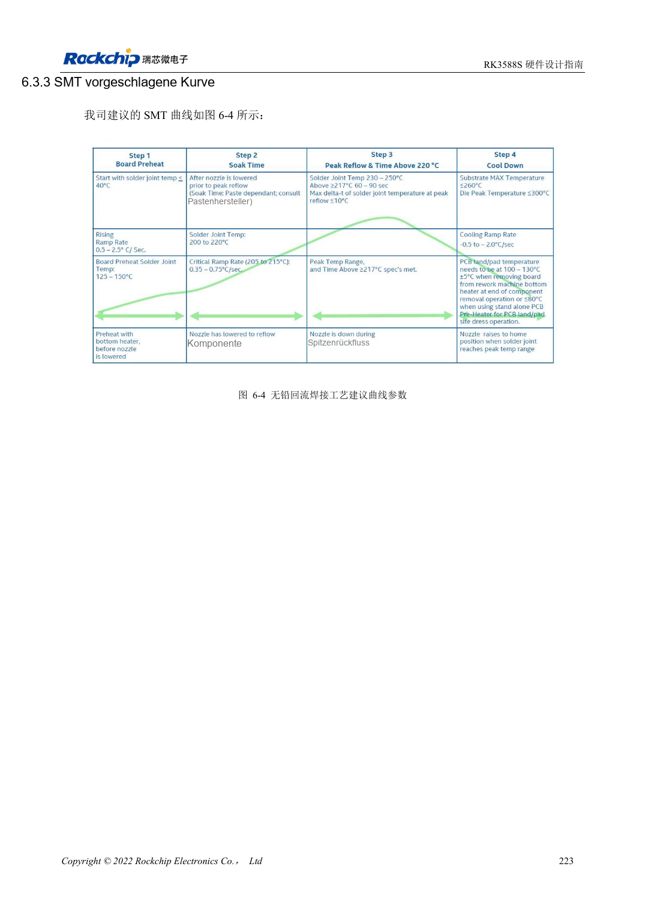
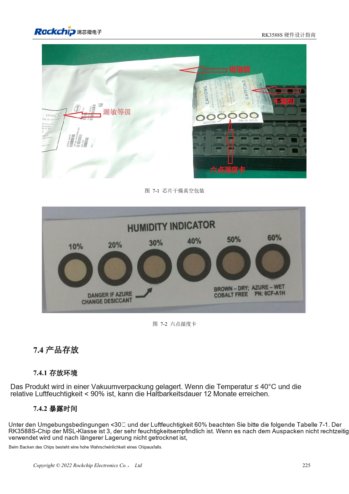

<!-- rk3588s-hardware-v12-20261109 -->

# RK3588S-Montage und Lagerung: Reflow, MSL3 und Backprotokoll

Grundlage ist der chinesische RK3588S Hardware Design Guide V1.2 (2023-12-14) zur Schaltungs- und PCB-Prüfung. CM7S-Träger folgen den Modulschnittstellen; Sige7S dient der Software-/Peripherieerprobung. SoC-Funktionen sind keine Boardanschlussliste. SDK/BSP, Kernel, Revision, Firmware und Multiplexing prüfen. Werte sind Quellenreferenzen, keine ArmSoM-Messungen.

**RK3588S Hardware Design Guide V1.2 (2023-12-14), CN** · §6–7

## Prozessgrenzen gelten für das Chipgehäuse

Das Reflowprofil gilt für RK3588S, nicht als Freigabe zum Reflow eines vollständigen CM7S-Moduls oder Sige7S-Boards. Lötpastenreferenz: 2–10°C Lagerung und 3–4 Stunden Raumtemperatur-Aufwärmung. Fertigung muss Legierung, Flussmittel, Wärmekapazität und Steckergrenzen abstimmen. Modulanschlüsse nach Produktmontageunterlagen ausführen.

## Kumulative Feuchteexposition erfassen

RK3588S ist MSL3 mit 168 Stunden Offenzeit bei ≤30°C/60%RH. Feuchtekarte, Öffnungszeit und Lagerung protokollieren; erneutes Versiegeln setzt die Zeit nicht automatisch zurück. Tabelle 7-2 unterscheidet Überschreitung über/bis 72 Stunden und Backtemperatur bei Gehäuse ≤1.4mm. 300°C in der MSL1-Zeile sind fragwürdig und keine hier verwendete Fertigungsbedingung.

## Entwurfsparameter und Prüftabelle

| Punkt | Quellenreferenz |
| --- | --- |
| MSL3-Offenzeit | 168h bei ≤30°C /60%RH |
| Trocknung 125°C +10/-0°C (Überschreitung >72h / ≤72h) | 9h /7h |
| Trocknung 90°C +8/-0°C (Überschreitung >72h / ≤72h) | 33h /23h |
| Trocknung 40°C +5/-0°C (Überschreitung >72h / ≤72h) | 13 Tage /9 Tage |
| Gehäusegrenze der Trocknungstabelle | Dicke ≤1.4mm |

## Quellenabbildungen

Für diese Reihe liegt kein entsprechendes englisches Designhandbuch vor. Alle vier Fassungen nutzen chinesische Originalausschnitte mit lokalisierten Beschriftungen. Bilder lassen sich in voller Auflösung öffnen; Text und Parametertabellen bleiben kopierbar. Seitenangaben beziehen sich auf physische PDF-Seiten.

Chinesisches Original · PDF 238 · 6-4

Chinesisches Original · PDF 240 · 7-2

## Entwicklung mit ArmSoM

CM7S eignet sich für eigene Träger: zunächst integrierte Versorgung, DDR und Bootschaltungen bestimmen, dann außerhalb der Modulstecker planen. Sige7S dient als Ausgangspunkt für Software-/Peripherieerprobung. Bei beiden Produkten herausgeführte Interfaces, Pins, Pegel, Images und Kühlung revisionsbezogen prüfen. Ein Chipreferenzplan ist kein Produktanschlussplan.

- [ArmSoM CM7S](https://www.armsom.org/cm7s) · [CM7S Docs](https://docs.armsom.org/armsom-cm7s)
- [ArmSoM Sige7S](https://www.armsom.org/sige7s) · [Sige7S Docs](https://docs.armsom.org/armsom-sige7s)

## Weiterlesen

- [RK3588S-Hardwaredesign: 30 Themen](/de/articles/rk3588s-hardware-design-series/)
- [RK3588S-ESD und EMI: Schnittstellenschutz und Rückwege](/de/articles/rk3588s-esd-emi-hardware-design/)
