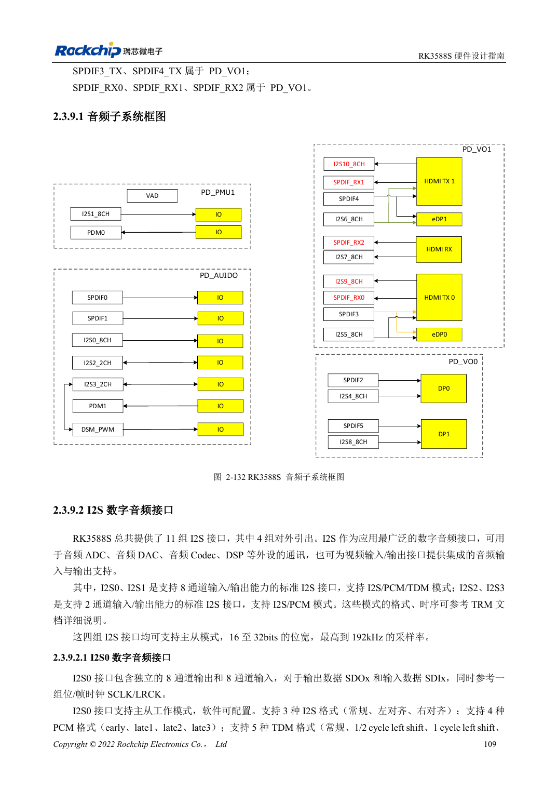
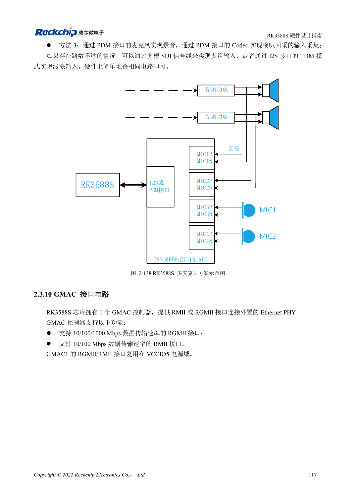

<!-- rk3588s-hardware-v12-20261109 -->

# RK3588S-Audiohardware: I2S, PDM und Mikrofonarrays

Grundlage ist der chinesische RK3588S Hardware Design Guide V1.2 (2023-12-14) zur Schaltungs- und PCB-Prüfung. CM7S-Träger folgen den Modulschnittstellen; Sige7S dient der Software-/Peripherieerprobung. SoC-Funktionen sind keine Boardanschlussliste. SDK/BSP, Kernel, Revision, Firmware und Multiplexing prüfen. Werte sind Quellenreferenzen, keine ArmSoM-Messungen.

**RK3588S Hardware Design Guide V1.2 (2023-12-14), CN** · §2.3.9; §3.4.18

## Interne und externe Schnittstellen trennen

Nur vier von elf I2S sind extern, andere dienen Video. I2S0/1 unterstützen acht Kanäle und I2S/PCM/TDM, I2S2/3 zwei Kanäle I2S/PCM. Interne Zahlen sind keine Trägerportzahlen. Nach Codec/ADC/DAC Master/Slave, MCLK, SCLK/LRCK, Wortbreite und Abtastrate festlegen.

## Takte und Analogpfade gemeinsam prüfen

Takte mehrerer I2S/PDM-Geräte als Daisy-Chain ohne lange Äste führen. Empfohlen sind 22Ω am SoC und getrennte Masseabschirmung der Takte. Mikrofone und Verstärker von DDR, Display, HF und Induktivitäten fernhalten. Arrays mit Wiedergabereferenz brauchen Synchronisations- und Softwarezuordnungsprüfung.

## Entwurfsparameter und Prüftabelle

| Punkt | Quellenreferenz |
| --- | --- |
| Externe I2S | 4 Gruppen |
| I2S0/1; I2S2/3 | 8 Kanäle; 2 Kanäle |
| Quellenbreite/Abtastrate | 16–32bit / bis 192kHz |
| Takt-Serienreferenz | 22Ω |

## Quellenabbildungen

Für diese Reihe liegt kein entsprechendes englisches Designhandbuch vor. Alle vier Fassungen nutzen chinesische Originalausschnitte mit lokalisierten Beschriftungen. Bilder lassen sich in voller Auflösung öffnen; Text und Parametertabellen bleiben kopierbar. Seitenangaben beziehen sich auf physische PDF-Seiten.

Chinesisches Original · PDF 124 · 2-132

Chinesisches Original · PDF 132 · 2-138

## Entwicklung mit ArmSoM

CM7S eignet sich für eigene Träger: zunächst integrierte Versorgung, DDR und Bootschaltungen bestimmen, dann außerhalb der Modulstecker planen. Sige7S dient als Ausgangspunkt für Software-/Peripherieerprobung. Bei beiden Produkten herausgeführte Interfaces, Pins, Pegel, Images und Kühlung revisionsbezogen prüfen. Ein Chipreferenzplan ist kein Produktanschlussplan.

- [ArmSoM CM7S](https://www.armsom.org/cm7s) · [CM7S Docs](https://docs.armsom.org/armsom-cm7s)
- [ArmSoM Sige7S](https://www.armsom.org/sige7s) · [Sige7S Docs](https://docs.armsom.org/armsom-sige7s)

## Weiterlesen

- [RK3588S-Hardwaredesign: 30 Themen](/de/articles/rk3588s-hardware-design-series/)
- [RK3588S-DP und eDP: PHYs, AUX und Kopplung](/de/articles/rk3588s-dp-edp-hardware-design/)
- [RK3588S-Ethernet: GMAC, PHY und Taktrichtung](/de/articles/rk3588s-gmac-hardware-design/)
