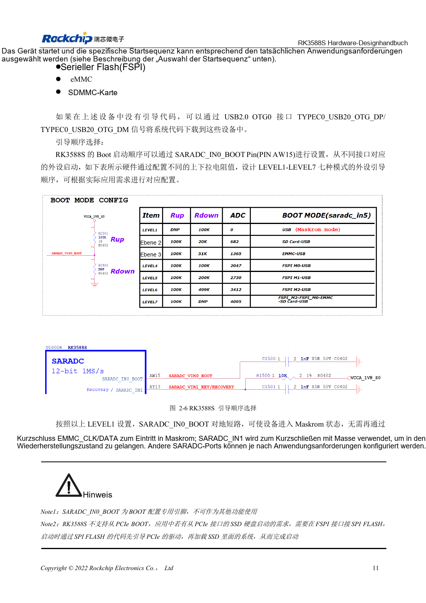
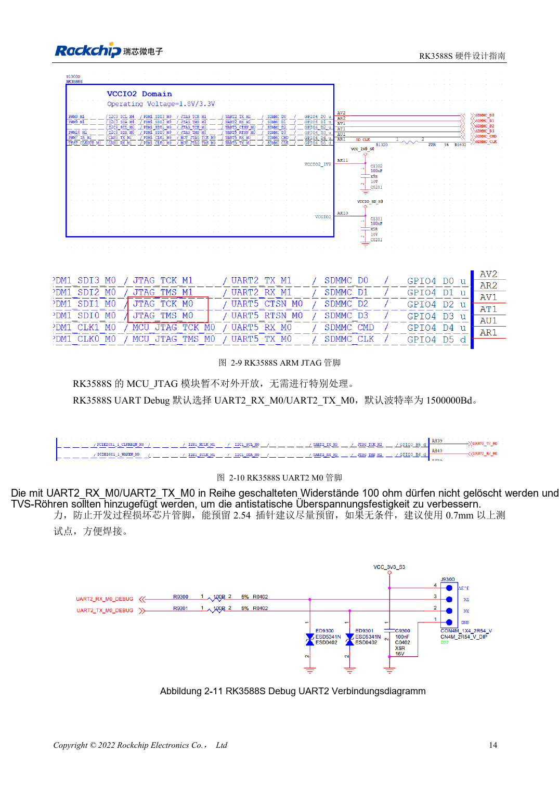

<!-- rk3588s-hardware-v12-20261109 -->

# RK3588S-Boot und Recovery: Maskrom, JTAG und UART

Grundlage ist der chinesische RK3588S Hardware Design Guide V1.2 (2023-12-14) zur Schaltungs- und PCB-Prüfung. CM7S-Träger folgen den Modulschnittstellen; Sige7S dient der Software-/Peripherieerprobung. SoC-Funktionen sind keine Boardanschlussliste. SDK/BSP, Kernel, Revision, Firmware und Multiplexing prüfen. Werte sind Quellenreferenzen, keine ArmSoM-Messungen.

**RK3588S Hardware Design Guide V1.2 (2023-12-14), CN** · §2.1.4–2.1.6; §2.3.2

## Recovery-Pfad erhalten

SARADC_IN0_BOOT an AW15 dient nur der Startauswahl; LEVEL1 wählt Maskrom. USB2.0 OTG0 für Downloads erhalten. Das ROM startet nicht direkt von PCIe-SSD: FSPI-Code initialisiert PCIe und lädt anschließend das SSD-System. Ein OS auf NVMe bedeutet keinen nativen NVMe-ROM-Boot.

## Debug und Pull-ups erhalten

SDMMC_DET vor Resetende stabilisieren: Low für SDMMC, High für ARM JTAG. Logs standardmäßig über UART2_M0 mit 1500000bps; 100Ω in RX/TX und TVS erhalten. 10kΩ an SARADC_IN1 vermeiden einen undefinierten Recovery-Eingang. Bei Modulen Steckerpins und Pegel prüfen, nicht SoC-Ballpositionen übernehmen.

## Entwurfsparameter und Prüftabelle

| Punkt | Quellenreferenz |
| --- | --- |
| Boot-Pin | SARADC_IN0_BOOT / AW15 |
| Debugging | UART2_M0 / 1500000bps |
| SDMMC_DET | 0: SDMMC; 1: ARM JTAG |
| Recovery-Pull-up | SARADC_IN1: 10kΩ |

## Quellenabbildungen

Für diese Reihe liegt kein entsprechendes englisches Designhandbuch vor. Alle vier Fassungen nutzen chinesische Originalausschnitte mit lokalisierten Beschriftungen. Bilder lassen sich in voller Auflösung öffnen; Text und Parametertabellen bleiben kopierbar. Seitenangaben beziehen sich auf physische PDF-Seiten.

Chinesisches Original · PDF 26 · 2-6

Chinesisches Original · PDF 29 · 2-10

## Entwicklung mit ArmSoM

CM7S eignet sich für eigene Träger: zunächst integrierte Versorgung, DDR und Bootschaltungen bestimmen, dann außerhalb der Modulstecker planen. Sige7S dient als Ausgangspunkt für Software-/Peripherieerprobung. Bei beiden Produkten herausgeführte Interfaces, Pins, Pegel, Images und Kühlung revisionsbezogen prüfen. Ein Chipreferenzplan ist kein Produktanschlussplan.

- [ArmSoM CM7S](https://www.armsom.org/cm7s) · [CM7S Docs](https://docs.armsom.org/armsom-cm7s)
- [ArmSoM Sige7S](https://www.armsom.org/sige7s) · [Sige7S Docs](https://docs.armsom.org/armsom-sige7s)

## Weiterlesen

- [RK3588S-Hardwaredesign: 30 Themen](/de/articles/rk3588s-hardware-design-series/)
- [RK3588S-Reset, Watchdog und Temperaturschutz](/de/articles/rk3588s-reset-watchdog-hardware/)
- [RK3588S-Versorgung: Startanforderungen und ungenutzte PHYs](/de/articles/rk3588s-power-rail-planning/)
