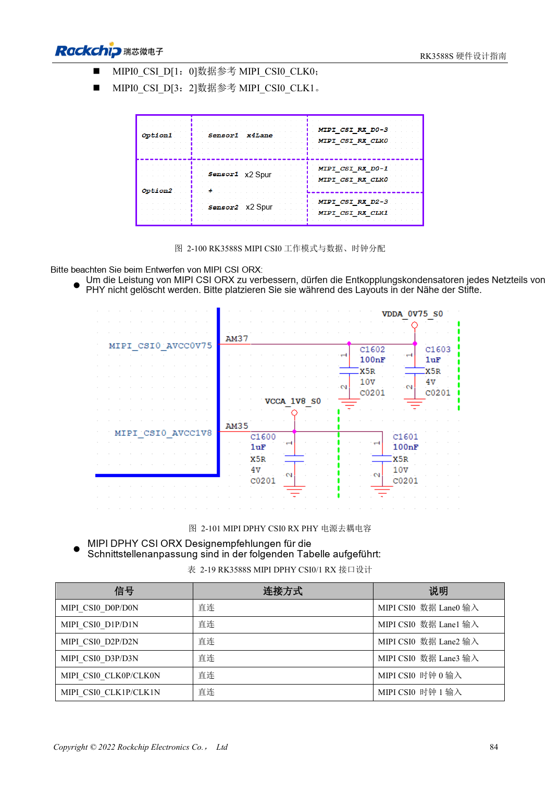
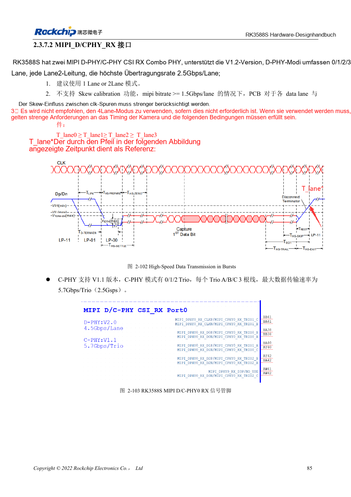

<!-- rk3588s-hardware-v12-20261109 -->

# RK3588S-Kameras: CSI, D/C-PHY und CIF planen

Grundlage ist der chinesische RK3588S Hardware Design Guide V1.2 (2023-12-14) zur Schaltungs- und PCB-Prüfung. CM7S-Träger folgen den Modulschnittstellen; Sige7S dient der Software-/Peripherieerprobung. SoC-Funktionen sind keine Boardanschlussliste. SDK/BSP, Kernel, Revision, Firmware und Multiplexing prüfen. Werte sind Quellenreferenzen, keine ArmSoM-Messungen.

**RK3588S Hardware Design Guide V1.2 (2023-12-14), CN** · §2.3.7.1–2.3.7.3; §3.4.10; §3.4.22

## Dedizierten und Combo-PHY getrennt planen

RK3588S besitzt einen dedizierten DPHY RX für 1×4 oder 2×2 Lanes sowie zwei D/C-Combo-Empfänger. Referenzrate des dedizierten DPHY: 2.5Gbps/lane. Combo-DPHY unterstützt keine Skew-Kalibrierung und bevorzugt eine oder zwei Lanes. Vier Lanes erfordern T_lane0≥T_lane1≥T_lane2≥T_lane3; ab ≥1.5Gbps/lane Timing besonders prüfen.

## CIF-Pegel und Systemprüfung

CIF liegt in VCCIO5/VCCIO6; beide Versorgungen samt I2C-Pull-ups müssen zum Sensor passen. MIPI-Verdrahtung belegt keine BSP-Unterstützung: Treiber, Device Tree und ISP-Konfiguration bleiben nötig. Erst einen Stream, dann Mehrfachbetrieb, Dauerlast, Bildverluste, Taktstabilität und Temperatur prüfen.

## Entwurfsparameter und Prüftabelle

| Punkt | Quellenreferenz |
| --- | --- |
| Rate des dedizierten DPHY RX | 2.5Gbps/lane |
| DPHY-Zielimpedanz | 100Ω ±10%; Alternative 95Ω ±10% |
| DPHY-Paar-/Takt-Daten-Differenz | <6mil / <12mil |

## Quellenabbildungen

Für diese Reihe liegt kein entsprechendes englisches Designhandbuch vor. Alle vier Fassungen nutzen chinesische Originalausschnitte mit lokalisierten Beschriftungen. Bilder lassen sich in voller Auflösung öffnen; Text und Parametertabellen bleiben kopierbar. Seitenangaben beziehen sich auf physische PDF-Seiten.

Chinesisches Original · PDF 99 · 2-100

Chinesisches Original · PDF 100 · 2-102

## Entwicklung mit ArmSoM

CM7S eignet sich für eigene Träger: zunächst integrierte Versorgung, DDR und Bootschaltungen bestimmen, dann außerhalb der Modulstecker planen. Sige7S dient als Ausgangspunkt für Software-/Peripherieerprobung. Bei beiden Produkten herausgeführte Interfaces, Pins, Pegel, Images und Kühlung revisionsbezogen prüfen. Ein Chipreferenzplan ist kein Produktanschlussplan.

- [ArmSoM CM7S](https://www.armsom.org/cm7s) · [CM7S Docs](https://docs.armsom.org/armsom-cm7s)
- [ArmSoM Sige7S](https://www.armsom.org/sige7s) · [Sige7S Docs](https://docs.armsom.org/armsom-sige7s)

## Weiterlesen

- [RK3588S-Hardwaredesign: 30 Themen](/de/articles/rk3588s-hardware-design-series/)
- [RK3588S-PCIe: Lanes, Referenztakte und Versorgung](/de/articles/rk3588s-pcie-hardware-design/)
- [RK3588S und RK3588S2: Kamera-PHYs und Kompatibilität](/de/articles/rk3588s-rk3588s2-hardware-differences/)
