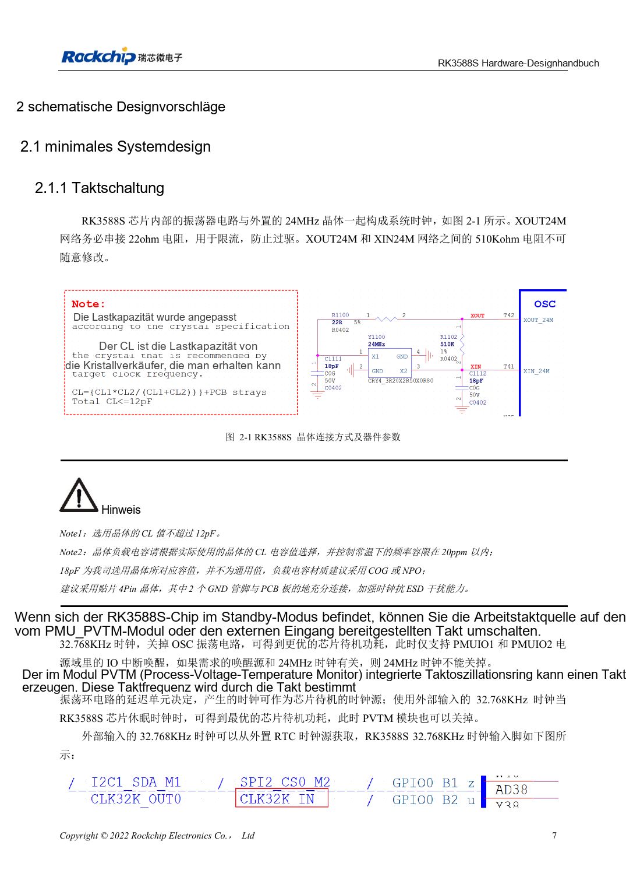
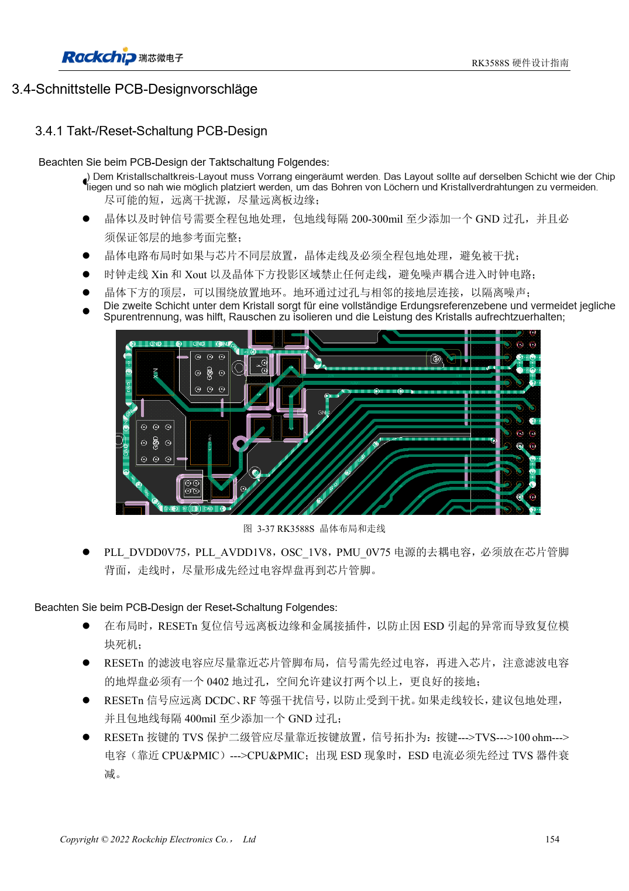

<!-- rk3588s-hardware-v12-20261109 -->

# RK3588S-Takte: 24MHz, 32kHz und Layout

Grundlage ist der chinesische RK3588S Hardware Design Guide V1.2 (2023-12-14) zur Schaltungs- und PCB-Prüfung. CM7S-Träger folgen den Modulschnittstellen; Sige7S dient der Software-/Peripherieerprobung. SoC-Funktionen sind keine Boardanschlussliste. SDK/BSP, Kernel, Revision, Firmware und Multiplexing prüfen. Werte sind Quellenreferenzen, keine ArmSoM-Messungen.

**RK3588S Hardware Design Guide V1.2 (2023-12-14), CN** · §2.1.1; §3.4.1

## Last zum Quarz passend wählen

22Ω an XOUT24M begrenzen die Anregung; 510kΩ zwischen XOUT24M und XIN24M nicht beliebig ändern. Quarz-CL ≤12pF. Die gezeigten 18pF gelten für den Referenzquarz; reale Last aus CL und Parasiten bestimmen, vorzugsweise C0G/NP0 und Vierpad-Quarz. Auch Tastkopfkapazität beeinflusst die Schwingung.

## Aufwecken und PCB gemeinsam prüfen

Vor dem Abschalten von 24MHz die Aufweckabhängigkeiten prüfen. Der Sparpfad nutzt PMU_PVTM oder externe 32.768kHz und passende PMUIO1/2-IOs. Quarz möglichst nah und gleichseitig zum SoC platzieren; fremde Leiter unter Quarz/XIN/XOUT vermeiden, Nachbargrundfläche erhalten und Abschirmmasse alle 200–300mil verbinden.

## Entwurfsparameter und Prüftabelle

| Punkt | Quellenreferenz |
| --- | --- |
| 24MHz-Toleranz | ≤20ppm |
| 32.768kHz-Toleranz | ±30ppm |
| 32kHz-Tastgrad | 45–55% |
| 32kHz-Amplitude | 0.7×VDD … VDD; VDD=PMUIO1 |

## Quellenabbildungen

Für diese Reihe liegt kein entsprechendes englisches Designhandbuch vor. Alle vier Fassungen nutzen chinesische Originalausschnitte mit lokalisierten Beschriftungen. Bilder lassen sich in voller Auflösung öffnen; Text und Parametertabellen bleiben kopierbar. Seitenangaben beziehen sich auf physische PDF-Seiten.

Chinesisches Original · PDF 22 · 2-1

Chinesisches Original · PDF 169 · 3-37

## Entwicklung mit ArmSoM

CM7S eignet sich für eigene Träger: zunächst integrierte Versorgung, DDR und Bootschaltungen bestimmen, dann außerhalb der Modulstecker planen. Sige7S dient als Ausgangspunkt für Software-/Peripherieerprobung. Bei beiden Produkten herausgeführte Interfaces, Pins, Pegel, Images und Kühlung revisionsbezogen prüfen. Ein Chipreferenzplan ist kein Produktanschlussplan.

- [ArmSoM CM7S](https://www.armsom.org/cm7s) · [CM7S Docs](https://docs.armsom.org/armsom-cm7s)
- [ArmSoM Sige7S](https://www.armsom.org/sige7s) · [Sige7S Docs](https://docs.armsom.org/armsom-sige7s)

## Weiterlesen

- [RK3588S-Hardwaredesign: 30 Themen](/de/articles/rk3588s-hardware-design-series/)
- [RK3588S und CM7S-Träger: Ressourcen und Validierung](/de/articles/rk3588s-cm7s-carrier-design/)
- [RK3588S-Reset, Watchdog und Temperaturschutz](/de/articles/rk3588s-reset-watchdog-hardware/)
