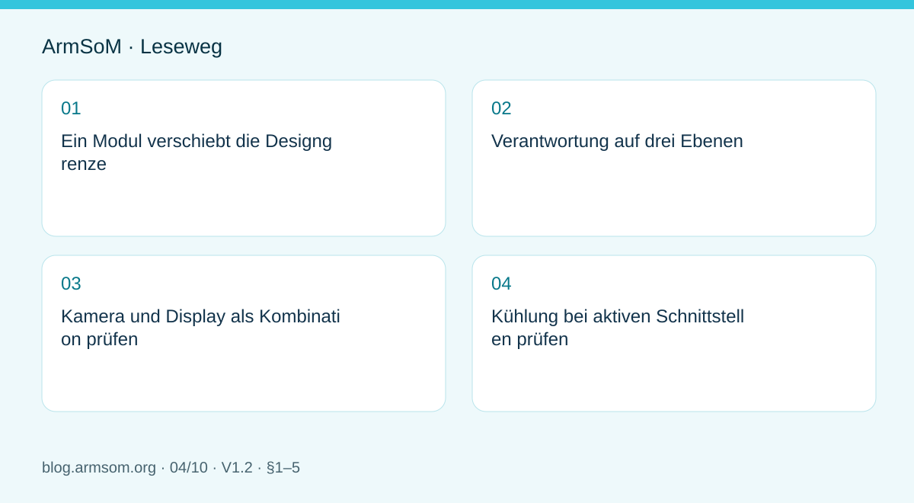
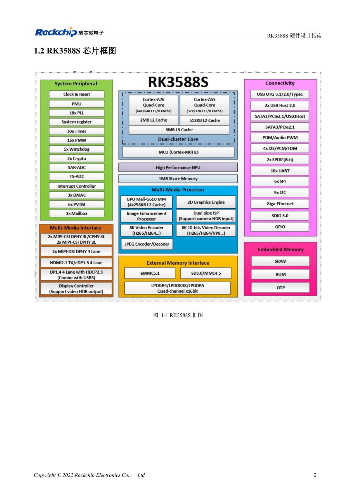

# RK3588S-Hardwaredesign: vom Referenzschaltplan zur CM7s-Trägerplatine

## Geltungsbereich und Quellen

Dies ist ein thematischer Engineering-Leitfaden, keine seitenweise Übersetzung des gesamten PDF. Quellenbeispiele sind keine ArmSoM-Messungen. Spannungen, Pins, SDK/BSP und Kernel mit der tatsächlichen Platinenrevision abgleichen.

**Rockchip:** `RK3588S Hardware Design Guide-V1.2-20231214.pdf` · V1.2 · §1–5

## Ein Modul verschiebt die Designgrenze

CM7s integriert eine RK3588S-Rechenplattform. Ausgangspunkt einer Trägerplatine sind reale Pins, Mechanik, Stecker und Versorgung des Moduls, nicht die vollständige Kopie eines EVB-Schaltplans. DDR-Fanout und Chipregler erklären das System; auf dem Träger stehen Peripherieversorgung, Verbindungen, Schutz und Gerätekühlung im Vordergrund.

RK3588S und RK3588 bieten keine identischen Schnittstellen. Auch RK3588S2-Pindefinitionen dürfen RK3588S-Unterlagen nicht stillschweigend ersetzen. Vollständige Chipbezeichnung, Modulrevision und Dokumentversion festhalten.

## Verantwortung auf drei Ebenen

| Ebene | Hauptaufgaben | Unterlagen |
| --- | --- | --- |
| Modul | Prozessor, Speicher, Boot und integrierte Versorgung | CM7s-Schaltplan und Revision |
| Träger | Signale, Peripherieversorgung, Stecker und Schutz | Modulpinout und Trägerschaltung |
| Gerät | Kabel, Kühlung, Gehäuse, EMC und Anwendungslast | Mechanik und Prüfplan |

An der Modulgrenze bleiben Pegel, Reset- und Enable-Zeiten, ungenutzte Pins und Multiplexing zu prüfen. Integration hebt diese Aufgaben nicht auf.

## Kamera und Display als Kombination prüfen

Mit einem konkreten Sensor oder Panel beginnen. Neben Videolanes werden Steuerbusse, Takte, Reset, Sensorversorgung oder Hintergrundbeleuchtung benötigt. Auflösung, Bildrate, Lane-Konfiguration, Kabel und Stecker dokumentieren und mit Treiber und Device Tree abgleichen. Die SoC-Anzahl von Schnittstellen belegt keinen Parallelbetrieb auf dem Träger.

## Kühlung bei aktiven Schnittstellen prüfen

Gleichzeitige KI-, Video-, Display- und Speicherlast unterscheidet sich vom unbelasteten Desktop. Einen Wärmepfad zu Kühlkörper, Gehäuse oder Luft definieren und Befestigung sowie Isolation berücksichtigen. Umgebung, Systemtemperatur, Drosselung und Anwendungsdurchsatz aufzeichnen. Kurzzeitige Spitzen sind keine Dauerleistung.

Sige7s oder eine CM7s-IO-Plattform können die Anwendungsbasis liefern. Wegen unterschiedlicher Stecker und Mechanik gelten Ergebnisse nur für die geprüfte Konfiguration und müssen auf dem eigenen Träger erneut geprüft werden.

## Abbildung aus der Quelle

Chinesisches Original; keine entsprechende englische Abbildung in den Materialien gefunden. Referenzdesign, kein ArmSoM-Platinenschaltplan.

`RK3588S Hardware Design Guide-V1.2-20231214.pdf` · PDF p. 17.

## Produkte und Entwicklungsunterlagen

- **CM7s** — [Produktseite](https://www.armsom.org/cm7s) · [Dokumentation](https://docs.armsom.org/armsom-cm7s)
- **Sige7s** — [Produktseite](https://www.armsom.org/sige7s) · [Dokumentation](https://docs.armsom.org/armsom-sige7s)

## Weitere Beiträge der Reihe

- [RK3576 in Betrieb nehmen: Minimalsystem und erste Einschaltprüfung](/de/articles/rk3576-hardware-bringup/)
- [ArmSoM CM5-Trägerplatine: Checkliste für Versorgung, Boot und Schnittstellen](/de/articles/019-cm5-carrier-production/)
- [RK3576-Hochgeschwindigkeitsschnittstellen: Schaltplan und PCB gemeinsam prüfen](/de/articles/rk3576-high-speed-interface-design/)
- [RK3588 für Edge-KI: Versorgung, Kühlung und Erweiterung gemeinsam planen](/de/articles/rk3588-edge-ai-hardware-design/)
- [RK3588-PCB-Prüfung: Lagenaufbau, Impedanz und Leiterführung](/de/articles/rk3588-high-speed-pcb-review/)
- [RK3506-HMI-Hardware: Entwicklung mit CM1 oder Forge1](/de/articles/rk3506-industrial-hmi-hardware/)
- [RK3308-Varianten: Hardwarekompatibilität für P2-Pro-Audioprojekte](/de/articles/rk3308-hardware-variant-compatibility/)
- [RK3588S und RK3588S2: Prüfungen vor einer Hardwareänderung](/de/articles/rk3588s-rk3588s2-hardware-differences/)
- [Vom Rockchip-Prototyp zur Serie: Prozessvorgaben und Prüfunterlagen](/de/articles/rockchip-hardware-production-checklist/)
