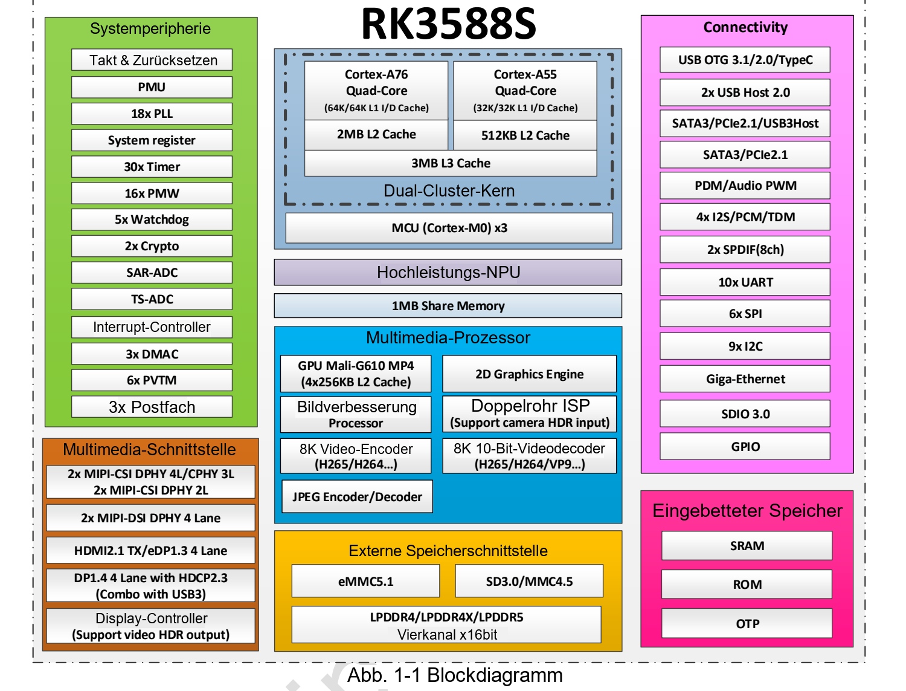
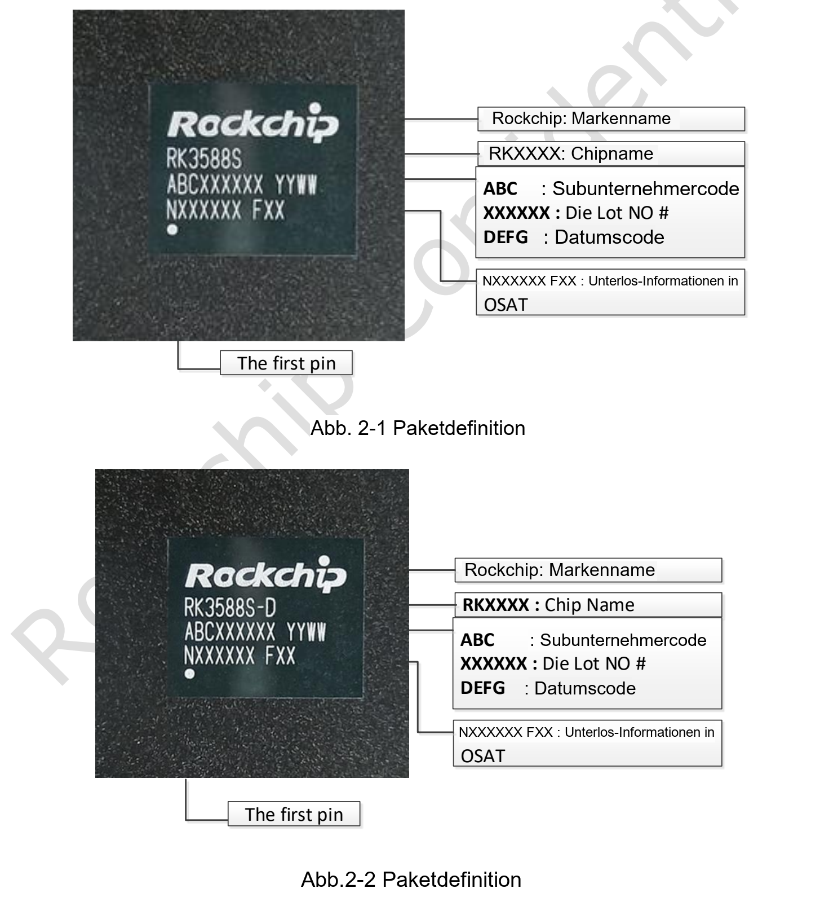
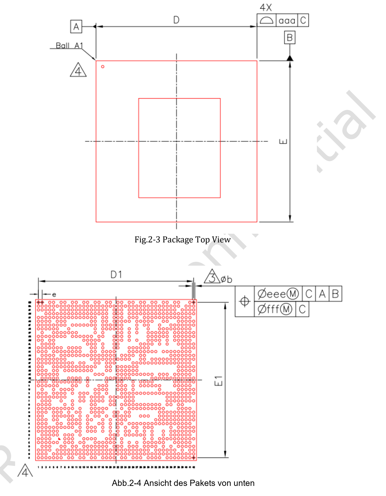
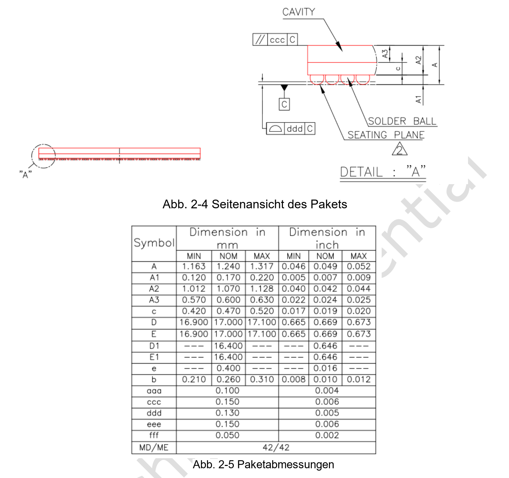

Dieser Leitfaden bezieht sich auf das bereitgestellte **Rockchip RK3588S Datasheet V1.3 vom 2022-03-10 mit 35 Seiten**. Es beschreibt den Chip und ersetzt weder Schaltpläne und mechanische Dateien von CM7S/Sige7S noch aktuelle SDK-Unterlagen. Es wird nicht als neueste Revision bezeichnet.

[Original-PDF herunterladen (V1.3, ca. 2.46 MiB)](/assets/rk3588s/Rockchip-RK3588S-Datasheet-V1.3-20220310.pdf) · [Editierbaren englischen Fachtext und Tabellen herunterladen](/docs/rk3588s/technical-reference-en.md)

Dies ist ein deutscher Leseleitfaden, keine vollständige Übersetzung des Datenblatts. Der englische Anhang umfasst PDF-Seiten 6–35 ohne Deckblatt, Änderungshistorie, Haftungstext und wiederholte Kopf-/Fußzeilen. Parameter und Unklarheiten bleiben erhalten. Den Geltungsbereich zusammengeführter Tabellenzellen bitte im PDF prüfen.

## Aufbau des Dokuments

| PDF-Seiten | Inhalt | Verwendung |
|---|---|---|
| 6–16, Kapitel 1 | CPU, Speicher, Video, NPU, Grafik, Schnittstellen, Blockdiagramm | Architektur und Fähigkeiten |
| 17–28, Kapitel 2 | Bestellung, Markierung, Gehäuse, Pins | Gehäuse und Signale identifizieren |
| 29–34, Kapitel 3 | Grenzwerte, Betriebsbedingungen, IO, PLL, PHY, ADC | Elektrische Prüfung |
| 35, Kapitel 4 | Thermik und Wärmewiderstände | Thermische Annahmen |

## Blockdiagramm und Gehäusezeichnungen

Die englischen Originalzeichnungen behalten ihre Maße. Genannt werden FCCSP1253L, 17 × 17 mm Gehäusekörper, 0.26 mm Lotkugeln und 0.4 mm Raster. Das sind Chipmaße, keine Boardabmessungen.

## Grenzwerte sind keine Betriebsziele

Abschnitt 3.1 beschreibt absolute Grenzen mit möglicher Bauteilschädigung. Für den Betrieb gelten die empfohlenen Bedingungen aus 3.2 sowie Versorgungssequenzen und Designrichtlinien. IO-Pegel hängen von der Spannungsdomäne ab; GPIO darf nicht pauschal als 5V-tolerant betrachtet werden.

Die maximalen CPU-, GPU- und NPU-Takte stehen in dieser Revision noch auf TBD. Spätere Produktfrequenzen dürfen diese historischen Tabellenwerte nicht ersetzen.

## Thermische Werte richtig einordnen

| Parameter | Typischer Wert V1.3 | Einheit |
|---|---|---|
| Sperrschicht–Umgebung θJA | 8.2 | °C/W |
| Sperrschicht–Platine θJB | 3.7 | °C/W |
| Sperrschicht–Gehäuse θJC | 0.01 | °C/W |

Die Quelle nennt Referenzsimulationen mit einer 10-lagigen, 200 × 130 mm Platine bei 25°C Umgebung. Das sind keine ArmSoM-Systemmessungen und keine allgemeine Temperaturprognose für Gehäuse. Abschnitt 4.1 verlangt eine Sperrschichttemperatur unter 125°C; daraus folgt keine Umgebungsspezifikation von 125°C.

## Beibehaltene Unstimmigkeiten

- Deckblatt V1.3, Kopfzeilen ab Seite 20 weiterhin V1.2.
- Fünf SPI-Controller im Text, 6× SPI im Blockdiagramm: TRM und Multiplexbelegung prüfen.
- HDMI/eDP-Anzahl und Blockdiagramm müssen abgeglichen werden; daraus keine zwei Boardausgänge versprechen.
- Table 3-10 erscheint auf Seite 34 zweimal; auch Bildnummern unterscheiden sich.
- Wärmewiderstände, negative Min/Max-Stromwerte und wiederholte PHY-Zeilen ohne klare Bedingungen bleiben unverändert.

Für CM7S-Trägerplatinen zuerst Modulpins und Versorgung prüfen; für Sige7S-Anwendungen zuerst Anschlüsse, Image und Treiber. Chipdaten ersetzen keine Boardvalidierung.

## Weiterführende Artikel und Produkte

- [RK3588S erklärt: acht CPU-Kerne, 6-TOPS-NPU und ArmSoM-Plattformen](/de/articles/rk3588s-chip-guide/)
- [CM7S oder Sige7S? Die passende RK3588S-Plattform wählen](/de/articles/cm7s-sige7s-rk3588s-selection/)
- [Edge-KI und Multimedia mit RK3588S: Produkte mit CM7S und Sige7S planen](/de/articles/rk3588s-edge-ai-multimedia/)

### Produkte und Entwicklungsunterlagen

- [CM7S](https://www.armsom.org/cm7s) · [CM7S Docs](https://docs.armsom.org/armsom-cm7s)
- [Sige7S](https://www.armsom.org/sige7s) · [Sige7S Docs](https://docs.armsom.org/armsom-sige7s)
- [Rockchip RKNN-Toolkit2](https://github.com/airockchip/rknn-toolkit2) · [RKNN-LLM](https://github.com/airockchip/rknn-llm)
