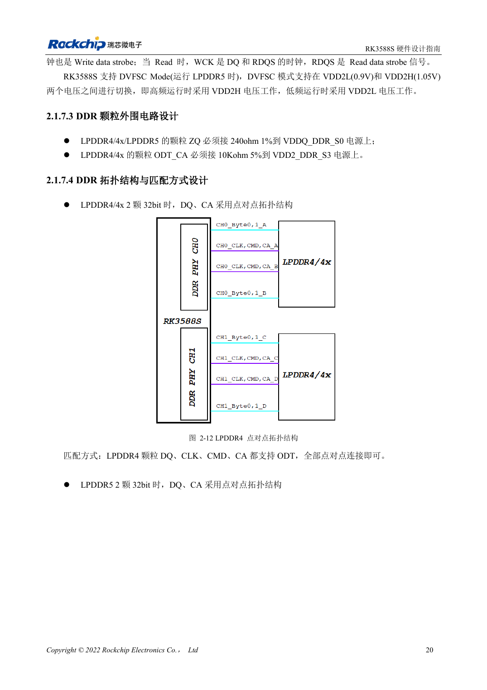
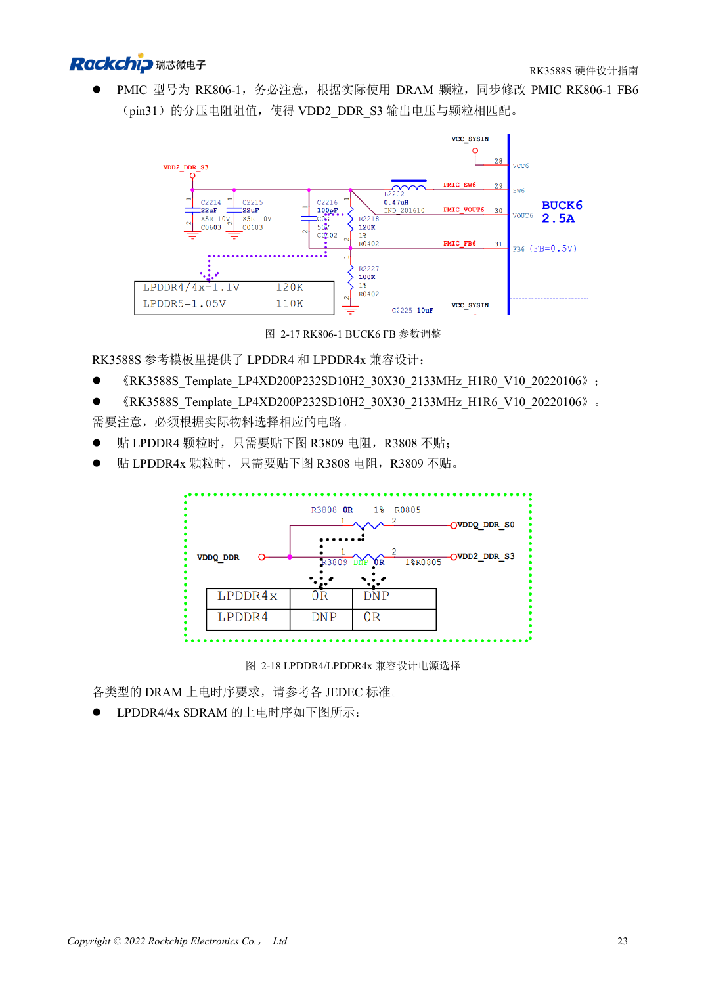

<!-- rk3588s-hardware-v12-20261109 -->

# RK3588S-DDR-Schaltung: LPDDR4/4X/5 und Kapazität

Grundlage ist der chinesische RK3588S Hardware Design Guide V1.2 (2023-12-14) zur Schaltungs- und PCB-Prüfung. CM7S-Träger folgen den Modulschnittstellen; Sige7S dient der Software-/Peripherieerprobung. SoC-Funktionen sind keine Boardanschlussliste. SDK/BSP, Kernel, Revision, Firmware und Multiplexing prüfen. Werte sind Quellenreferenzen, keine ArmSoM-Messungen.

**RK3588S Hardware Design Guide V1.2 (2023-12-14), CN** · §2.1.7

## Kapazität und Vorlage gemeinsam wählen

V1.2 beschreibt vier 16-Bit-Kanäle, insgesamt 64 Bit, bis 8GB pro Kanal und 32GB gesamt. Die 32-Bit-CH0/CH1 dürfen keine unterschiedlichen Kapazitäten wie 4GB+2GB nutzen. Das gilt für diese Anleitung, nicht automatisch für Varianten oder spätere BSPs. Speicherteil, Gehäuse, Firmware und Vorlage gemeinsam bestätigen.

## Spannung und Mapping sind kein Namenswechsel

Zwei 32-Bit-Bausteine nutzen Punkt-zu-Punkt-DQ/CA. Die Vorlage bestückt für LPDDR4 R3809 ohne R3808, für LPDDR4X umgekehrt. Bezeichner gelten nur für die Vorlage; andere Schaltplannetze prüfen. LPDDR5 braucht eigene WCK-, Mapping- und Versorgungsvorgaben. CM7S integriert DDR; Trägerarbeit betrifft Eingang, Schnittstellen und Kühlung.

## Entwurfsparameter und Prüftabelle

| Punkt | Quellenreferenz |
| --- | --- |
| V1.2-Bus | 4×16bit =64bit |
| V1.2-Adressierung | 8GB/Kanal; 32GB gesamt |
| CH0 / CH1 | Gleiche Kapazität |

## Quellenabbildungen

Für diese Reihe liegt kein entsprechendes englisches Designhandbuch vor. Alle vier Fassungen nutzen chinesische Originalausschnitte mit lokalisierten Beschriftungen. Bilder lassen sich in voller Auflösung öffnen; Text und Parametertabellen bleiben kopierbar. Seitenangaben beziehen sich auf physische PDF-Seiten.

Chinesisches Original · PDF 35 · 2-12

Chinesisches Original · PDF 38 · 2-18

## Entwicklung mit ArmSoM

CM7S eignet sich für eigene Träger: zunächst integrierte Versorgung, DDR und Bootschaltungen bestimmen, dann außerhalb der Modulstecker planen. Sige7S dient als Ausgangspunkt für Software-/Peripherieerprobung. Bei beiden Produkten herausgeführte Interfaces, Pins, Pegel, Images und Kühlung revisionsbezogen prüfen. Ein Chipreferenzplan ist kein Produktanschlussplan.

- [ArmSoM CM7S](https://www.armsom.org/cm7s) · [CM7S Docs](https://docs.armsom.org/armsom-cm7s)
- [ArmSoM Sige7S](https://www.armsom.org/sige7s) · [Sige7S Docs](https://docs.armsom.org/armsom-sige7s)

## Weiterlesen

- [RK3588S-Hardwaredesign: 30 Themen](/de/articles/rk3588s-hardware-design-series/)
- [RK3588S und RK806: Einzel- und Doppel-PMIC](/de/articles/rk3588s-rk806-pmic-design/)
- [RK3588S-DDR-Routing: Längen- und Laufzeitabgleich](/de/articles/rk3588s-ddr-pcb-routing/)
