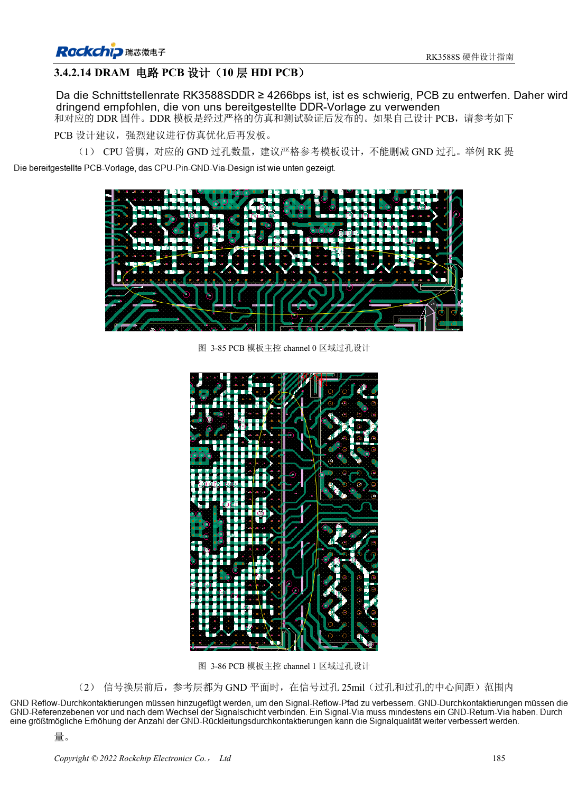
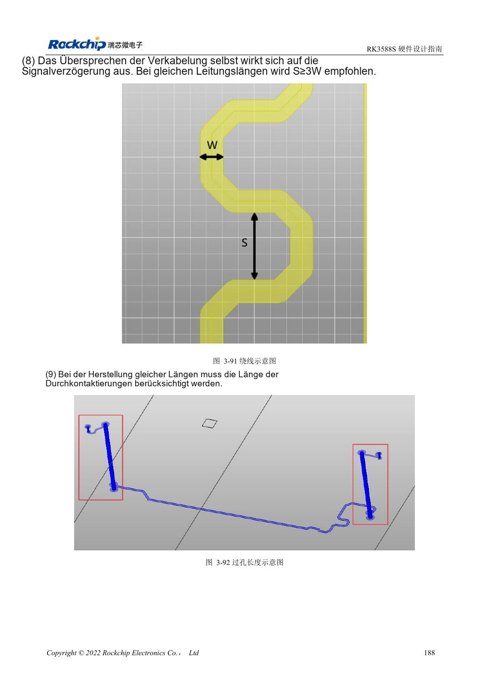

<!-- rk3588s-hardware-v12-20261109 -->

# RK3588S-DDR-Routing: Längen- und Laufzeitabgleich

Grundlage ist der chinesische RK3588S Hardware Design Guide V1.2 (2023-12-14) zur Schaltungs- und PCB-Prüfung. CM7S-Träger folgen den Modulschnittstellen; Sige7S dient der Software-/Peripherieerprobung. SoC-Funktionen sind keine Boardanschlussliste. SDK/BSP, Kernel, Revision, Firmware und Multiplexing prüfen. Werte sind Quellenreferenzen, keine ArmSoM-Messungen.

**RK3588S Hardware Design Guide V1.2 (2023-12-14), CN** · §3.4.2.14

## Die RK3588S-Routingtabellen verwenden

Tabellen 3-13, 3-14 und 3-15 in §3.4.2.14 gelten für LPDDR5, LPDDR4X und LPDDR4. Die Längenvorgaben setzen Innenlagen einer 10-lagigen HDI-Referenz voraus. Die 16ps-Regel einer anderen RK3588-Anleitung für achtlagige Durchkontaktierungsplatinen nicht übernehmen. DQ/DM: 45Ω, Adresse/Steuerung: 50Ω, Differenzpaare: 90Ω, jeweils ±10%.

## Bytegruppen und Abstände definieren

Bei LPDDR5 gelten DQ/DM zu DQS/WCLK im Byte ≤25mil, Adresse/Steuerung zu CLK ≤40mil, Paarabweichung ≤5mil und DQS/WCLK zu CLK ≤200mil. LPDDR4X erlaubt DQS zu CLK ≤250mil. Datenabstand mindestens zwei Leiterbreiten; zum Strobe vorzugsweise drei, mindestens zwei. Training-Logs, Temperatur, Zielfrequenz-Stress und wiederholte Kaltstarts prüfen.

## Entwurfsparameter und Prüftabelle

| Punkt | Quellenreferenz |
| --- | --- |
| LPDDR5-DQ/DM-Impedanz | 45Ω ±10% |
| LPDDR5-Adresse/Steuerung | 50Ω ±10% |
| LPDDR5-Differenzziel | 90Ω ±10% |
| Byteinterne Längendifferenz | DQ/DM ↔ DQS/WCLK: ≤25mil |
| Adresslängendifferenz | ≤40mil |
| Paarinterne Differenz | ≤5mil |

## Quellenabbildungen

Für diese Reihe liegt kein entsprechendes englisches Designhandbuch vor. Alle vier Fassungen nutzen chinesische Originalausschnitte mit lokalisierten Beschriftungen. Bilder lassen sich in voller Auflösung öffnen; Text und Parametertabellen bleiben kopierbar. Seitenangaben beziehen sich auf physische PDF-Seiten.

Chinesisches Original · PDF 200 · 3-85

Chinesisches Original · PDF 203 · 3-91

## Entwicklung mit ArmSoM

CM7S eignet sich für eigene Träger: zunächst integrierte Versorgung, DDR und Bootschaltungen bestimmen, dann außerhalb der Modulstecker planen. Sige7S dient als Ausgangspunkt für Software-/Peripherieerprobung. Bei beiden Produkten herausgeführte Interfaces, Pins, Pegel, Images und Kühlung revisionsbezogen prüfen. Ein Chipreferenzplan ist kein Produktanschlussplan.

- [ArmSoM CM7S](https://www.armsom.org/cm7s) · [CM7S Docs](https://docs.armsom.org/armsom-cm7s)
- [ArmSoM Sige7S](https://www.armsom.org/sige7s) · [Sige7S Docs](https://docs.armsom.org/armsom-sige7s)

## Weiterlesen

- [RK3588S-Hardwaredesign: 30 Themen](/de/articles/rk3588s-hardware-design-series/)
- [RK3588S-DDR-Schaltung: LPDDR4/4X/5 und Kapazität](/de/articles/rk3588s-ddr-circuit-design/)
- [RK3588S-eMMC: Takt, Pull-ups und Strobe](/de/articles/rk3588s-emmc-hardware-design/)
