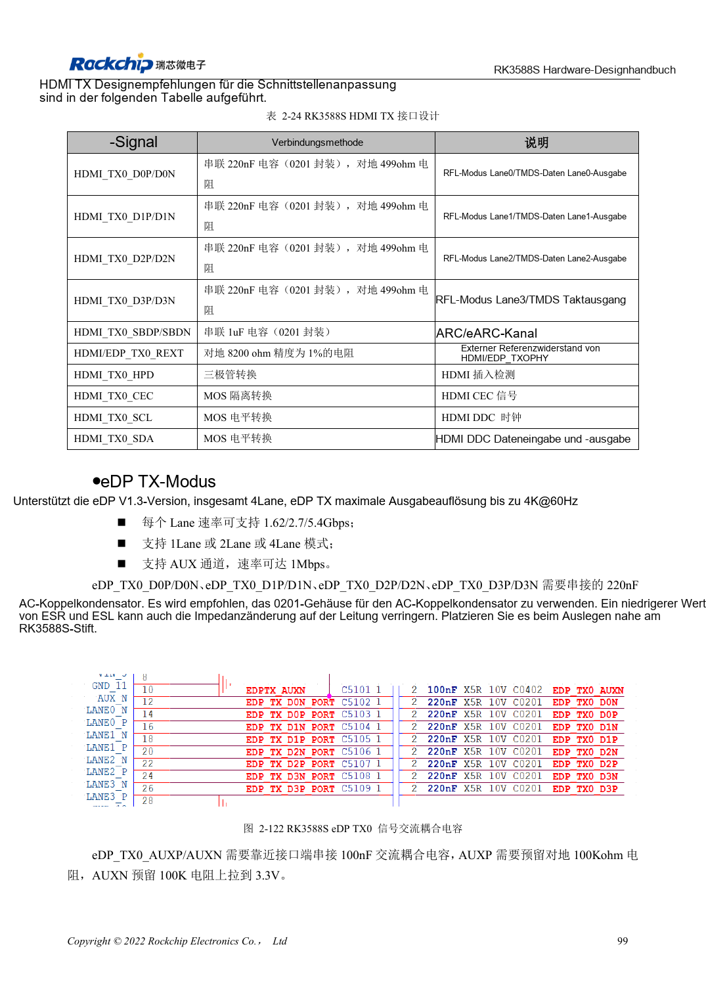
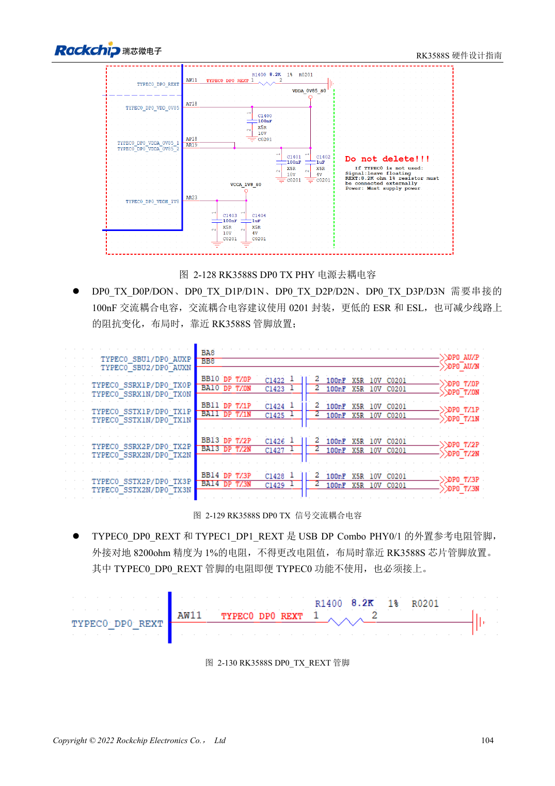

<!-- rk3588s-hardware-v12-20261109 -->

# RK3588S-DP und eDP: PHYs, AUX und Kopplung

Grundlage ist der chinesische RK3588S Hardware Design Guide V1.2 (2023-12-14) zur Schaltungs- und PCB-Prüfung. CM7S-Träger folgen den Modulschnittstellen; Sige7S dient der Software-/Peripherieerprobung. SoC-Funktionen sind keine Boardanschlussliste. SDK/BSP, Kernel, Revision, Firmware und Multiplexing prüfen. Werte sind Quellenreferenzen, keine ArmSoM-Messungen.

**RK3588S Hardware Design Guide V1.2 (2023-12-14), CN** · §2.3.8.1; §2.3.8.3; §3.4.3; §3.4.11

## Ähnliche Namen sind keine identischen Schaltungen

DP0 teilen PHYs mit USB-Type-C, eDP mit HDMI-TX. DP-Hauptkanal nutzt 100nF, eDP 220nF, AUX 100nF. Impedanz, Kopplung und Pins nicht vertauschen. Kabel, Stecker, Display und BSP gehören zum Kanal.

## TYPEC0-Pflichten und Geltungsbereich

Alle drei TYPEC0_DP0-Versorgungen und 8.2kΩ/1%-REXT laut Anleitung auch ohne Schnittstellennutzung erhalten. eDP nutzt 220nF im Hauptkanal und 100nF für AUX; Stecker- und Kabelimpedanz prüfen. RK3588S hat einen DP-Combo. Verbliebene TYPEC1-/TX1-Texte belegen keine zweite Schnittstelle.

## Entwurfsparameter und Prüftabelle

| Punkt | Quellenreferenz |
| --- | --- |
| DP-/USB-DP-Impedanz | 100Ω / 95Ω; ±10% |
| eDP-Impedanz | 90Ω ±10%; zum Kabel passend |
| DP-/eDP-Hauptlinkkopplung | 100nF / 220nF |
| AUX-Kopplung | 100nF |
| Länge/Paardifferenz | <6in / <6mil |

## Quellenabbildungen

Für diese Reihe liegt kein entsprechendes englisches Designhandbuch vor. Alle vier Fassungen nutzen chinesische Originalausschnitte mit lokalisierten Beschriftungen. Bilder lassen sich in voller Auflösung öffnen; Text und Parametertabellen bleiben kopierbar. Seitenangaben beziehen sich auf physische PDF-Seiten.

Chinesisches Original · PDF 114 · 2-122

Chinesisches Original · PDF 119 · 2-129

## Entwicklung mit ArmSoM

CM7S eignet sich für eigene Träger: zunächst integrierte Versorgung, DDR und Bootschaltungen bestimmen, dann außerhalb der Modulstecker planen. Sige7S dient als Ausgangspunkt für Software-/Peripherieerprobung. Bei beiden Produkten herausgeführte Interfaces, Pins, Pegel, Images und Kühlung revisionsbezogen prüfen. Ein Chipreferenzplan ist kein Produktanschlussplan.

- [ArmSoM CM7S](https://www.armsom.org/cm7s) · [CM7S Docs](https://docs.armsom.org/armsom-cm7s)
- [ArmSoM Sige7S](https://www.armsom.org/sige7s) · [Sige7S Docs](https://docs.armsom.org/armsom-sige7s)

## Weiterlesen

- [RK3588S-Hardwaredesign: 30 Themen](/de/articles/rk3588s-hardware-design-series/)
- [RK3588S-MIPI-Displays: D-PHY, C-PHY und Panels](/de/articles/rk3588s-mipi-display-hardware/)
- [RK3588S-Audiohardware: I2S, PDM und Mikrofonarrays](/de/articles/rk3588s-audio-hardware-design/)
