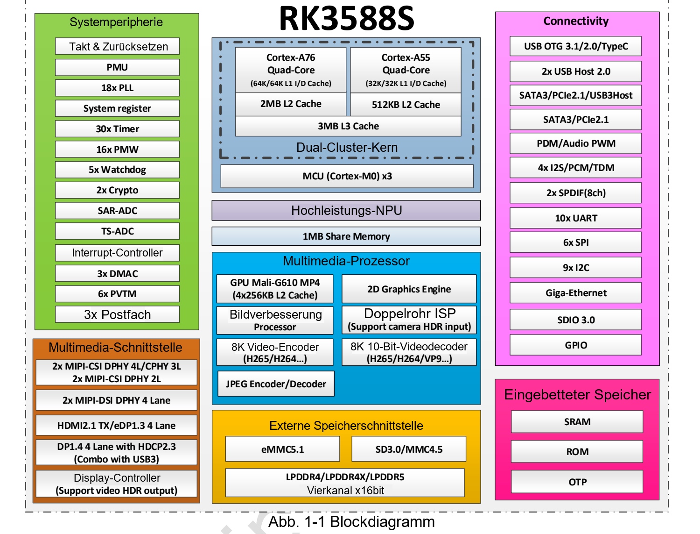

Ein gutes RK3588S-System verteilt Aufgaben auf passende Hardwareeinheiten und vermeidet unnötige Kopien. CM7S und Sige7S bieten dafür einen Einstieg. Die folgenden Szenarien sind Entwicklungsvorschläge, keine nachgewiesenen Kundeninstallationen oder Benchmarks.

## Lokale Bildanalyse

Eine typische Kette lautet: Kamera oder Stream → Aufnahme/Decodierung → Skalierung und Formatwandlung → NPU-Inferenz → Nachverarbeitung → Anzeige oder Ergebnisübertragung. Die CPU übernimmt Anwendungslogik, Hardwarecodecs geeignete Videodaten, RGA passende Bildoperationen und die NPU konvertierte, unterstützte Modelle.

Für einen Sige7S-Prototyp zunächst eine validierte Eingabequelle verwenden. Eine CM7S-Trägerplatine wird interessant, wenn Sensorwahl, Isolation oder Gehäuse eigene Hardware verlangen. Ein sichtbares Kamerabild genügt nicht: Belichtung, Weißabgleich, Verzeichnung und IQ-Abstimmung beeinflussen die Inferenzqualität.

## Interaktive Displays und Videoterminals

Grafik, Videodecodierung und Displayverarbeitung machen RK3588S für Informationsterminals und lokale Videoanwendungen interessant. Eine 8K-Decoderangabe bedeutet nicht, dass jeder Browser, Player und Anschluss 8K ausgibt. Format, Beschleunigungspfad, Kabel und Display müssen zusammenpassen.

Mit realen Inhalten testen: Bittiefe, Codec, Untertitel und UI-Komposition verändern die Last. Bei paralleler KI zusätzlich Speicherlast, Temperatur und Ende-zu-Ende-Latenz messen, nicht nur den Spitzenwert einer Einheit.

## Integration in eigene Geräte

CM7S ermöglicht anwendungsspezifische Trägerplatinen und Steckverbinder. CAN oder RS485 auf Systemebene benötigen außerdem Transceiver, Schutzbeschaltung und gegebenenfalls Isolation. Ein interner Controller ist noch kein anschlussfertiger Feldbusport.

## Software und Abnahme

Rockchips RKNN-Toolkit2 stellt Werkzeuge für Konvertierung und Bereitstellung bereit. Das ältere RKNN-Toolkit ist dazu nicht kompatibel. Für Sprachmodelle ist RKNN-LLM separat zu prüfen. Entscheidend sind Operatoren und Beispiele der eingesetzten Version; Framework-Unterstützung garantiert keine beliebige Modellkompatibilität.

| Phase | Dokumentieren |
|---|---|
| Konvertierung | Toolversion, Modellhash, Eingabeform, Kalibrierungsdaten |
| Genauigkeit | Vergleich vor/nach Konvertierung mit demselben Datensatz |
| Bereitstellung | Boardrevision, Image, Kernel, Treiber und Runtime |
| Leistung | Latenz, Durchsatz, CPU-Last, Temperatur und Leistungsaufnahme |
| Zuverlässigkeit | Dauerbetrieb, Neustart nach Stromausfall, ungültige Eingaben, Speicherlebensdauer |

Mit einem reproduzierbaren Beispiel beginnen, danach eigene Modelle und Daten einsetzen. ArmSoM-Dokumentation und RKNN-Beiträge unterstützen den Entwicklungsweg. Bildrate, Energiebedarf und Genauigkeit erst nach Messung am Zielgerät als Produktleistung angeben.

## Weiterführende Artikel und Produkte

- [RK3588S erklärt: acht CPU-Kerne, 6-TOPS-NPU und ArmSoM-Plattformen](/de/articles/rk3588s-chip-guide/)
- [CM7S oder Sige7S? Die passende RK3588S-Plattform wählen](/de/articles/cm7s-sige7s-rk3588s-selection/)
- [RK3588S Datasheet V1.3: Download, Blockdiagramm und Hardware-Leitfaden](/de/articles/rk3588s-datasheet-v13/)

### Produkte und Entwicklungsunterlagen

- [CM7S](https://www.armsom.org/cm7s) · [CM7S Docs](https://docs.armsom.org/armsom-cm7s)
- [Sige7S](https://www.armsom.org/sige7s) · [Sige7S Docs](https://docs.armsom.org/armsom-sige7s)
- [Rockchip RKNN-Toolkit2](https://github.com/airockchip/rknn-toolkit2) · [RKNN-LLM](https://github.com/airockchip/rknn-llm)

- [RKNN-Toolkit2 V2.5.0: YOLOv5](/de/articles/rknn-v250-sdk-quickstart-yolov5/)
- [Rockchip MPP](/de/articles/089-rockchip-mpp/)
- [RGA IM2D API](/de/articles/129-rockchip-rga-im2d-api/)
