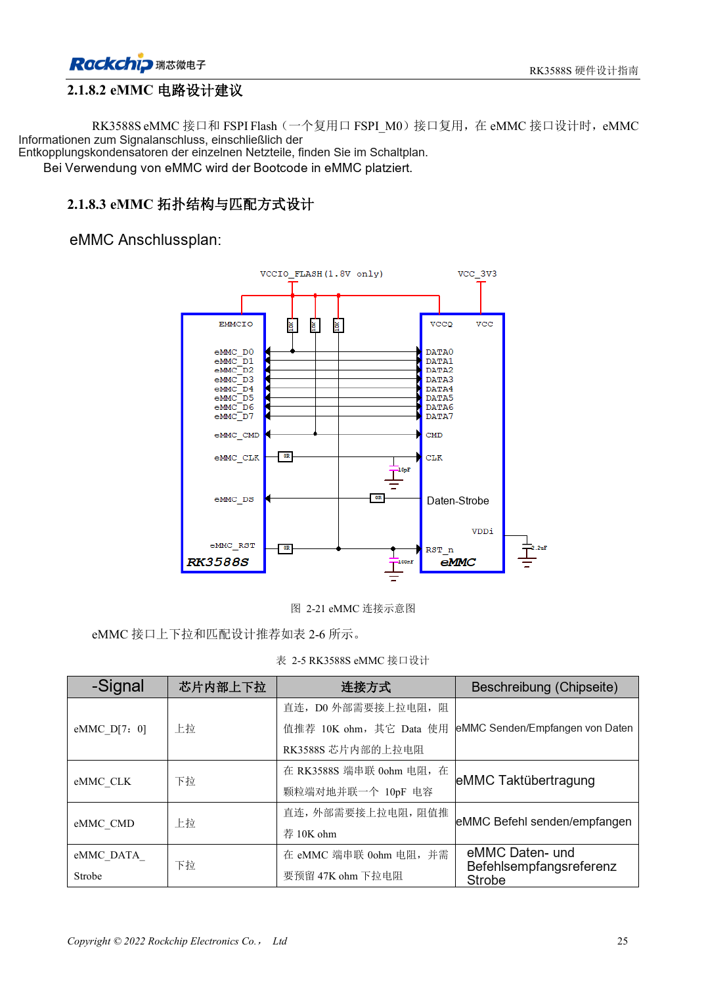
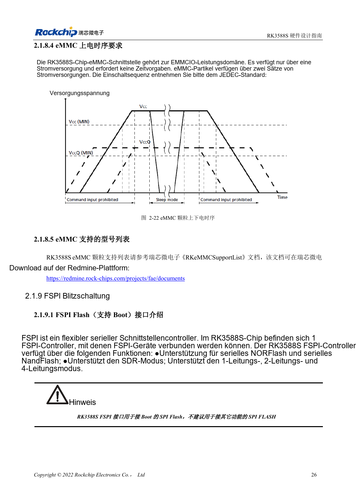

<!-- rk3588s-hardware-v12-20261109 -->

# RK3588S-eMMC: Takt, Pull-ups und Strobe

Grundlage ist der chinesische RK3588S Hardware Design Guide V1.2 (2023-12-14) zur Schaltungs- und PCB-Prüfung. CM7S-Träger folgen den Modulschnittstellen; Sige7S dient der Software-/Peripherieerprobung. SoC-Funktionen sind keine Boardanschlussliste. SDK/BSP, Kernel, Revision, Firmware und Multiplexing prüfen. Werte sind Quellenreferenzen, keine ArmSoM-Messungen.

**RK3588S Hardware Design Guide V1.2 (2023-12-14), CN** · §2.1.8; §3.4.12

## CLK gemäß V1.2 ausführen

Tabelle 2-5: 0Ω in CLK am RK3588S, 10pF nach Masse am eMMC. D0/CMD erhalten externe 10kΩ-Pull-ups, andere Daten interne. Strobe: 0Ω am Baustein und vorgesehene 47kΩ nach Masse. Nicht alle Signale gleich behandeln; Bauteilpositionen sind wesentlich.

## Versorgung und Modus prüfen

EMMCIO und die beiden Speicherversorgungen unterscheiden; Sequenz für das genaue Bauteil prüfen. Unterstützungsliste, Loader/BSP, Zielmodus, Kaltstart, Dauertransfer und Stromausfall-Recovery testen. eMMC von CM7S sitzt auf dem Modul; Austausch oder externer Zugang richten sich nach dessen Dokumentation.

## Entwurfsparameter und Prüftabelle

| Punkt | Quellenreferenz |
| --- | --- |
| CLK | 0Ω am SoC; 10pF an eMMC |
| D0 / CMD | 10kΩ Pull-up |
| Strobe | 0Ω an eMMC; vorsehen 47kΩ Pull-down |
| PCB-Impedanz/Länge | 50Ω ±10% / <3.5in |
| Takt-Daten-Differenz | <120mil |

## Quellenabbildungen

Für diese Reihe liegt kein entsprechendes englisches Designhandbuch vor. Alle vier Fassungen nutzen chinesische Originalausschnitte mit lokalisierten Beschriftungen. Bilder lassen sich in voller Auflösung öffnen; Text und Parametertabellen bleiben kopierbar. Seitenangaben beziehen sich auf physische PDF-Seiten.

Chinesisches Original · PDF 40 · 2-21

Chinesisches Original · PDF 41 · 2-22

## Entwicklung mit ArmSoM

CM7S eignet sich für eigene Träger: zunächst integrierte Versorgung, DDR und Bootschaltungen bestimmen, dann außerhalb der Modulstecker planen. Sige7S dient als Ausgangspunkt für Software-/Peripherieerprobung. Bei beiden Produkten herausgeführte Interfaces, Pins, Pegel, Images und Kühlung revisionsbezogen prüfen. Ein Chipreferenzplan ist kein Produktanschlussplan.

- [ArmSoM CM7S](https://www.armsom.org/cm7s) · [CM7S Docs](https://docs.armsom.org/armsom-cm7s)
- [ArmSoM Sige7S](https://www.armsom.org/sige7s) · [Sige7S Docs](https://docs.armsom.org/armsom-sige7s)

## Weiterlesen

- [RK3588S-Hardwaredesign: 30 Themen](/de/articles/rk3588s-hardware-design-series/)
- [RK3588S-DDR-Routing: Längen- und Laufzeitabgleich](/de/articles/rk3588s-ddr-pcb-routing/)
- [RK3588S-FSPI-Flash: Boot, Versorgung und Anpassung](/de/articles/rk3588s-fspi-boot-hardware/)
