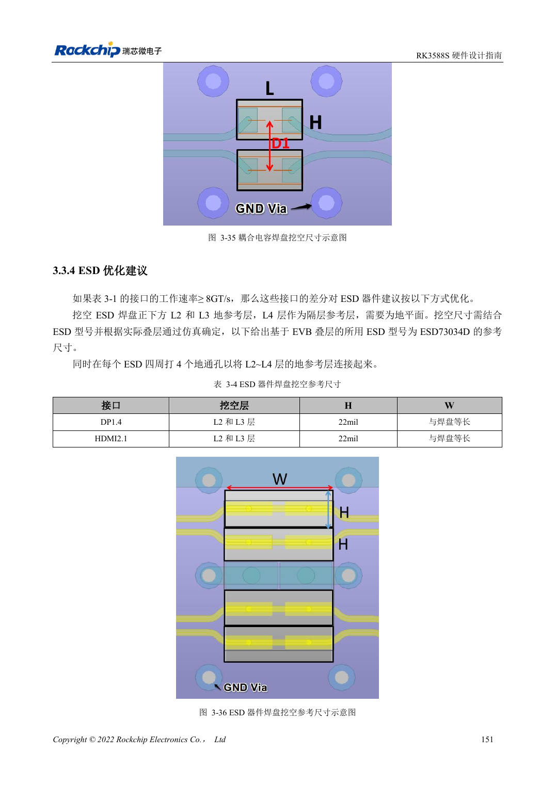

<!-- rk3588s-hardware-v12-20261109 -->

# RK3588S-ESD und EMI: Schnittstellenschutz und Rückwege

Grundlage ist der chinesische RK3588S Hardware Design Guide V1.2 (2023-12-14) zur Schaltungs- und PCB-Prüfung. CM7S-Träger folgen den Modulschnittstellen; Sige7S dient der Software-/Peripherieerprobung. SoC-Funktionen sind keine Boardanschlussliste. SDK/BSP, Kernel, Revision, Firmware und Multiplexing prüfen. Werte sind Quellenreferenzen, keine ArmSoM-Messungen.

**RK3588S Hardware Design Guide V1.2 (2023-12-14), CN** · §5; §3.3.4

## Schutz am Stromeintritt platzieren

TVS nahe am Stecker oder Entladeeintritt mit kurzem niederimpedantem Masseweg platzieren. Reset, Takt und Interrupt vom Rand fernhalten, laut Quelle mindestens 5mm. ESD-Kapazität und Pads in SI einbeziehen; höhere Werte sind nicht automatisch besser.

## EMI an Quelle und Kopplung untersuchen

Unterbrochene Rückwege, Stubs, Gleichtaktumwandlung und Schaltregler vor Filtern/Schirmen prüfen. Kühler können gekoppelte Energie abstrahlen; Erdungsoptionen vorsehen und testen. Allgemeine Serienwiderstände ersetzen keine USB/HDMI/PCIe-Regeln. Mit realem Gehäuse, Kabeln und Zertifizierungsbedingungen prüfen; Hinweise sind keine Zertifizierung.

## Entwurfsparameter und Prüftabelle

| Punkt | Quellenreferenz |
| --- | --- |
| Randabstand empfindlicher Netze | ≥5mm |
| Taktquelle bis Serienwiderstand | ≤400mil |
| Versorgungsflächenrand | 20H; H=Dielektrikumsabstand Versorgung/Masse |
| Hochgeschwindigkeits-ESD | Schnittstellenspezifische Kapazitätsgrenzen |

## Quellenabbildungen

Für diese Reihe liegt kein entsprechendes englisches Designhandbuch vor. Alle vier Fassungen nutzen chinesische Originalausschnitte mit lokalisierten Beschriftungen. Bilder lassen sich in voller Auflösung öffnen; Text und Parametertabellen bleiben kopierbar. Seitenangaben beziehen sich auf physische PDF-Seiten.

Chinesisches Original · PDF 166 · 3-36

## Entwicklung mit ArmSoM

CM7S eignet sich für eigene Träger: zunächst integrierte Versorgung, DDR und Bootschaltungen bestimmen, dann außerhalb der Modulstecker planen. Sige7S dient als Ausgangspunkt für Software-/Peripherieerprobung. Bei beiden Produkten herausgeführte Interfaces, Pins, Pegel, Images und Kühlung revisionsbezogen prüfen. Ein Chipreferenzplan ist kein Produktanschlussplan.

- [ArmSoM CM7S](https://www.armsom.org/cm7s) · [CM7S Docs](https://docs.armsom.org/armsom-cm7s)
- [ArmSoM Sige7S](https://www.armsom.org/sige7s) · [Sige7S Docs](https://docs.armsom.org/armsom-sige7s)

## Weiterlesen

- [RK3588S-Hardwaredesign: 30 Themen](/de/articles/rk3588s-hardware-design-series/)
- [RK3588S-Thermik: Referenzwärmewiderstand und Systemprüfung](/de/articles/rk3588s-thermal-hardware-design/)
- [RK3588S-Montage und Lagerung: Reflow, MSL3 und Backprotokoll](/de/articles/rk3588s-assembly-storage-design/)
