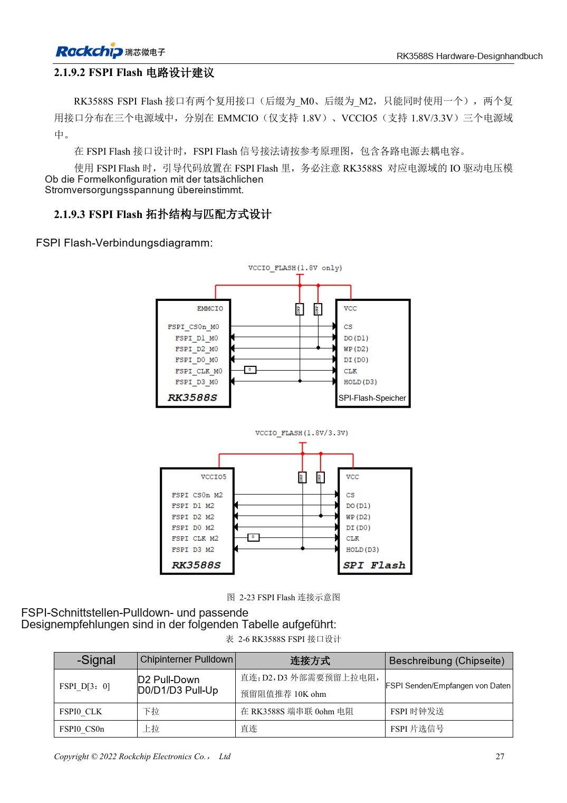

<!-- rk3588s-hardware-v12-20261109 -->

# RK3588S-FSPI-Flash: Boot, Versorgung und Anpassung

Grundlage ist der chinesische RK3588S Hardware Design Guide V1.2 (2023-12-14) zur Schaltungs- und PCB-Prüfung. CM7S-Träger folgen den Modulschnittstellen; Sige7S dient der Software-/Peripherieerprobung. SoC-Funktionen sind keine Boardanschlussliste. SDK/BSP, Kernel, Revision, Firmware und Multiplexing prüfen. Werte sind Quellenreferenzen, keine ArmSoM-Messungen.

**RK3588S Hardware Design Guide V1.2 (2023-12-14), CN** · §2.1.9; §2.1.4; §3.4.15

## Bootrolle und Domäne bestimmen

FSPI kann frühen Code einschließlich PCIe-Initialisierung vor SSD-Boot speichern. Die Muxgruppe bestimmt die IO-Domäne; Flash muss dieselbe Versorgung nutzen. Gleiches Gehäuse genügt nicht für Austauschbarkeit: Bauteilunterstützung, Kapazität, Loader und Programmierablauf prüfen.

## Test und Recovery erhalten

Tabelle 2-6 sieht 10kΩ-Pull-ups für D2/D3, 0Ω in CLK am SoC und direktes CS vor. Position, Länge und Start gemeinsam prüfen, dann Kaltstarts und vollständigen Rücklesevergleich durchführen. USB-Recovery für Reparatur bei beschädigtem Flashinhalt erhalten.

## Widerspruch bei Multiplexgruppen

PDF-Seite 42 nennt nur FSPI_M0 und FSPI_M2, spricht aber von drei Versorgungsdomänen; der Boottext erwähnt außerdem FSPI_M1. Daraus folgt kein dritter nutzbarer Anschluss. M0/M2 vor der Auswahl anhand der EMMCIO-/VCCIO5-Pins, Bootfirmware und TRM prüfen.

## Entwurfsparameter und Prüftabelle

| Punkt | Quellenreferenz |
| --- | --- |
| D2 / D3 | Vorsehen 10kΩ Pull-up |
| CLK | 0Ω am SoC |
| Versorgung | Gleiche Schiene wie gewählte FSPI-IO-Domäne |
| PCB-Impedanz/Länge | 50Ω ±10% / <4in |
| Takt-Daten-Differenz | <200mil |

## Quellenabbildungen

Für diese Reihe liegt kein entsprechendes englisches Designhandbuch vor. Alle vier Fassungen nutzen chinesische Originalausschnitte mit lokalisierten Beschriftungen. Bilder lassen sich in voller Auflösung öffnen; Text und Parametertabellen bleiben kopierbar. Seitenangaben beziehen sich auf physische PDF-Seiten.

Chinesisches Original · PDF 42 · 2-23

## Entwicklung mit ArmSoM

CM7S eignet sich für eigene Träger: zunächst integrierte Versorgung, DDR und Bootschaltungen bestimmen, dann außerhalb der Modulstecker planen. Sige7S dient als Ausgangspunkt für Software-/Peripherieerprobung. Bei beiden Produkten herausgeführte Interfaces, Pins, Pegel, Images und Kühlung revisionsbezogen prüfen. Ein Chipreferenzplan ist kein Produktanschlussplan.

- [ArmSoM CM7S](https://www.armsom.org/cm7s) · [CM7S Docs](https://docs.armsom.org/armsom-cm7s)
- [ArmSoM Sige7S](https://www.armsom.org/sige7s) · [Sige7S Docs](https://docs.armsom.org/armsom-sige7s)

## Weiterlesen

- [RK3588S-Hardwaredesign: 30 Themen](/de/articles/rk3588s-hardware-design-series/)
- [RK3588S-eMMC: Takt, Pull-ups und Strobe](/de/articles/rk3588s-emmc-hardware-design/)
- [RK3588S-SDMMC und SDIO-WLAN: Pegelwechsel und Schutz](/de/articles/rk3588s-sdmmc-sdio-wifi-design/)
