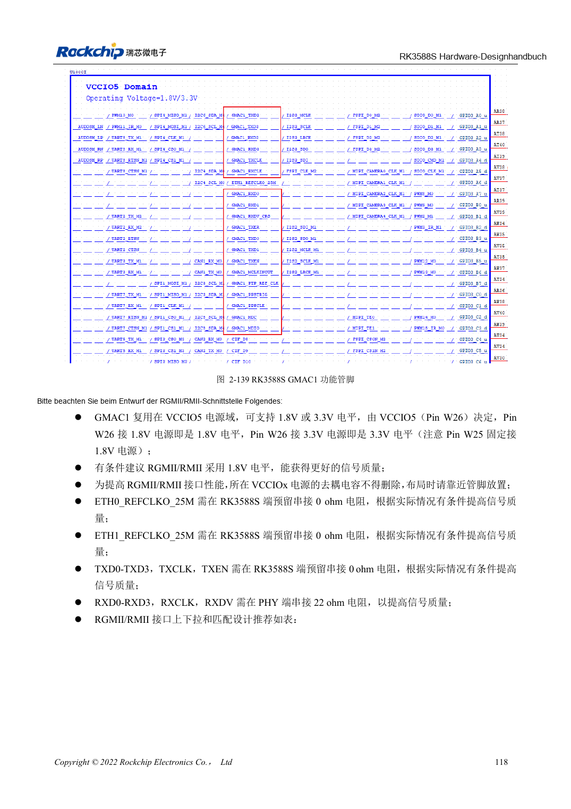
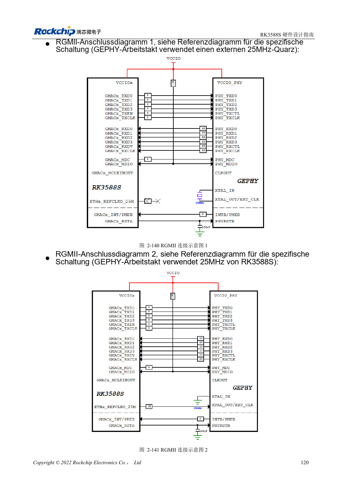

<!-- rk3588s-hardware-v12-20261109 -->

# RK3588S-Ethernet: GMAC, PHY und Taktrichtung

Grundlage ist der chinesische RK3588S Hardware Design Guide V1.2 (2023-12-14) zur Schaltungs- und PCB-Prüfung. CM7S-Träger folgen den Modulschnittstellen; Sige7S dient der Software-/Peripherieerprobung. SoC-Funktionen sind keine Boardanschlussliste. SDK/BSP, Kernel, Revision, Firmware und Multiplexing prüfen. Werte sind Quellenreferenzen, keine ArmSoM-Messungen.

**RK3588S Hardware Design Guide V1.2 (2023-12-14), CN** · §2.3.10; §3.4.17

## Ein GMAC1 mit VCCIO5-Prüfung

RK3588S stellt einen GMAC1 für einen externen RGMII-/RMII-PHY bereit. VCCIO5 W26 wählt 1.8V/3.3V; die feste 1.8V-Hilfsversorgung an W25 bleibt erforderlich. Einzelne ETH0-Texte bedeuten keinen zweiten Controller. Den 50MHz-RMII-Ein-/Ausgangsmodus an MAC und PHY abstimmen, um doppelte Treiber zu vermeiden.

## Delay und Anpassung prüfen

TX mit vorgesehenen 0Ω am SoC, RX mit 22Ω am PHY, MDIO-Pull-up 1.5–1.8kΩ. PHY-internes Delay, PCB-Laufzeit und BSP gemeinsam prüfen, um Doppelkompensation zu vermeiden. Raten, bidirektionale Dauerlast, Fehler und Reset testen. RGMII nicht direkt an RJ45 anschließen.

## Entwurfsparameter und Prüftabelle

| Punkt | Quellenreferenz |
| --- | --- |
| RGMII-Impedanz | 50Ω ±10% single-ended |
| TX/RX-Gruppe zu Takt | <120mil |
| Leiterlänge | <5in |
| MDIO-Pull-up | 1.5–1.8kΩ |

## Quellenabbildungen

Für diese Reihe liegt kein entsprechendes englisches Designhandbuch vor. Alle vier Fassungen nutzen chinesische Originalausschnitte mit lokalisierten Beschriftungen. Bilder lassen sich in voller Auflösung öffnen; Text und Parametertabellen bleiben kopierbar. Seitenangaben beziehen sich auf physische PDF-Seiten.

Chinesisches Original · PDF 133 · 2-139

Chinesisches Original · PDF 135 · 2-140

## Entwicklung mit ArmSoM

CM7S eignet sich für eigene Träger: zunächst integrierte Versorgung, DDR und Bootschaltungen bestimmen, dann außerhalb der Modulstecker planen. Sige7S dient als Ausgangspunkt für Software-/Peripherieerprobung. Bei beiden Produkten herausgeführte Interfaces, Pins, Pegel, Images und Kühlung revisionsbezogen prüfen. Ein Chipreferenzplan ist kein Produktanschlussplan.

- [ArmSoM CM7S](https://www.armsom.org/cm7s) · [CM7S Docs](https://docs.armsom.org/armsom-cm7s)
- [ArmSoM Sige7S](https://www.armsom.org/sige7s) · [Sige7S Docs](https://docs.armsom.org/armsom-sige7s)

## Weiterlesen

- [RK3588S-Hardwaredesign: 30 Themen](/de/articles/rk3588s-hardware-design-series/)
- [RK3588S-Audiohardware: I2S, PDM und Mikrofonarrays](/de/articles/rk3588s-audio-hardware-design/)
- [RK3588S-GPIO und SARADC: Domänen und Tasten](/de/articles/rk3588s-gpio-saradc-hardware/)
