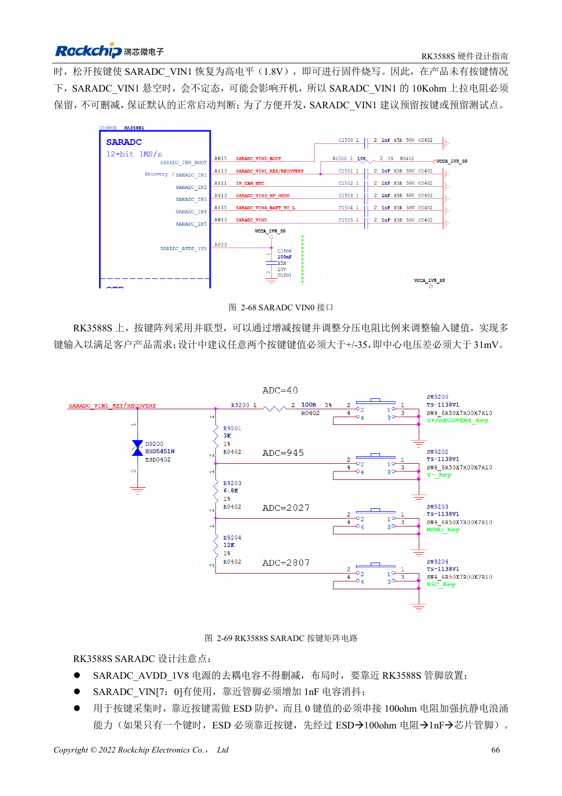

<!-- rk3588s-hardware-v12-20261109 -->

# RK3588S-GPIO und SARADC: Domänen und Tasten

Grundlage ist der chinesische RK3588S Hardware Design Guide V1.2 (2023-12-14) zur Schaltungs- und PCB-Prüfung. CM7S-Träger folgen den Modulschnittstellen; Sige7S dient der Software-/Peripherieerprobung. SoC-Funktionen sind keine Boardanschlussliste. SDK/BSP, Kernel, Revision, Firmware und Multiplexing prüfen. Werte sind Quellenreferenzen, keine ArmSoM-Messungen.

**RK3588S Hardware Design Guide V1.2 (2023-12-14), CN** · §2.1.10; §2.3.2; §2.3.16

## Domänen zuerst prüfen

PMUIO1, EMMCIO und VCCIO1 sind fest 1.8V; PMUIO2, VCCIO2 und VCCIO4/5/6 wählen 1.8V oder 3.3V. Feste Begleitpins und wählbare Pins nicht zwischen S0/S3 mischen. Automatische Domänenerkennung erlaubt keine 5V-Signale.

## Nicht alle ADC-Kanäle sind frei

SARADC: 12 Bit, 1MS/s, 0–1.8V, acht Eingänge; IN0_BOOT ist reserviert, IN1 behält Recovery und 10kΩ-Pull-up. 1nF nahe genutzten Pins, ESD vor dem Tastenserienwiderstand. Die Angabe ±35 Tastencodes/123mV ist neben 12 Bit uneindeutig; Schwellen anhand Treiberskalierung und Messung bestimmen.

## Entwurfsparameter und Prüftabelle

| Punkt | Quellenreferenz |
| --- | --- |
| SARADC | 12bit; 1MS/s; 0–1.8V |
| Reservierte Eingänge | IN0_BOOT; IN1 Wiederherstellung |
| Eingangsfilter | 1nF |
| Recovery-Pull-up | 10kΩ |

## Quellenabbildungen

Für diese Reihe liegt kein entsprechendes englisches Designhandbuch vor. Alle vier Fassungen nutzen chinesische Originalausschnitte mit lokalisierten Beschriftungen. Bilder lassen sich in voller Auflösung öffnen; Text und Parametertabellen bleiben kopierbar. Seitenangaben beziehen sich auf physische PDF-Seiten.

Chinesisches Original · PDF 81 · 2-69

## Entwicklung mit ArmSoM

CM7S eignet sich für eigene Träger: zunächst integrierte Versorgung, DDR und Bootschaltungen bestimmen, dann außerhalb der Modulstecker planen. Sige7S dient als Ausgangspunkt für Software-/Peripherieerprobung. Bei beiden Produkten herausgeführte Interfaces, Pins, Pegel, Images und Kühlung revisionsbezogen prüfen. Ein Chipreferenzplan ist kein Produktanschlussplan.

- [ArmSoM CM7S](https://www.armsom.org/cm7s) · [CM7S Docs](https://docs.armsom.org/armsom-cm7s)
- [ArmSoM Sige7S](https://www.armsom.org/sige7s) · [Sige7S Docs](https://docs.armsom.org/armsom-sige7s)

## Weiterlesen

- [RK3588S-Hardwaredesign: 30 Themen](/de/articles/rk3588s-hardware-design-series/)
- [RK3588S-Ethernet: GMAC, PHY und Taktrichtung](/de/articles/rk3588s-gmac-hardware-design/)
- [RK3588S-UART, SPI, CAN, I2C und PWM zuordnen](/de/articles/rk3588s-serial-control-hardware/)
