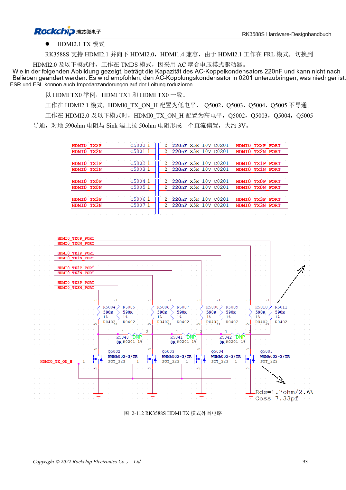
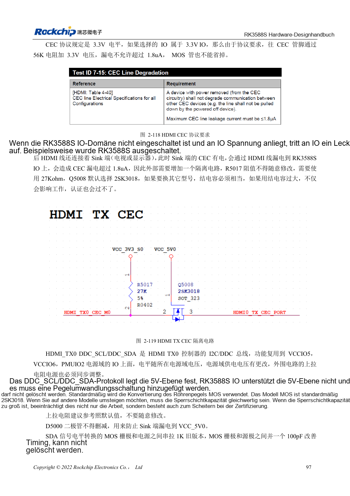

<!-- rk3588s-hardware-v12-20261109 -->

# RK3588S-HDMI-TX: FRL, TMDS und Kompatibilität

Grundlage ist der chinesische RK3588S Hardware Design Guide V1.2 (2023-12-14) zur Schaltungs- und PCB-Prüfung. CM7S-Träger folgen den Modulschnittstellen; Sige7S dient der Software-/Peripherieerprobung. SoC-Funktionen sind keine Boardanschlussliste. SDK/BSP, Kernel, Revision, Firmware und Multiplexing prüfen. Werte sind Quellenreferenzen, keine ArmSoM-Messungen.

**RK3588S Hardware Design Guide V1.2 (2023-12-14), CN** · §2.3.8.1; §3.4.6

## FRL und TMDS benötigen verschiedene Zustände

HDMI2.1 nutzt FRL, HDMI2.0 und ältere Modi TMDS. Die Referenz verwendet 220nF und geschalteten Bias, bei TMDS 590Ω zusammen mit dem Empfänger. MOS-Auszustand und parasitäre Kapazität sind wichtig. Ein Bild rechtfertigt kein Entfernen der Steuerung. Gemeinsame HDMI/eDP-PHYs begrenzen Gleichzeitigkeit.

## Steuerung und Hochgeschwindigkeit prüfen

REXT: 8.2kΩ, 1%. DDC braucht 5V-Wandlung, TX-CEC 27kΩ und Isolation gegen Leckstrom. Pin18 am Stecker: 4.8–5.3V. HDMI2.1-ESD ≤0.2pF. Hotplug, ausgeschaltete Verbindung sowie Displays/Kabel testen. Historische Nichtunterstützung beschreibt die Quellenversion, nicht jeden aktuellen BSP.

## 590Ω gegenüber 499Ω bleibt offen

TMDS-Text auf Seite 108 und Layout auf Seite 220 nennen 590Ω, Tabelle 2-24 auf Seite 114 dagegen 499Ω. Nicht stillschweigend vereinheitlichen. Vor BOM-Freigabe Referenzschaltplan, PHY-Konfiguration und Herstellerangaben abgleichen. Es gibt einen HDMI/eDP-Combo; verbliebene TX1-Bezeichnungen belegen keinen zweiten Anschluss.

## Entwurfsparameter und Prüftabelle

| Punkt | Quellenreferenz |
| --- | --- |
| TX-Kopplungs-/Biasreferenz | 220nF; 590Ω (PDF108/220) gegenüber 499Ω (PDF114) |
| REXT | 8.2kΩ ±1% |
| PCB-Differenzimpedanz/Länge | 100Ω ±10% / <4in |
| Vias/Abstand | Möglichst ohne Vias / ≥7× Leiterbreite |

## Quellenabbildungen

Für diese Reihe liegt kein entsprechendes englisches Designhandbuch vor. Alle vier Fassungen nutzen chinesische Originalausschnitte mit lokalisierten Beschriftungen. Bilder lassen sich in voller Auflösung öffnen; Text und Parametertabellen bleiben kopierbar. Seitenangaben beziehen sich auf physische PDF-Seiten.

Chinesisches Original · PDF 108 · 2-112

Chinesisches Original · PDF 112 · 2-119

## Entwicklung mit ArmSoM

CM7S eignet sich für eigene Träger: zunächst integrierte Versorgung, DDR und Bootschaltungen bestimmen, dann außerhalb der Modulstecker planen. Sige7S dient als Ausgangspunkt für Software-/Peripherieerprobung. Bei beiden Produkten herausgeführte Interfaces, Pins, Pegel, Images und Kühlung revisionsbezogen prüfen. Ein Chipreferenzplan ist kein Produktanschlussplan.

- [ArmSoM CM7S](https://www.armsom.org/cm7s) · [CM7S Docs](https://docs.armsom.org/armsom-cm7s)
- [ArmSoM Sige7S](https://www.armsom.org/sige7s) · [Sige7S Docs](https://docs.armsom.org/armsom-sige7s)

## Weiterlesen

- [RK3588S-Hardwaredesign: 30 Themen](/de/articles/rk3588s-hardware-design-series/)
- [RK3588S und RK3588S2: Kamera-PHYs und Kompatibilität](/de/articles/rk3588s-rk3588s2-hardware-differences/)
- [RK3588S-MIPI-Displays: D-PHY, C-PHY und Panels](/de/articles/rk3588s-mipi-display-hardware/)
