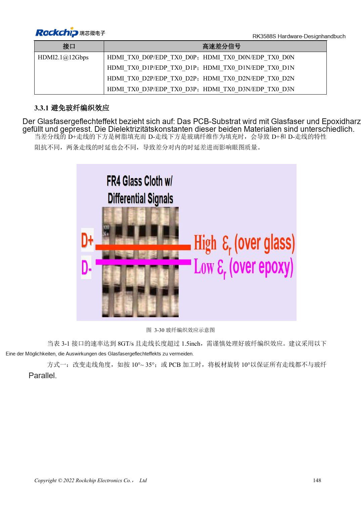
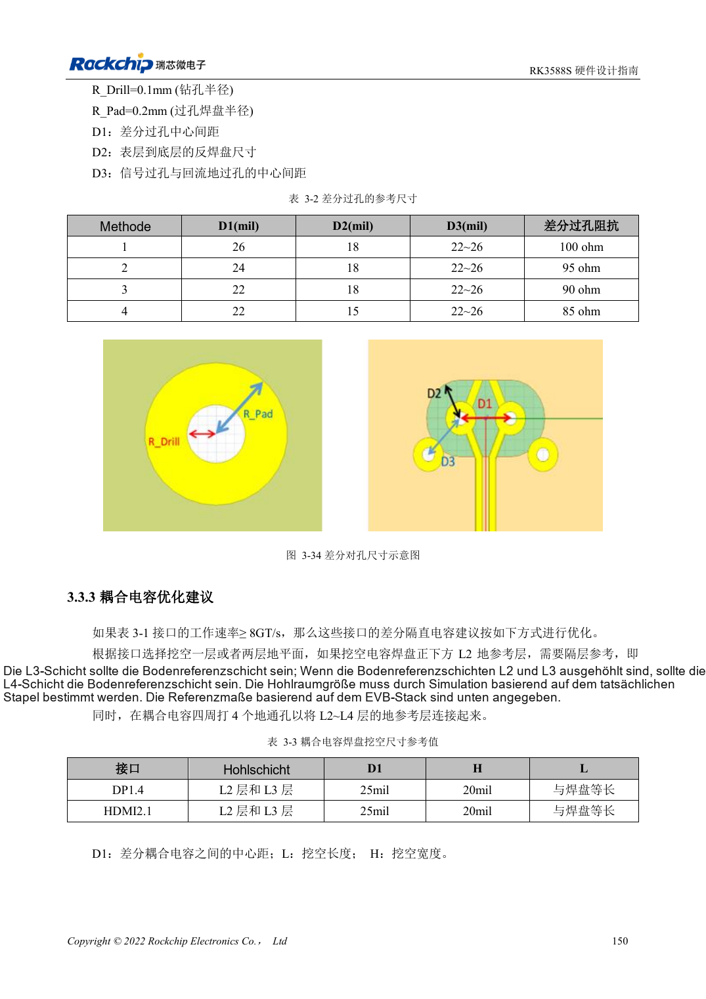
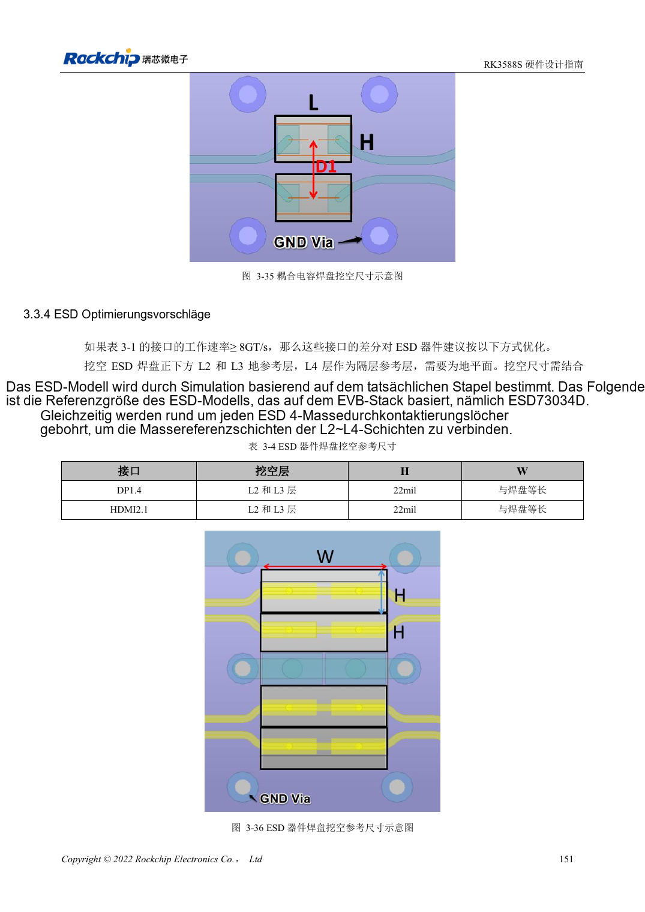

<!-- rk3588s-hardware-v12-20261109 -->

# RK3588S-Hochgeschwindigkeits-PCB: Pads und Vias ab 8GT/s

Grundlage ist der chinesische RK3588S Hardware Design Guide V1.2 (2023-12-14) zur Schaltungs- und PCB-Prüfung. CM7S-Träger folgen den Modulschnittstellen; Sige7S dient der Software-/Peripherieerprobung. SoC-Funktionen sind keine Boardanschlussliste. SDK/BSP, Kernel, Revision, Firmware und Multiplexing prüfen. Werte sind Quellenreferenzen, keine ArmSoM-Messungen.

**RK3588S Hardware Design Guide V1.2 (2023-12-14), CN** · §3.2–3.3

## Tatsächliche schnelle Links bestimmen

Tabelle 3-1 nennt DP1.4 mit 8.1Gbps und HDMI2.1 mit 12Gbps. RK3588-PCIe3.0-Regeln verleihen RK3588S kein PCIe3.0. Ab 8GT/s und über 1.5in Glasgewebeeffekte prüfen; 10°–35° Leiterwinkel sind eine Möglichkeit. Referenzradien: Bohrung 0.1mm, Pad 0.2mm. Einen anderen Aufbau erneut simulieren.

## Rückstrom nach Aussparungen erhalten

Wird L2 unter einem Kondensator entfernt, muss L3 Masse sein; bei L2/L3-Aussparung L4, mit nahen Masseverbindungen. Maße gelten für EVB-Aufbau und Bauteile. Relevante Leiter über 1.5in benötigen Glasgewebeprüfung, etwa Winkelrouting. Modul, Träger und Stecker als vollständigen Kanal simulieren oder messen.

## Entwurfsparameter und Prüftabelle

| Punkt | Quellenreferenz |
| --- | --- |
| Glasgewebeprüfung | 8GT/s und Länge >1.5in |
| Winkelbeispiel | 10°–35° |
| Via-Referenzradien | Bohrung 0.1mm; Pad 0.2mm |

## Quellenabbildungen

Für diese Reihe liegt kein entsprechendes englisches Designhandbuch vor. Alle vier Fassungen nutzen chinesische Originalausschnitte mit lokalisierten Beschriftungen. Bilder lassen sich in voller Auflösung öffnen; Text und Parametertabellen bleiben kopierbar. Seitenangaben beziehen sich auf physische PDF-Seiten.

Chinesisches Original · PDF 163 · 3-30

Chinesisches Original · PDF 165 · 3-34

Chinesisches Original · PDF 166 · 3-36

## Entwicklung mit ArmSoM

CM7S eignet sich für eigene Träger: zunächst integrierte Versorgung, DDR und Bootschaltungen bestimmen, dann außerhalb der Modulstecker planen. Sige7S dient als Ausgangspunkt für Software-/Peripherieerprobung. Bei beiden Produkten herausgeführte Interfaces, Pins, Pegel, Images und Kühlung revisionsbezogen prüfen. Ein Chipreferenzplan ist kein Produktanschlussplan.

- [ArmSoM CM7S](https://www.armsom.org/cm7s) · [CM7S Docs](https://docs.armsom.org/armsom-cm7s)
- [ArmSoM Sige7S](https://www.armsom.org/sige7s) · [Sige7S Docs](https://docs.armsom.org/armsom-sige7s)

## Weiterlesen

- [RK3588S-Hardwaredesign: 30 Themen](/de/articles/rk3588s-hardware-design-series/)
- [RK3588S-Lagenaufbau und Fanout: HDI oder PTH](/de/articles/rk3588s-pcb-stackup-fanout/)
- [RK3588S-Power-PCB und PDN: Kupfer, Rückwege und Abblockung](/de/articles/rk3588s-power-pcb-pdn-design/)
