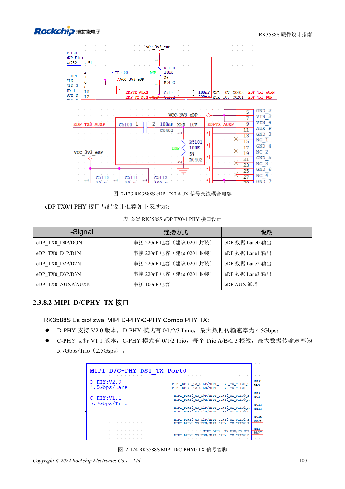
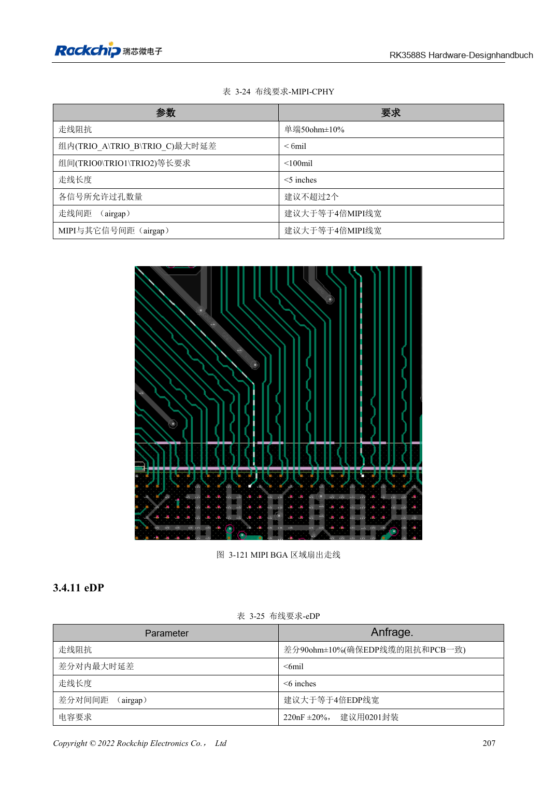

<!-- rk3588s-hardware-v12-20261109 -->

# RK3588S-MIPI-Displays: D-PHY, C-PHY und Panels

Grundlage ist der chinesische RK3588S Hardware Design Guide V1.2 (2023-12-14) zur Schaltungs- und PCB-Prüfung. CM7S-Träger folgen den Modulschnittstellen; Sige7S dient der Software-/Peripherieerprobung. SoC-Funktionen sind keine Boardanschlussliste. SDK/BSP, Kernel, Revision, Firmware und Multiplexing prüfen. Werte sind Quellenreferenzen, keine ArmSoM-Messungen.

**RK3588S Hardware Design Guide V1.2 (2023-12-14), CN** · §2.3.8.2; §3.4.10; §3.4.21

## Lanes und Trios getrennt planen

Die zwei D/C-Combo-PHYs bieten vier Zweidraht-Datenlanes bei D-PHY oder drei A/B/C-Trios bei C-PHY. TX/RX desselben PHY müssen denselben D- oder C-PHY-Modus nutzen. Panelprotokoll, Lane-/Triozahl und Timing vor Verdrahtung prüfen.

## Panels brauchen mehr als Daten

Hintergrundlichtversorgung, Enable, Reset, Touch-I2C und Interrupt nach Pegel und Sequenz abstimmen. D-PHY-Differenzimpedanz und C-PHY-Einzelimpedanz benötigen getrennte DRC-Regeln. Panelinitialisierung im konkreten BSP, Helligkeitswechsel, Schlaf/Aufwachen, Touchstörungen und Dauerbetrieb testen.

## Entwurfsparameter und Prüftabelle

| Punkt | Quellenreferenz |
| --- | --- |
| D-PHY-Quellenrate | 4.5Gbps/lane |
| C-PHY-Quellenrate | 5.7Gbps/trio |
| C-PHY-Impedanz | 50Ω ±10% single-ended |
| C-PHY innerhalb/zwischen Trios | <6mil / <100mil |
| C-PHY-Länge | <5in |

## Quellenabbildungen

Für diese Reihe liegt kein entsprechendes englisches Designhandbuch vor. Alle vier Fassungen nutzen chinesische Originalausschnitte mit lokalisierten Beschriftungen. Bilder lassen sich in voller Auflösung öffnen; Text und Parametertabellen bleiben kopierbar. Seitenangaben beziehen sich auf physische PDF-Seiten.

Chinesisches Original · PDF 115 · 2-124

Chinesisches Original · PDF 222 · 3-121

## Entwicklung mit ArmSoM

CM7S eignet sich für eigene Träger: zunächst integrierte Versorgung, DDR und Bootschaltungen bestimmen, dann außerhalb der Modulstecker planen. Sige7S dient als Ausgangspunkt für Software-/Peripherieerprobung. Bei beiden Produkten herausgeführte Interfaces, Pins, Pegel, Images und Kühlung revisionsbezogen prüfen. Ein Chipreferenzplan ist kein Produktanschlussplan.

- [ArmSoM CM7S](https://www.armsom.org/cm7s) · [CM7S Docs](https://docs.armsom.org/armsom-cm7s)
- [ArmSoM Sige7S](https://www.armsom.org/sige7s) · [Sige7S Docs](https://docs.armsom.org/armsom-sige7s)

## Weiterlesen

- [RK3588S-Hardwaredesign: 30 Themen](/de/articles/rk3588s-hardware-design-series/)
- [RK3588S-HDMI-TX: FRL, TMDS und Kompatibilität](/de/articles/rk3588s-hdmi-tx-hardware-design/)
- [RK3588S-DP und eDP: PHYs, AUX und Kopplung](/de/articles/rk3588s-dp-edp-hardware-design/)
