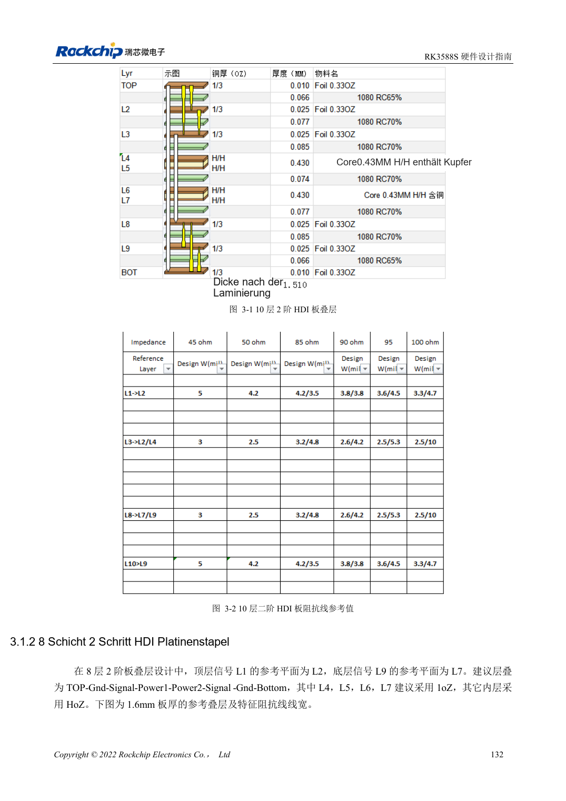
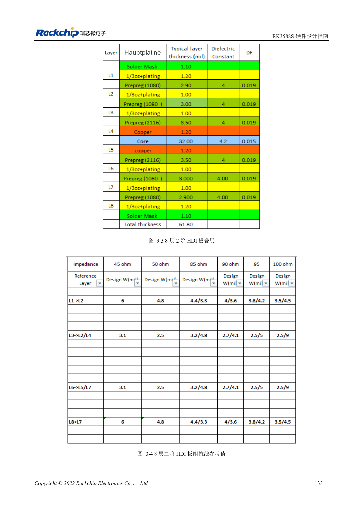
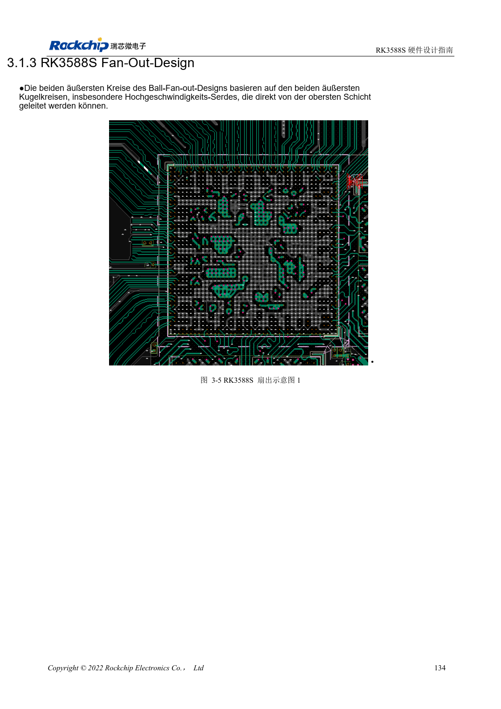

<!-- rk3588s-hardware-v12-20261109 -->

# RK3588S-Lagenaufbau und Fanout: HDI oder PTH

Grundlage ist der chinesische RK3588S Hardware Design Guide V1.2 (2023-12-14) zur Schaltungs- und PCB-Prüfung. CM7S-Träger folgen den Modulschnittstellen; Sige7S dient der Software-/Peripherieerprobung. SoC-Funktionen sind keine Boardanschlussliste. SDK/BSP, Kernel, Revision, Firmware und Multiplexing prüfen. Werte sind Quellenreferenzen, keine ArmSoM-Messungen.

**RK3588S Hardware Design Guide V1.2 (2023-12-14), CN** · §3.1–3.2

## Beide Referenzen nutzen HDI zweiter Ordnung

Das RK3588S-Handbuch zeigt zehn- und achtlagige HDI-Aufbauten zweiter Ordnung, nicht die achtlagige RK3588-Durchkontaktierungsreferenz. Referenzdicke 1.6mm; Signale möglichst neben Masse, Aufbau symmetrisch. Seite 147 nennt die Unterseite des Achtlagenaufbaus fälschlich L9. Diagramm und Fertigerunterlagen statt dieses Labels verwenden.

## BGA-Fanout und Trägerrouting trennen

Die äußeren zwei Ballreihen können auf der Oberseite entflochten werden; schnelle Links möglichst ohne Lagenwechsel führen. Breiten, Microvias, vergrabene Vias und Antipads aus Fertigung und Impedanzberechnung ableiten. Ein CM7S-Träger beginnt am Modulstecker, nicht am RK3588S-BGA. Den gesamten Modul-/Stecker-/Trägerkanal prüfen.

## Entwurfsparameter und Prüftabelle

| Punkt | Quellenreferenz |
| --- | --- |
| Referenzlagenaufbauten | 10-Lagen / 8-Lagen HDI zweiter Ordnung |
| Beispiel-Platinendicke | 1.6mm |
| Geltungsbereich der Leiterlänge | PCB + Vias + Gehäuse |

## Quellenabbildungen

Für diese Reihe liegt kein entsprechendes englisches Designhandbuch vor. Alle vier Fassungen nutzen chinesische Originalausschnitte mit lokalisierten Beschriftungen. Bilder lassen sich in voller Auflösung öffnen; Text und Parametertabellen bleiben kopierbar. Seitenangaben beziehen sich auf physische PDF-Seiten.

Chinesisches Original · PDF 147 · 3-1

Chinesisches Original · PDF 148 · 3-3

Chinesisches Original · PDF 149 · 3-5

## Entwicklung mit ArmSoM

CM7S eignet sich für eigene Träger: zunächst integrierte Versorgung, DDR und Bootschaltungen bestimmen, dann außerhalb der Modulstecker planen. Sige7S dient als Ausgangspunkt für Software-/Peripherieerprobung. Bei beiden Produkten herausgeführte Interfaces, Pins, Pegel, Images und Kühlung revisionsbezogen prüfen. Ein Chipreferenzplan ist kein Produktanschlussplan.

- [ArmSoM CM7S](https://www.armsom.org/cm7s) · [CM7S Docs](https://docs.armsom.org/armsom-cm7s)
- [ArmSoM Sige7S](https://www.armsom.org/sige7s) · [Sige7S Docs](https://docs.armsom.org/armsom-sige7s)

## Weiterlesen

- [RK3588S-Hardwaredesign: 30 Themen](/de/articles/rk3588s-hardware-design-series/)
- [RK3588S-UART, SPI, CAN, I2C und PWM zuordnen](/de/articles/rk3588s-serial-control-hardware/)
- [RK3588S-Hochgeschwindigkeits-PCB: Pads und Vias ab 8GT/s](/de/articles/rk3588s-high-speed-pcb-review/)
