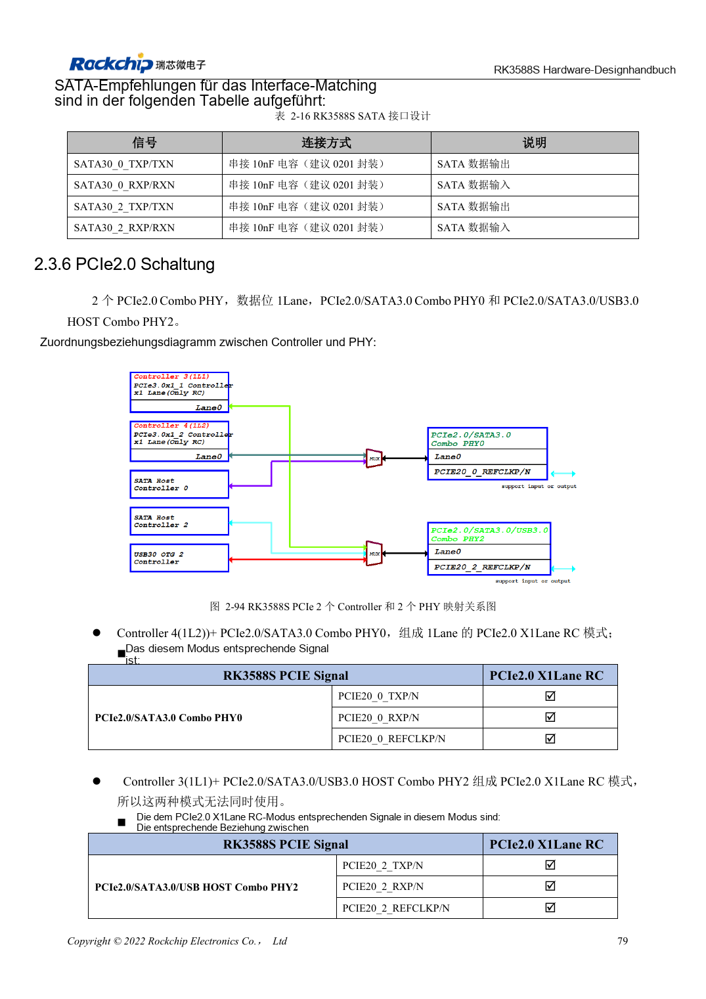
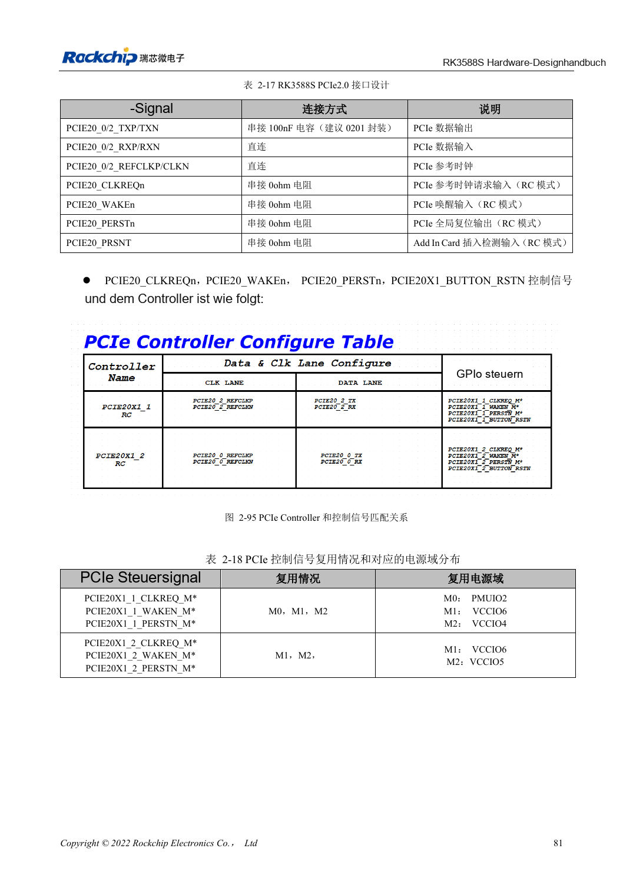

<!-- rk3588s-hardware-v12-20261109 -->

# RK3588S-PCIe: Lanes, Referenztakte und Versorgung

Grundlage ist der chinesische RK3588S Hardware Design Guide V1.2 (2023-12-14) zur Schaltungs- und PCB-Prüfung. CM7S-Träger folgen den Modulschnittstellen; Sige7S dient der Software-/Peripherieerprobung. SoC-Funktionen sind keine Boardanschlussliste. SDK/BSP, Kernel, Revision, Firmware und Multiplexing prüfen. Werte sind Quellenreferenzen, keine ArmSoM-Messungen.

**RK3588S Hardware Design Guide V1.2 (2023-12-14), CN** · §2.3.6; §3.4.4

## Für PCIe2.0 x1 auslegen

Das RK3588S-Kapitel nennt zwei PCIe2.0-x1-RC-Controller an PHY0/2, nicht die PCIe3.0-x4-Architektur des RK3588. Seite 95 enthält noch PCIe3.0-Text; die Aussage zur nicht gleichzeitigen Nutzung auf Seite 94 ist unklar abgegrenzt. Das Zuordnungsbild verwenden, Parallelbetrieb nicht versprechen und TRM/SDK prüfen. REFCLK wird standardmäßig zum EP ausgegeben.

## Steuersignale und vollständiger Kanal

CLKREQn/WAKEn benötigen Funktionspins derselben Mx-Gruppe. PERSTn darf GPIO nutzen; als Funktionspin muss es zur Gruppe gehören. Standard-Slot-Steuerpegel von 3.3V passend übersetzen. 100nF Kopplung, 85Ω Daten und 100Ω REFCLK vorsehen. Modul, Stecker und Träger gemeinsam auf Kaltstart, Zielrate, Resume und Dauertransfer prüfen.

## Entwurfsparameter und Prüftabelle

| Punkt | Quellenreferenz |
| --- | --- |
| PCIe-Controller | 2 × PCIe2.0 x1 RC |
| PCIe-Datenimpedanz | 85Ω ±10% |
| REFCLK-Impedanz | 100Ω ±10% |
| PCIe-Kopplung | 100nF ±20% |
| Daten-/REFCLK-Paardifferenz | <6mil / <12mil |
| Länge/Vias | <6in / empfohlen ≤2 |

## Quellenabbildungen

Für diese Reihe liegt kein entsprechendes englisches Designhandbuch vor. Alle vier Fassungen nutzen chinesische Originalausschnitte mit lokalisierten Beschriftungen. Bilder lassen sich in voller Auflösung öffnen; Text und Parametertabellen bleiben kopierbar. Seitenangaben beziehen sich auf physische PDF-Seiten.

Chinesisches Original · PDF 94 · 2-94

Chinesisches Original · PDF 96 · 2-95

## Entwicklung mit ArmSoM

CM7S eignet sich für eigene Träger: zunächst integrierte Versorgung, DDR und Bootschaltungen bestimmen, dann außerhalb der Modulstecker planen. Sige7S dient als Ausgangspunkt für Software-/Peripherieerprobung. Bei beiden Produkten herausgeführte Interfaces, Pins, Pegel, Images und Kühlung revisionsbezogen prüfen. Ein Chipreferenzplan ist kein Produktanschlussplan.

- [ArmSoM CM7S](https://www.armsom.org/cm7s) · [CM7S Docs](https://docs.armsom.org/armsom-cm7s)
- [ArmSoM Sige7S](https://www.armsom.org/sige7s) · [Sige7S Docs](https://docs.armsom.org/armsom-sige7s)

## Weiterlesen

- [RK3588S-Hardwaredesign: 30 Themen](/de/articles/rk3588s-hardware-design-series/)
- [RK3588S-SATA: drei Controller und gemeinsame PHYs](/de/articles/rk3588s-sata-hardware-design/)
- [RK3588S-Kameras: CSI, D/C-PHY und CIF planen](/de/articles/rk3588s-camera-hardware-design/)
