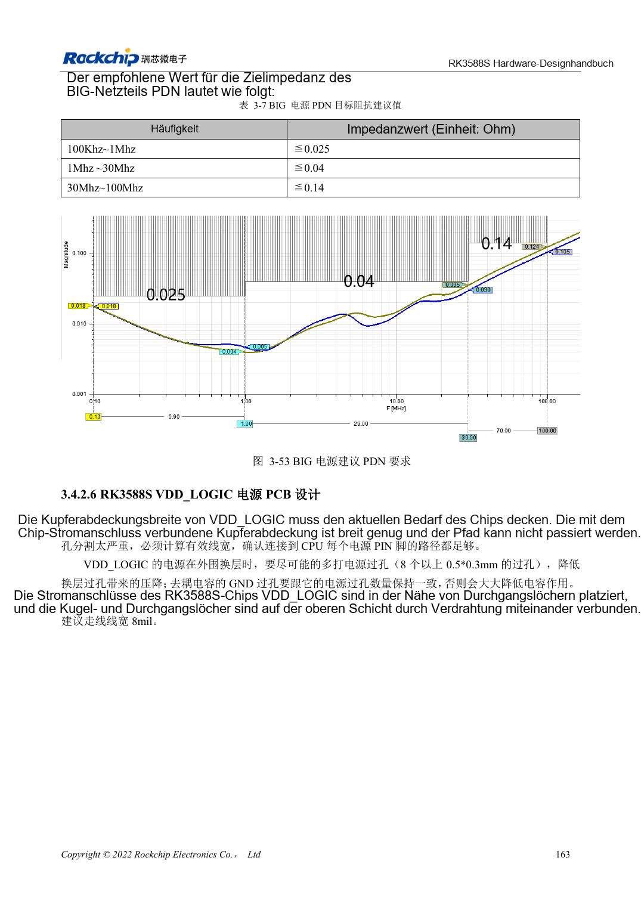

<!-- rk3588s-hardware-v12-20261109 -->

# RK3588S-Power-PCB und PDN: Kupfer, Rückwege und Abblockung

Grundlage ist der chinesische RK3588S Hardware Design Guide V1.2 (2023-12-14) zur Schaltungs- und PCB-Prüfung. CM7S-Träger folgen den Modulschnittstellen; Sige7S dient der Software-/Peripherieerprobung. SoC-Funktionen sind keine Boardanschlussliste. SDK/BSP, Kernel, Revision, Firmware und Multiplexing prüfen. Werte sind Quellenreferenzen, keine ArmSoM-Messungen.

**RK3588S Hardware Design Guide V1.2 (2023-12-14), CN** · §3.4.2

## Kondensatorzahl allein reicht nicht

Massevias an Hochstrom-Buck-Kondensatoren sollen den positiven Vias entsprechen. Effektive Kupferbreite und Engstellen nach Durchkontaktierungen prüfen; schmale Thermal-Reliefs an kritischen Versorgungen vermeiden. RK806-Platzierung zwischen kurzen Pfaden und Wärmeverteilung abwägen.

## Impedanz frequenzabhängig prüfen

Tabelle 3-7 nennt frequenzabhängige BIG-PDN-Ziele, keinen Universalkondensator. Regler, Flächen, Vias, Gehäuse und ESR/ESL modellieren. Das sind Referenzempfehlungen, keine ArmSoM-Messungen. Einbruch und Nachschwingen bei Lastsprüngen mit Temperatur, Takt und Fehlern korrelieren.

## Entwurfsparameter und Prüftabelle

| Punkt | Quellenreferenz |
| --- | --- |
| BIG PDN 100kHz–1MHz | ≤0.025Ω |
| BIG PDN 1–30MHz | ≤0.04Ω |
| BIG PDN 30–100MHz | ≤0.14Ω |
| Via-Referenzstrom (<1V) | 0.5A; Quellenbeispiel 0.5×0.3mm Via |

## Quellenabbildungen

Für diese Reihe liegt kein entsprechendes englisches Designhandbuch vor. Alle vier Fassungen nutzen chinesische Originalausschnitte mit lokalisierten Beschriftungen. Bilder lassen sich in voller Auflösung öffnen; Text und Parametertabellen bleiben kopierbar. Seitenangaben beziehen sich auf physische PDF-Seiten.

Chinesisches Original · PDF 178 · 3-53

## Entwicklung mit ArmSoM

CM7S eignet sich für eigene Träger: zunächst integrierte Versorgung, DDR und Bootschaltungen bestimmen, dann außerhalb der Modulstecker planen. Sige7S dient als Ausgangspunkt für Software-/Peripherieerprobung. Bei beiden Produkten herausgeführte Interfaces, Pins, Pegel, Images und Kühlung revisionsbezogen prüfen. Ein Chipreferenzplan ist kein Produktanschlussplan.

- [ArmSoM CM7S](https://www.armsom.org/cm7s) · [CM7S Docs](https://docs.armsom.org/armsom-cm7s)
- [ArmSoM Sige7S](https://www.armsom.org/sige7s) · [Sige7S Docs](https://docs.armsom.org/armsom-sige7s)

## Weiterlesen

- [RK3588S-Hardwaredesign: 30 Themen](/de/articles/rk3588s-hardware-design-series/)
- [RK3588S-Hochgeschwindigkeits-PCB: Pads und Vias ab 8GT/s](/de/articles/rk3588s-high-speed-pcb-review/)
- [RK3588S-Thermik: Referenzwärmewiderstand und Systemprüfung](/de/articles/rk3588s-thermal-hardware-design/)
