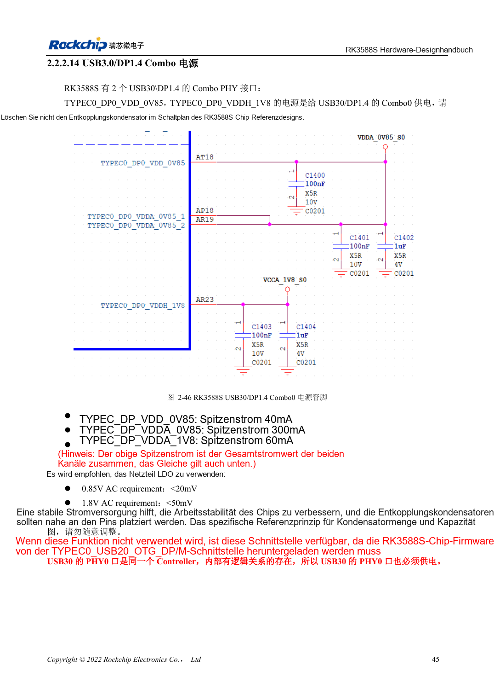
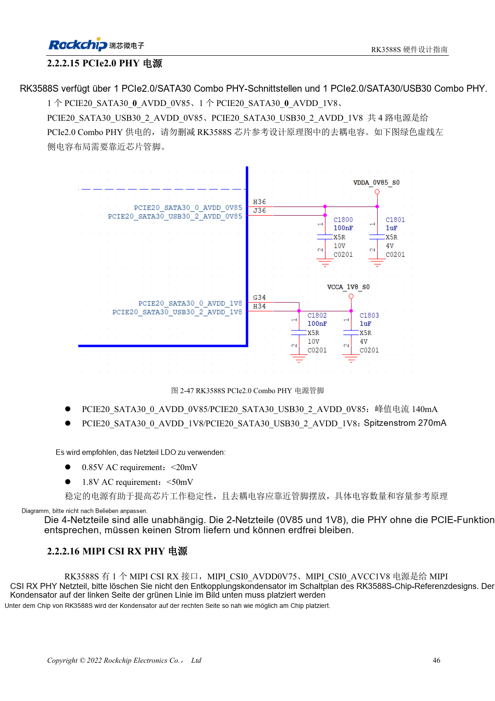

<!-- rk3588s-hardware-v12-20261109 -->

# RK3588S-Versorgung: Startanforderungen und ungenutzte PHYs

Grundlage ist der chinesische RK3588S Hardware Design Guide V1.2 (2023-12-14) zur Schaltungs- und PCB-Prüfung. CM7S-Träger folgen den Modulschnittstellen; Sige7S dient der Software-/Peripherieerprobung. SoC-Funktionen sind keine Boardanschlussliste. SDK/BSP, Kernel, Revision, Firmware und Multiplexing prüfen. Werte sind Quellenreferenzen, keine ArmSoM-Messungen.

**RK3588S Hardware Design Guide V1.2 (2023-12-14), CN** · §2.2.1–2.2.2

## Ungenutzte Funktionen erlauben nicht automatisch fehlende Schienen

Tabelle 2-9 verlangt Startversorgungen für CPU, GPU, NPU, VDENC, DDR, PMU, SARADC, OTP, EMMCIO, VCCIO2, USB2-PHY und TYPEC0. Start, Betrieb, Schlaf, Last, Ripple und Abblockung je Schiene festhalten. Software-Power-down ersetzt keine Startversorgung.

## Jeden Combo-PHY prüfen

RK3588S besitzt PHY0 für PCIe2.0/SATA3.0 und PHY2 für PCIe2.0/SATA3.0/USB3.0, jeweils mit 0.85V und 1.8V. Ein ungenutzter PHY darf laut Quelle unversorgt bleiben, sofern auch seine SATA-/USB-Funktionen entfallen. TYPEC0 hat eine separate obligatorische Startversorgung. Widersprüchliche MIPI-Versorgungsnamen und Spitzenstromangaben anhand des Schaltplans prüfen.

## Entwurfsparameter und Prüftabelle

| Punkt | Quellenreferenz |
| --- | --- |
| PCIe2.0-Analogwelligkeit | 0.85V: <20mV; 1.8V: <50mV |
| PHY-Versorgung | PHY0 / PHY2: 0.85V + 1.8V |
| Obligatorisch beim Start | TYPEC0_DP0; USB2 PHY; Tabelle 2-9 |

## Quellenabbildungen

Für diese Reihe liegt kein entsprechendes englisches Designhandbuch vor. Alle vier Fassungen nutzen chinesische Originalausschnitte mit lokalisierten Beschriftungen. Bilder lassen sich in voller Auflösung öffnen; Text und Parametertabellen bleiben kopierbar. Seitenangaben beziehen sich auf physische PDF-Seiten.

Chinesisches Original · PDF 60 · 2-46

Chinesisches Original · PDF 61 · 2-47

## Entwicklung mit ArmSoM

CM7S eignet sich für eigene Träger: zunächst integrierte Versorgung, DDR und Bootschaltungen bestimmen, dann außerhalb der Modulstecker planen. Sige7S dient als Ausgangspunkt für Software-/Peripherieerprobung. Bei beiden Produkten herausgeführte Interfaces, Pins, Pegel, Images und Kühlung revisionsbezogen prüfen. Ein Chipreferenzplan ist kein Produktanschlussplan.

- [ArmSoM CM7S](https://www.armsom.org/cm7s) · [CM7S Docs](https://docs.armsom.org/armsom-cm7s)
- [ArmSoM Sige7S](https://www.armsom.org/sige7s) · [Sige7S Docs](https://docs.armsom.org/armsom-sige7s)

## Weiterlesen

- [RK3588S-Hardwaredesign: 30 Themen](/de/articles/rk3588s-hardware-design-series/)
- [RK3588S-Boot und Recovery: Maskrom, JTAG und UART](/de/articles/rk3588s-boot-debug-hardware/)
- [RK3588S-Einschaltfolge: RESETn und S0/S3](/de/articles/rk3588s-power-sequencing-design/)
