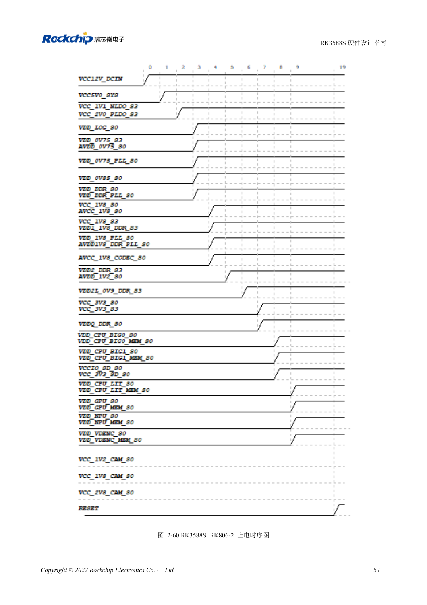

<!-- rk3588s-hardware-v12-20261109 -->

# RK3588S-Einschaltfolge: RESETn und S0/S3

Grundlage ist der chinesische RK3588S Hardware Design Guide V1.2 (2023-12-14) zur Schaltungs- und PCB-Prüfung. CM7S-Träger folgen den Modulschnittstellen; Sige7S dient der Software-/Peripherieerprobung. SoC-Funktionen sind keine Boardanschlussliste. SDK/BSP, Kernel, Revision, Firmware und Multiplexing prüfen. Werte sind Quellenreferenzen, keine ArmSoM-Messungen.

**RK3588S Hardware Design Guide V1.2 (2023-12-14), CN** · §2.1.10.3; §2.2.1.2–2.2.1.3

## Explizite Folgen haben Vorrang

Niedrige Spannung zuerst ersetzt nicht Vorgaben wie MIPI_D/C_PHY_VDD → 1.8V → 1.2V. Den konkreten Power-Tree statt numerischer Sortierung nutzen. RESETn ≥1ms nach letzter Stabilisierung freigeben und Peripherie beachten. Beim Abschalten RESETn vor dem Entfernen der Versorgung aktivieren.

## Schlaf und Rückspeisung testen

Fester 1.8V-Pin und wählbare Domänenspannung müssen gemeinsam S0 oder S3 sein. Kaltstart, Warmreset, Schlaf und Abschalten messen, einschließlich Rückspeisung durch USB, HDMI und Controller. Träger folgen Moduleingang und Enable, statt interne SoC-Versorgungen nachzubauen.

## Entwurfsparameter und Prüftabelle

| Punkt | Quellenreferenz |
| --- | --- |
| Resetfreigabe | ≥1ms nach Stabilisierung der letzten Schiene |
| Abschalten | RESETn Low → Versorgung aus |
| MIPI-D/C-Referenz | VDD → 1.8V → 1.2V |

## Quellenabbildungen

Für diese Reihe liegt kein entsprechendes englisches Designhandbuch vor. Alle vier Fassungen nutzen chinesische Originalausschnitte mit lokalisierten Beschriftungen. Bilder lassen sich in voller Auflösung öffnen; Text und Parametertabellen bleiben kopierbar. Seitenangaben beziehen sich auf physische PDF-Seiten.

Chinesisches Original · PDF 72 · 2-60

## Entwicklung mit ArmSoM

CM7S eignet sich für eigene Träger: zunächst integrierte Versorgung, DDR und Bootschaltungen bestimmen, dann außerhalb der Modulstecker planen. Sige7S dient als Ausgangspunkt für Software-/Peripherieerprobung. Bei beiden Produkten herausgeführte Interfaces, Pins, Pegel, Images und Kühlung revisionsbezogen prüfen. Ein Chipreferenzplan ist kein Produktanschlussplan.

- [ArmSoM CM7S](https://www.armsom.org/cm7s) · [CM7S Docs](https://docs.armsom.org/armsom-cm7s)
- [ArmSoM Sige7S](https://www.armsom.org/sige7s) · [Sige7S Docs](https://docs.armsom.org/armsom-sige7s)

## Weiterlesen

- [RK3588S-Hardwaredesign: 30 Themen](/de/articles/rk3588s-hardware-design-series/)
- [RK3588S-Versorgung: Startanforderungen und ungenutzte PHYs](/de/articles/rk3588s-power-rail-planning/)
- [RK3588S und RK806: Einzel- und Doppel-PMIC](/de/articles/rk3588s-rk806-pmic-design/)
