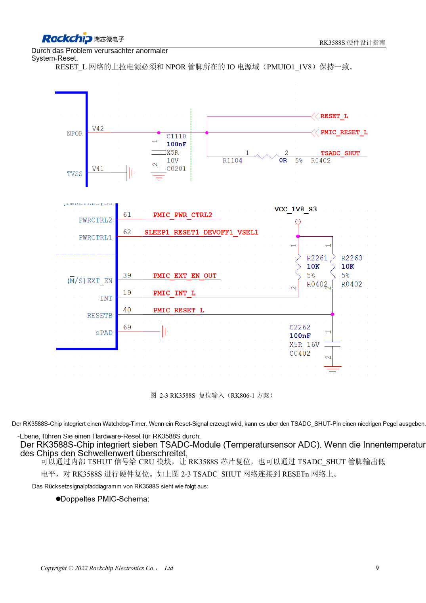
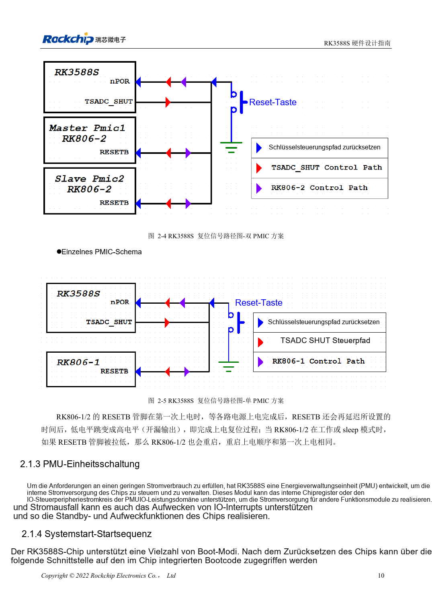

<!-- rk3588s-hardware-v12-20261109 -->

# RK3588S-Reset, Watchdog und Temperaturschutz

Grundlage ist der chinesische RK3588S Hardware Design Guide V1.2 (2023-12-14) zur Schaltungs- und PCB-Prüfung. CM7S-Träger folgen den Modulschnittstellen; Sige7S dient der Software-/Peripherieerprobung. SoC-Funktionen sind keine Boardanschlussliste. SDK/BSP, Kernel, Revision, Firmware und Multiplexing prüfen. Werte sind Quellenreferenzen, keine ArmSoM-Messungen.

**RK3588S Hardware Design Guide V1.2 (2023-12-14), CN** · §2.1.2; §3.4.1

## Pulsbreite und Startwartezeit unterscheiden

NPOR_u an V42 ist Low-aktiv. Gefordert sind 100 Perioden bei 24MHz und zugleich mindestens 4μs; 100/24MHz≈4.167μs, daher reichen exakt 4.000μs nicht. 100nF nahe am Pin und Pull-up nach PMUIO1_1V8 vorsehen. ≥1ms nach der letzten stabilen Versorgung bis zur Resetfreigabe ist eine separate Vorgabe.

## Gesamtes Resetnetz validieren

RK806-1/2 gibt RESETB nach Startverzögerung frei; Low im Betrieb oder Schlaf wiederholt die Versorgungsfolge. Watchdog und sieben TSADC wirken ebenfalls am Reset mit. RESETn, Spannungen und UART gemeinsam beobachten. Taste → TVS → 100Ω → Filter → CPU/PMIC prüfen; Reset von DC/DC, Metallsteckern und Rand fernhalten.

## Entwurfsparameter und Prüftabelle

| Punkt | Quellenreferenz |
| --- | --- |
| NPOR_u | V42; aktiv Low |
| Mindestreset | 100 Zyklen @24MHz ≈4.167μs |
| Filterkondensator | 100nF |
| Pull-up | PMUIO1_1V8 |

## Quellenabbildungen

Für diese Reihe liegt kein entsprechendes englisches Designhandbuch vor. Alle vier Fassungen nutzen chinesische Originalausschnitte mit lokalisierten Beschriftungen. Bilder lassen sich in voller Auflösung öffnen; Text und Parametertabellen bleiben kopierbar. Seitenangaben beziehen sich auf physische PDF-Seiten.

Chinesisches Original · PDF 24 · 2-3

Chinesisches Original · PDF 25 · 2-5

## Entwicklung mit ArmSoM

CM7S eignet sich für eigene Träger: zunächst integrierte Versorgung, DDR und Bootschaltungen bestimmen, dann außerhalb der Modulstecker planen. Sige7S dient als Ausgangspunkt für Software-/Peripherieerprobung. Bei beiden Produkten herausgeführte Interfaces, Pins, Pegel, Images und Kühlung revisionsbezogen prüfen. Ein Chipreferenzplan ist kein Produktanschlussplan.

- [ArmSoM CM7S](https://www.armsom.org/cm7s) · [CM7S Docs](https://docs.armsom.org/armsom-cm7s)
- [ArmSoM Sige7S](https://www.armsom.org/sige7s) · [Sige7S Docs](https://docs.armsom.org/armsom-sige7s)

## Weiterlesen

- [RK3588S-Hardwaredesign: 30 Themen](/de/articles/rk3588s-hardware-design-series/)
- [RK3588S-Takte: 24MHz, 32kHz und Layout](/de/articles/rk3588s-clock-hardware-design/)
- [RK3588S-Boot und Recovery: Maskrom, JTAG und UART](/de/articles/rk3588s-boot-debug-hardware/)
