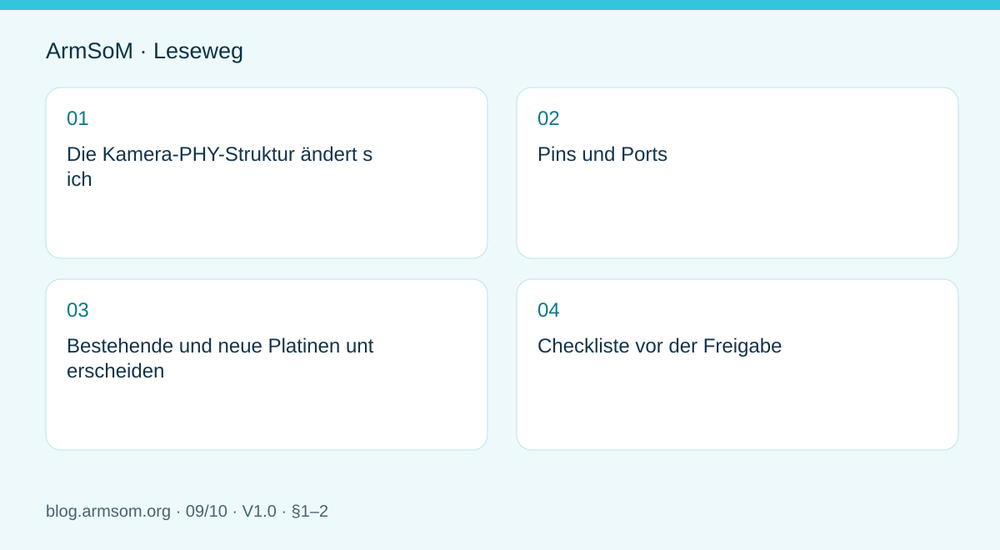
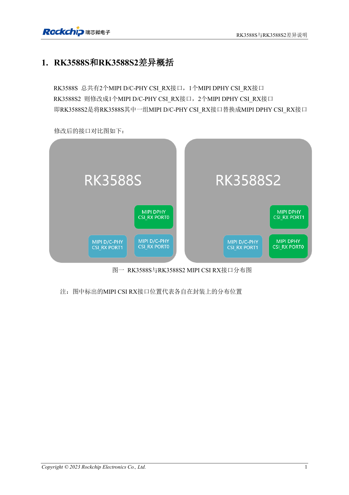
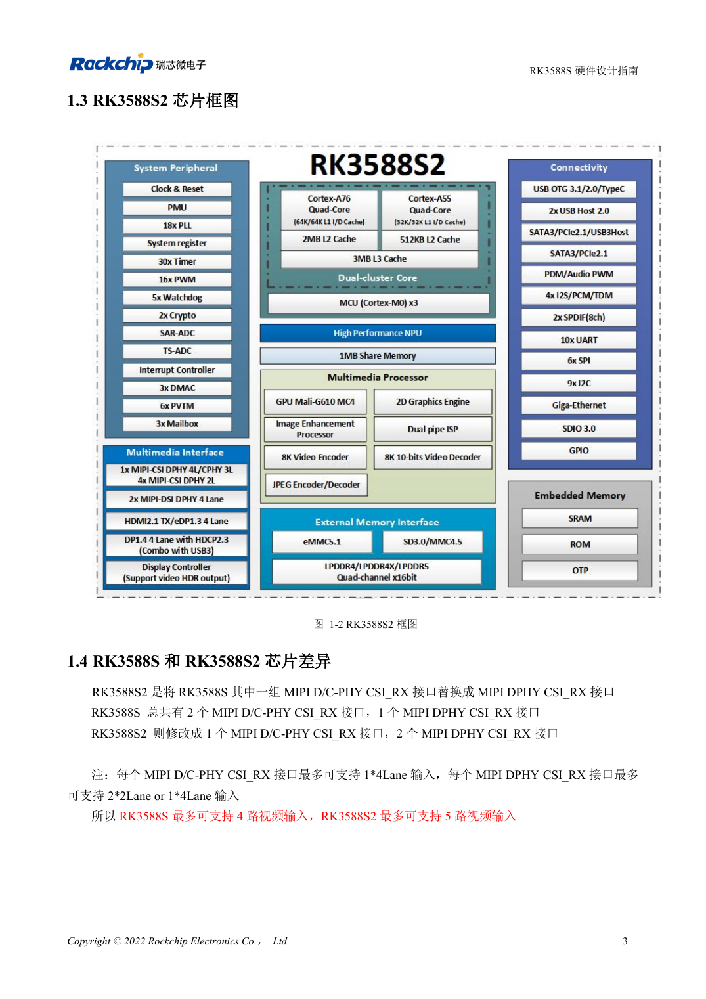
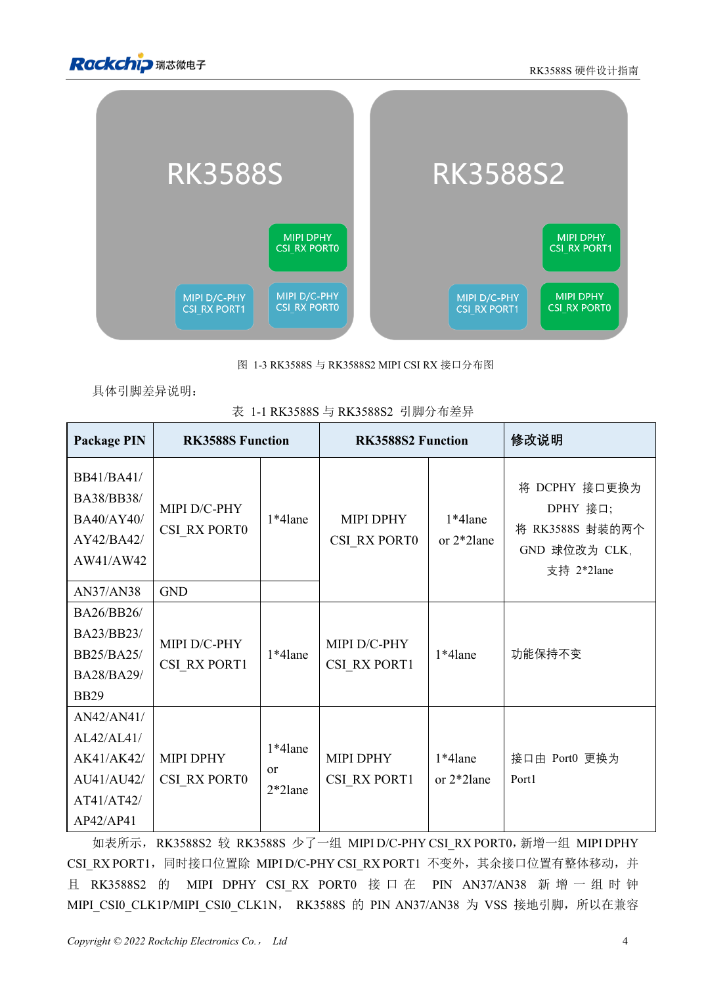

# RK3588S und RK3588S2: Prüfungen vor einer Hardwareänderung

## Geltungsbereich und Quellen

Dies ist ein thematischer Engineering-Leitfaden, keine seitenweise Übersetzung des gesamten PDF. Quellenbeispiele sind keine ArmSoM-Messungen. Spannungen, Pins, SDK/BSP und Kernel mit der tatsächlichen Platinenrevision abgleichen.

**Rockchip:** `RK3588S与RK3588S2差异说明_V1.0_20231214_CN.pdf` · V1.0 · §1–2

## Die Kamera-PHY-Struktur ändert sich

Kapitel 1 nennt beim RK3588S zwei MIPI-D/C-PHY-CSI_RX- und eine DPHY-Schnittstelle. RK3588S2 besitzt eine D/C-PHY- und zwei DPHY-Schnittstellen. Typ und Position ändern sich, nicht lediglich die Anzahl identischer Ports.

Sensormodus D-PHY/C-PHY, Lane-Anordnung und Steckerzuordnung bestimmen. Software-Portnamen dürfen nicht ungeprüft übernommen werden. CM7s ist als RK3588S-Modul dokumentiert; dieser Vergleich macht daraus kein S2-Produkt.

## Pins und Ports

| Position | RK3588S | RK3588S2 |
| --- | --- | --- |
| Bisheriger D/C-PHY CSI_RX PORT0 | D/C-PHY, 1×4 Lane | DPHY CSI_RX PORT0, 1×4 oder 2×2 Lane |
| AN37/AN38 | GND | Neue MIPI_CSI0_CLK1P/MIPI_CSI0_CLK1N |
| D/C-PHY CSI_RX PORT1 | Ursprüngliche Schnittstelle | Funktion unverändert |
| Bisheriger DPHY CSI_RX PORT0 | PORT0 | Umbenannt in DPHY CSI_RX PORT1 |

Der Wechsel von Masse zu Taktfunktionen an AN37/AN38 ist wesentlich. Alle Balls der Originaltabelle prüfen, nicht nur Portnamen vergleichen.

## Bestehende und neue Platinen unterscheiden

Kapitel 2 verlangt Rockchips Kompatibilitätspatch und eine neue Schnittstellenzuordnung, wenn S2 auf eine bestehende RK3588S-PCB gesetzt wird. Neue S2-Platinen sollen das neue Referenzdesign verwenden; die Quelle nennt bis zu fünf Kameras.

Das ist weder eine CM7s-Steckerzusage noch ein Nachweis beliebiger Auflösungs-, Bildraten- und ISP-Kombinationen. Patchdatei, BSP-Commit und vollständige Parallelbetriebsgrenzen fehlen in der Notiz. Die zur Softwareversion passende Umsetzung muss beschafft werden.

## Checkliste vor der Freigabe

1. Chipmarkierung sowie PCB- und Modulrevision bestimmen.
2. Balls, PHYs, Sensormodus und Bestückung vergleichen.
3. Patch, Device-Tree-Ports, Takte und Reset prüfen.
4. Einzelkamera und danach Zielkombination, Frameverluste und Wiederherstellung testen.
5. Hardwareversion und Image-Prüfsumme dokumentieren.

Für diesen Artikel wurden weder Chips getauscht noch parallele Kameras getestet.

## Abbildung aus der Quelle

Chinesisches Original; keine entsprechende englische Abbildung in den Materialien gefunden. Referenzdesign, kein ArmSoM-Platinenschaltplan.

`RK3588S与RK3588S2差异说明_V1.0_20231214_CN.pdf` · PDF p. 6.

## Produkte und Entwicklungsunterlagen

- **CM7s** — [Produktseite](https://www.armsom.org/cm7s) · [Dokumentation](https://docs.armsom.org/armsom-cm7s)

## Weitere Beiträge der Reihe

- [RK3576 in Betrieb nehmen: Minimalsystem und erste Einschaltprüfung](/de/articles/rk3576-hardware-bringup/)
- [ArmSoM CM5-Trägerplatine: Checkliste für Versorgung, Boot und Schnittstellen](/de/articles/019-cm5-carrier-production/)
- [RK3576-Hochgeschwindigkeitsschnittstellen: Schaltplan und PCB gemeinsam prüfen](/de/articles/rk3576-high-speed-interface-design/)
- [RK3588S-Hardwaredesign: vom Referenzschaltplan zur CM7s-Trägerplatine](/de/articles/rk3588s-cm7s-carrier-design/)
- [RK3588 für Edge-KI: Versorgung, Kühlung und Erweiterung gemeinsam planen](/de/articles/rk3588-edge-ai-hardware-design/)
- [RK3588-PCB-Prüfung: Lagenaufbau, Impedanz und Leiterführung](/de/articles/rk3588-high-speed-pcb-review/)
- [RK3506-HMI-Hardware: Entwicklung mit CM1 oder Forge1](/de/articles/rk3506-industrial-hmi-hardware/)
- [RK3308-Varianten: Hardwarekompatibilität für P2-Pro-Audioprojekte](/de/articles/rk3308-hardware-variant-compatibility/)
- [Vom Rockchip-Prototyp zur Serie: Prozessvorgaben und Prüfunterlagen](/de/articles/rockchip-hardware-production-checklist/)

<!-- rk3588s-hardware-v12-20261109 -->

## RK3588S und RK3588S2: Kamera-PHYs und Kompatibilität

Grundlage ist der chinesische RK3588S Hardware Design Guide V1.2 (2023-12-14) zur Schaltungs- und PCB-Prüfung. CM7S-Träger folgen den Modulschnittstellen; Sige7S dient der Software-/Peripherieerprobung. SoC-Funktionen sind keine Boardanschlussliste. SDK/BSP, Kernel, Revision, Firmware und Multiplexing prüfen. Werte sind Quellenreferenzen, keine ArmSoM-Messungen.

**RK3588S Hardware Design Guide V1.2 (2023-12-14), CN** · §1.3–1.4

## Der Hauptunterschied liegt am Kameraeingang

RK3588S hat zwei D/C-Combo-RX und einen dedizierten DPHY RX; RK3588S2 einen D/C-Combo und zwei dedizierte DPHY RX. Das Handbuch zeigt Referenzkombinationen mit bis zu vier beziehungsweise fünf Kameras. Daraus folgen weder Boardsteckerzahlen noch BSP-Unterstützung aller Kombinationen.

## Pins und Software erneut prüfen

Tabelle 1-1 ändert AN37 und AN38 von RK3588S-GND zu RK3588S2-Kameratakten. Für S2 auf einem bestehenden S-Design nennt das Handbuch einen Kompatibilitätspatch; dies ist keine bedingungslose Austauschbarkeit. Markierung, Boardrevision, Netze, Sensoren und SDK prüfen, anschließend Aufnahme und Schlaf testen.

## Entwurfsparameter und Prüftabelle

| Punkt | Quellenreferenz |
| --- | --- |
| RK3588S-Empfangs-PHY | 2 × D/C Combo + 1 × DPHY |
| RK3588S2-Empfangs-PHY | 1 × D/C Combo + 2 × DPHY |
| Geänderte Balls | AN37 / AN38 |
| Kamerakombinationen der Quelle | RK3588S: ≤4; RK3588S2: ≤5 |

## Quellenabbildungen

Für diese Reihe liegt kein entsprechendes englisches Designhandbuch vor. Alle vier Fassungen nutzen chinesische Originalausschnitte mit lokalisierten Beschriftungen. Bilder lassen sich in voller Auflösung öffnen; Text und Parametertabellen bleiben kopierbar. Seitenangaben beziehen sich auf physische PDF-Seiten.

Chinesisches Original · PDF 18 · 1-2

Chinesisches Original · PDF 19 · 1-3

## Entwicklung mit ArmSoM

CM7S eignet sich für eigene Träger: zunächst integrierte Versorgung, DDR und Bootschaltungen bestimmen, dann außerhalb der Modulstecker planen. Sige7S dient als Ausgangspunkt für Software-/Peripherieerprobung. Bei beiden Produkten herausgeführte Interfaces, Pins, Pegel, Images und Kühlung revisionsbezogen prüfen. Ein Chipreferenzplan ist kein Produktanschlussplan.

- [ArmSoM CM7S](https://www.armsom.org/cm7s) · [CM7S Docs](https://docs.armsom.org/armsom-cm7s)
- [ArmSoM Sige7S](https://www.armsom.org/sige7s) · [Sige7S Docs](https://docs.armsom.org/armsom-sige7s)

## Weiterlesen

- [RK3588S-Hardwaredesign: 30 Themen](/de/articles/rk3588s-hardware-design-series/)
- [RK3588S-Kameras: CSI, D/C-PHY und CIF planen](/de/articles/rk3588s-camera-hardware-design/)
- [RK3588S-HDMI-TX: FRL, TMDS und Kompatibilität](/de/articles/rk3588s-hdmi-tx-hardware-design/)
