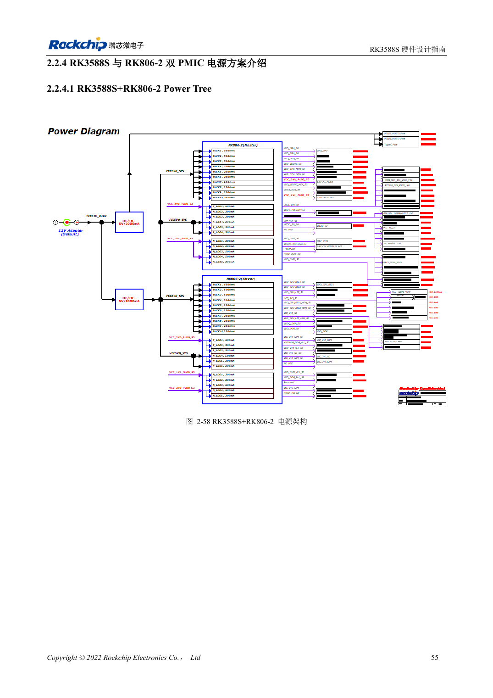
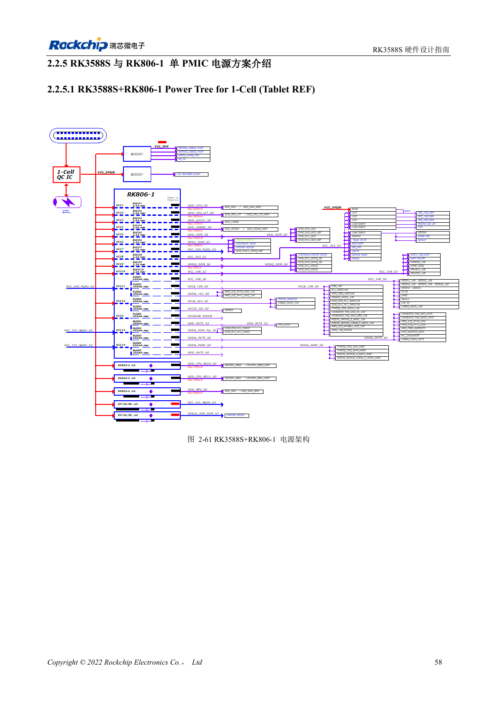

<!-- rk3588s-hardware-v12-20261109 -->

# RK3588S und RK806: Einzel- und Doppel-PMIC

Grundlage ist der chinesische RK3588S Hardware Design Guide V1.2 (2023-12-14) zur Schaltungs- und PCB-Prüfung. CM7S-Träger folgen den Modulschnittstellen; Sige7S dient der Software-/Peripherieerprobung. SoC-Funktionen sind keine Boardanschlussliste. SDK/BSP, Kernel, Revision, Firmware und Multiplexing prüfen. Werte sind Quellenreferenzen, keine ArmSoM-Messungen.

**RK3588S Hardware Design Guide V1.2 (2023-12-14), CN** · §2.2.3–2.2.5

## Vollständige Referenz wählen

Zwei RK806-2 und ein RK806-1 mit externen Versorgungen sind unterschiedliche Architekturen. Ausgangszuordnung, Standardspannungen, Sequenz, Bus, Schlaf und Reset gemeinsam übernehmen. 2.7–5.5V am PMIC sind keine ArmSoM-Board-Eingangsspezifikation.

## Synchronisierung und Layout

EXT_EN legt Master/Slave fest; SYNC/SYNC_CLK synchronisieren die zwei PMICs, VDC/PWRON/RESET nach Referenz verbinden. Ein PMIC arbeitet als Master mit offenen SYNC/SYNC_CLK. Hochstrompfade, Kondensator-Masserückwege und Wärmeverteilung prüfen. Maximalstrom ist keine Dauerstromgarantie bei jeder Temperatur.

## Entwurfsparameter und Prüftabelle

| Punkt | Quellenreferenz |
| --- | --- |
| RK806-Eingang | 2.7–5.5V |
| Gehäuse | 7×7mm QFN68 |
| Zwei-PMIC-Referenz | RK806-2 |
| Ein-PMIC-Referenz | RK806-1 + externe Versorgung |

## Quellenabbildungen

Für diese Reihe liegt kein entsprechendes englisches Designhandbuch vor. Alle vier Fassungen nutzen chinesische Originalausschnitte mit lokalisierten Beschriftungen. Bilder lassen sich in voller Auflösung öffnen; Text und Parametertabellen bleiben kopierbar. Seitenangaben beziehen sich auf physische PDF-Seiten.

Chinesisches Original · PDF 70 · 2-58

Chinesisches Original · PDF 73 · 2-61

## Entwicklung mit ArmSoM

CM7S eignet sich für eigene Träger: zunächst integrierte Versorgung, DDR und Bootschaltungen bestimmen, dann außerhalb der Modulstecker planen. Sige7S dient als Ausgangspunkt für Software-/Peripherieerprobung. Bei beiden Produkten herausgeführte Interfaces, Pins, Pegel, Images und Kühlung revisionsbezogen prüfen. Ein Chipreferenzplan ist kein Produktanschlussplan.

- [ArmSoM CM7S](https://www.armsom.org/cm7s) · [CM7S Docs](https://docs.armsom.org/armsom-cm7s)
- [ArmSoM Sige7S](https://www.armsom.org/sige7s) · [Sige7S Docs](https://docs.armsom.org/armsom-sige7s)

## Weiterlesen

- [RK3588S-Hardwaredesign: 30 Themen](/de/articles/rk3588s-hardware-design-series/)
- [RK3588S-Einschaltfolge: RESETn und S0/S3](/de/articles/rk3588s-power-sequencing-design/)
- [RK3588S-DDR-Schaltung: LPDDR4/4X/5 und Kapazität](/de/articles/rk3588s-ddr-circuit-design/)
