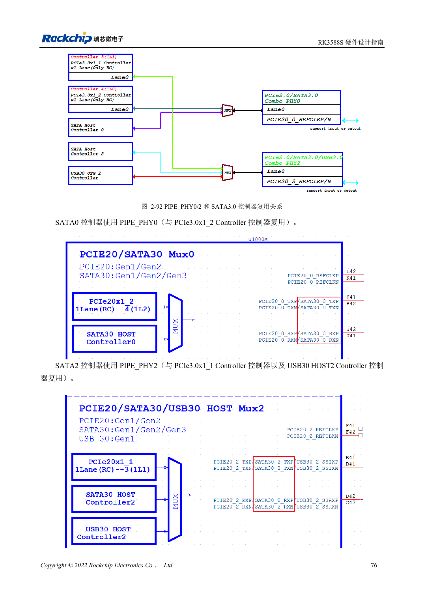
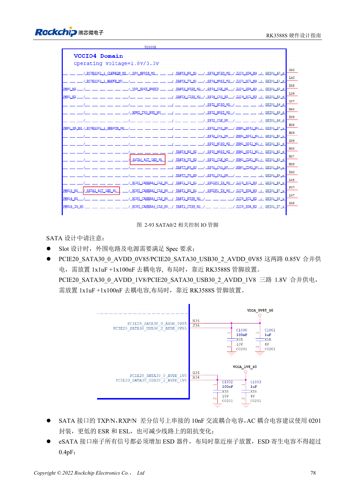

<!-- rk3588s-hardware-v12-20261109 -->

# RK3588S-SATA: drei Controller und gemeinsame PHYs

Grundlage ist der chinesische RK3588S Hardware Design Guide V1.2 (2023-12-14) zur Schaltungs- und PCB-Prüfung. CM7S-Träger folgen den Modulschnittstellen; Sige7S dient der Software-/Peripherieerprobung. SoC-Funktionen sind keine Boardanschlussliste. SDK/BSP, Kernel, Revision, Firmware und Multiplexing prüfen. Werte sind Quellenreferenzen, keine ArmSoM-Messungen.

**RK3588S Hardware Design Guide V1.2 (2023-12-14), CN** · §2.3.5; §3.4.7

## Zuerst die Multiplexmatrix erstellen

Die zwei RK3588S-SATA-Controller nutzen PIPE_PHY0 und PIPE_PHY2 gemeinsam mit PCIe2.0; PHY2 dient auch USB3 HOST2. 1.5/3/6Gbps und Port Multiplier im Handbuch garantieren nicht zwei herausgeführte Ports an CM7S oder Sige7S. Verfügbarkeit zuerst anhand der Produktunterlagen klären, dann Stecker und BSP wählen.

## Signale und Laufwerksversorgung getrennt prüfen

Die Referenz nutzt 10nF in TX und RX, vorzugsweise 0201; PCIe-Werte nicht kopieren. SATA_CP_DET, MP_SWITCH und CP_POD sind gemeinsame Steuerressourcen; Hotplug gezielt auslegen. Externe Versorgung auf Anlaufstrom prüfen sowie Dauerwrites, Fehler, Hotplug und Stromausfall-Recovery testen.

## Entwurfsparameter und Prüftabelle

| Punkt | Quellenreferenz |
| --- | --- |
| SATA-Kopplung | 10nF ±20%; TX und RX |
| Differenzziel | 100Ω ±10%; Quellenalternative 90Ω ±10% |
| Länge/Paardifferenz | <6in / <6mil |
| Empfohlene Viazahl | Empfohlen ≤2 |

## Quellenabbildungen

Für diese Reihe liegt kein entsprechendes englisches Designhandbuch vor. Alle vier Fassungen nutzen chinesische Originalausschnitte mit lokalisierten Beschriftungen. Bilder lassen sich in voller Auflösung öffnen; Text und Parametertabellen bleiben kopierbar. Seitenangaben beziehen sich auf physische PDF-Seiten.

Chinesisches Original · PDF 91 · 2-92

Chinesisches Original · PDF 93 · 2-93

## Entwicklung mit ArmSoM

CM7S eignet sich für eigene Träger: zunächst integrierte Versorgung, DDR und Bootschaltungen bestimmen, dann außerhalb der Modulstecker planen. Sige7S dient als Ausgangspunkt für Software-/Peripherieerprobung. Bei beiden Produkten herausgeführte Interfaces, Pins, Pegel, Images und Kühlung revisionsbezogen prüfen. Ein Chipreferenzplan ist kein Produktanschlussplan.

- [ArmSoM CM7S](https://www.armsom.org/cm7s) · [CM7S Docs](https://docs.armsom.org/armsom-cm7s)
- [ArmSoM Sige7S](https://www.armsom.org/sige7s) · [Sige7S Docs](https://docs.armsom.org/armsom-sige7s)

## Weiterlesen

- [RK3588S-Hardwaredesign: 30 Themen](/de/articles/rk3588s-hardware-design-series/)
- [RK3588S-USB und Type-C: Controller, PHYs und Recovery](/de/articles/rk3588s-usb-typec-hardware-design/)
- [RK3588S-PCIe: Lanes, Referenztakte und Versorgung](/de/articles/rk3588s-pcie-hardware-design/)
